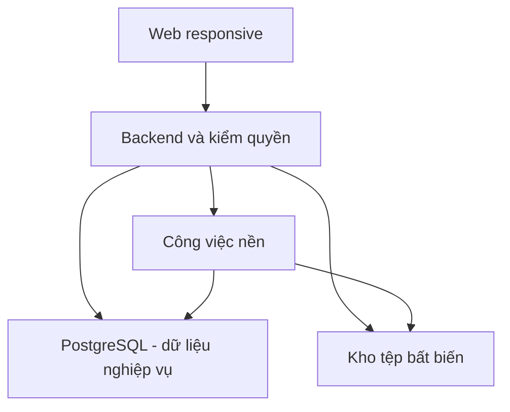

# Kiến trúc hệ thống SNOTE v2

| Trường | Giá trị |
| --- | --- |
| Trạng thái | Thiết kế bản đầu theo quyền tự quyết được giao tại [SRC-27](../../review/provenance.md); các ngưỡng phụ thuộc máy chủ được ghi rõ |
| Phạm vi | Web cho cá nhân, sinh viên và giáo viên; lớp chứa workspace nhóm |

Một frontend web đáp ứng máy tính/điện thoại gọi một backend có các module tách ranh giới nghiệp vụ. PostgreSQL là nguồn trạng thái nghiệp vụ; kho tệp lưu bytes bất biến; công việc nền xử lý ảnh xem trước, nhắc lịch, đối soát và dọn. Đây là **modular monolith** cho bản đầu, không tạo nhiều dịch vụ chỉ để biểu diễn các module.

| Module | Sở hữu dữ liệu và quy tắc | Giao tiếp nội bộ |
| --- | --- | --- |
| Tài khoản/quyền | Cách dùng tự chọn; quyền, tư cách và cấp riêng | Mọi hành động nhận quyết định quyền theo đối tượng; không kiểm role Teacher toàn cục để mở lớp bất kỳ |
| Lớp/workspace | Lớp, nhóm, thành viên, lời mời, yêu cầu, chuyển chủ, lưu trữ | Chặn kích hoạt tư cách vượt giới hạn bằng giao dịch theo người + lớp |
| Công việc | Việc, checklist, trạng thái, lịch sử giao lại; buổi làm riêng | Lịch đọc buổi riêng sau lọc quyền, không sao chép để chia sẻ |
| Lịch | Sự kiện có giờ/cả ngày và đối tượng nhận | Các màn lịch tham chiếu cùng sự kiện nguồn |
| Thư viện/tệp | Mục, phiên bản, rác, quota theo phạm vi, kho bytes | Bài giao nhận tham chiếu bất biến và yêu cầu giữ tệp |
| Bài giao/nộp | Bài, nhóm nhận, tiến độ, phiên bản, hạn và biên nhận thao tác | Cần xác nhận quyền/hạn/quota tại điểm chốt, không phụ thuộc nút hiển thị |
| Thông báo | Thông điệp phát sinh sau thay đổi có hiệu lực | Khi mở đích, kiểm quyền hiện hành; lịch nhắc kiểm trạng thái lúc phát |

**Giao dịch và lỗi:** Cơ sở dữ liệu và kho tệp không được giả định là một giao dịch nguyên tử. Tải tệp ở trạng thái tạm; xác minh; kiểm lại quyền, hạn, phiên bản nền, quota; chốt bản ghi và biên nhận chống lặp trong một giao dịch dữ liệu; chỉ trả thành công sau đó. Nếu mất phản hồi, truy vấn biên nhận trước khi thử tạo dữ liệu. Công việc nền đối soát tệp tạm, tham chiếu và quota, dọn chỉ khi chứng minh không còn nơi tham chiếu. Mô hình chi tiết ở [dữ liệu và giao dịch](data-and-transactions.md).

**Bảo mật:** Kiểm phạm vi trước tìm kiếm, tổng hợp và tải tệp. Thẻ URL chỉ truy cập đích công khai, giới hạn chuyển hướng, kích thước và thời gian; không chuyển credential người dùng sang nguồn. Định danh bytes không tự cấp quyền. Chi tiết [ranh giới quyền](security-boundaries.md).

**Quyết định công nghệ:** Giữ bộ React/TypeScript/Vite/Tailwind, NestJS, PostgreSQL/Prisma, REST, Git/GitHub và Docker Compose được đưa vào thảo luận. Mật khẩu băm bằng thuật toán chuyên dụng hiện đại được cấu hình sau khi chọn thư viện, phiên truy cập ngắn hạn và cơ chế làm mới/thu hồi; không chọn JWT tự chứa như nguồn quyền duy nhất. Tệp cần giao diện lưu trữ trừu tượng: máy chủ cục bộ cho thử nghiệm cô lập; kho tương thích object storage cho môi trường cần độ bền/đa máy. Không tuyên bố Docker Compose là cơ chế sao lưu hay nơi lưu tệp. Nhà cung cấp, chi phí, công suất và phiên bản dependency được xác nhận khi có môi trường, không suy từ đề xuất cũ.

Ranh giới module là quyết định thiết kế; chi tiết endpoint ở [hợp đồng](../contracts/README.md), kiểm chứng ở [quality](../quality/README.md) và triển khai ở [operations](../operations/README.md). Đề xuất trước đây tại [review](../../review/blocked/data-integrity-proposal.md) là lịch sử phân tích, tài liệu hiện hành ở đây ưu tiên.

[Sơ đồ thuật toán và điểm chốt giao dịch](decision-algorithms.md) đối chiếu quyền, gia nhập nhóm, Nộp, tệp và thứ tự Việc tiếp theo với mã quy tắc. Đây là sơ đồ quyết định khái niệm; các bước giao dịch ở [mô hình dữ liệu](data-and-transactions.md), các đường API ở [contracts](../contracts/README.md).

Cơ chế giao dịch/điều khiển cạnh tranh dựa trên [tài liệu PostgreSQL](https://www.postgresql.org/docs/current/mvcc-serialization-failure-handling.html) và [tài liệu Prisma về transaction](https://www.prisma.io/docs/orm/prisma-client/queries/transactions); khả năng cụ thể phải kiểm với phiên bản cài đặt. Việc dùng kho tệp và Docker Compose được đánh giá riêng với [tài liệu Compose production](https://docs.docker.com/compose/how-tos/production/); các nguồn kỹ thuật không thay quyết định nghiệp vụ của SNOTE.
