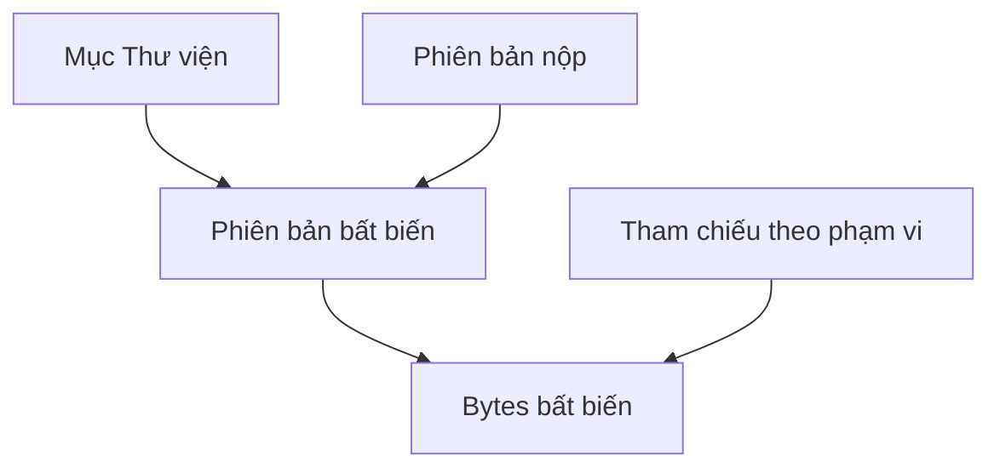

# Mô hình dữ liệu và giao dịch

| Trường | Giá trị |
| --- | --- |
| Trạng thái | Thiết kế logic bản đầu, [SRC-27](../../review/provenance.md); tên bảng/kiểu khóa vật lý sẽ do migration kiểm chứng |
| Nguồn quy tắc | [Cấu trúc](../requirements/structural-rules.md), [Thư viện](../requirements/library.md), [bài giao](../requirements/assignments-and-submissions.md) |

| Cụm thực thể | Khóa quan hệ và ràng buộc logic |
| --- | --- |
| Account, AccountUsage, PersonalWorkspace | Một workspace cá nhân cố định/account; usage Sinh viên/Giáo viên/Quản lý cá nhân có thể đổi và ghi lịch sử; chủ lớp tồn tại độc lập usage hiện tại |
| Class, Workspace | Workspace.kind = independent/default/class_group; class_group có đúng một class_id, không đổi lớp; default không share/transfer/archive |
| ClassMembership, WorkspaceMembership, Invitation, JoinRequest | Lưu trạng thái và mốc hiệu lực/kết thúc. Tư cách nhóm có hiệu lực đòi tư cách lớp còn hiệu lực; lời mời hết hiệu lực không hồi sinh. Lớp trưởng là vai trò cấp lớp, trưởng nhóm là quyền cấp workspace |
| Grant, ClassPolicy, PolicyOverride | Quyền theo action, scope, principal và trạng thái; cấp riêng không cấp tiếp. Cấu hình lớp là mặc định, quyền theo bài cụ thể có ưu tiên khi quy tắc bài quy định (hai quyền sau hạn) |
| Task, ChecklistItem, TaskHistory, PrivateWorkSession | Một người phụ trách chính tối đa; lịch làm có owner riêng; lịch sử ghi người/thời điểm, không xóa theo giao lại |
| Event, EventAudience | Event có scope + audience; timed lưu instant và timezone tạo, all_day lưu cặp ngày [start,endExclusive) và timezone nguồn; hủy là trạng thái, không xóa dấu vết theo quyền |
| LibraryItem, ContentRevision, Blob, TrashEntry | Item có revision hiện hành và scope; revision bất biến; Blob bytes bất biến; rác giữ item/revision 30 ngày, blob giữ lâu hơn nếu bản nộp còn tham chiếu |
| Assignment, AssignmentRecipient, SubmissionRevision, Feedback | Mỗi cặp assignment+workspace nhận có một recipient; chuỗi revision của nó bất biến; feedback trỏ đúng revision; deadline/cài đặt hiệu lực lúc nộp được chụp vào receipt |
| QuotaReference, OperationReceipt, UploadStaging | QuotaReference theo scope + nội dung xác minh; trong cùng workspace tính một lần, bản nộp là lý do giữ ref. OperationReceipt khóa (principal, scope, action, clientKey) và fingerprint, trả lại kết quả cũ khi thử lại. Staging không nhìn thấy như mục hoàn chỉnh |

Không dùng một cột số nhóm như nguồn sự thật của giới hạn có thể thay đổi. Giao dịch kích hoạt tư cách khóa/tuần tự hóa theo cặp người học + lớp; đếm tư cách đang hoạt động và áp giới hạn hiện hành. Khôi phục nhóm kiểm mọi thành viên có xung đột trước khi đổi trạng thái; lỗi không khôi phục một phần. Chuyển chủ có một yêu cầu còn hiệu lực và xác nhận người nhận trước khi chuyển nguyên tử.

**Quy trình tải/nộp:** (1) xác nhận idempotency key và quyền khởi đầu; (2) tải tạm, xác minh loại và kích thước thực; (3) kiểm lại quyền, tư cách, trạng thái lưu trữ, phiên bản nền, hạn và quota tại điểm chốt; (4) ghi revision, quota, biên nhận cùng giao dịch dữ liệu; (5) phát thông báo sau commit; (6) đối soát và dọn staging không tham chiếu. Cùng key khác fingerprint trả lỗi, không trả nhầm kết quả. Giao dịch cạnh tranh cần thử lại toàn bộ quyết định, không chỉ câu lệnh ghi. Nếu lần gửi đã commit nhưng phản hồi mất, biên nhận cũ giữ thời điểm chấp nhận cũ.

**Quota:** tệp hiện hành và snapshot nộp tính một lần theo nội dung trong workspace; bản sao sang workspace khác tính ở đích; tệp đề bài thuộc quota lớp riêng. Rác/lịch sử chỉ còn bản cũ không tính quota người dùng, vẫn theo dõi vật lý. Ngân sách vật lý có thể chặn thao tác tăng thêm trong khi quota logic còn chỗ; bản cũ phải được giữ. Giữ chỗ dung lượng nguyên tử cho upload đồng thời, trả lại khi thất bại/hết hạn; khôi phục rác thiếu quota không mất mục trước hạn 30 ngày. Không tối ưu trùng bytes liên người dùng khi chưa có cách chống lộ dữ liệu. Phải đo mức tiêu thụ để đặt ngưỡng vật lý theo máy chủ; không tự đặt con số chưa có cấu hình.

**Đối soát:** GC đánh dấu đối tượng chờ dọn, ngăn tham chiếu mới rồi kiểm lại trước xóa. Phiên bản nộp tham chiếu nội dung còn truy cập được sau khi mục nguồn bị dọn. Sao lưu/khôi phục phải đọc được cả metadata và bytes trong cùng mốc; xem [vận hành](../operations/README.md).
