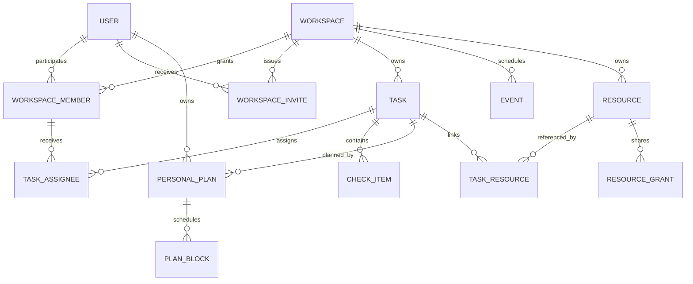
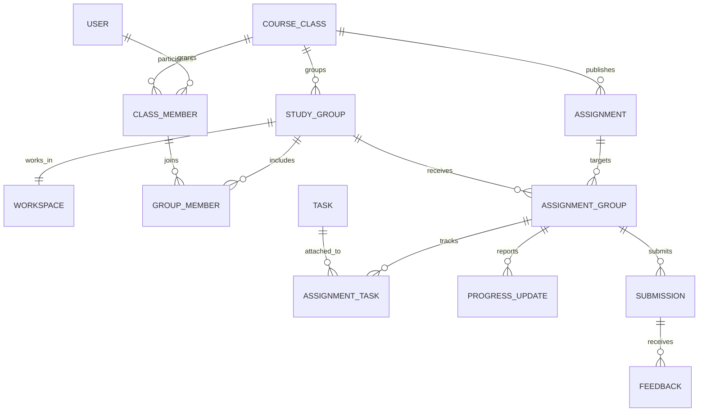

# SNOTE v2 — Sơ đồ 5 · Mô hình dữ liệu

**ERD logic đề xuất.** Tên thực thể dùng để trao đổi, sẽ ánh xạ sang schema và migration sau khi duyệt SRS. Hai sơ đồ dùng chung định danh `USER`, `WORKSPACE` và `TASK`.

## 5A — Workspace, công việc và tài nguyên

| Thực thể | Dữ liệu và ràng buộc chính |
|---|---|
| USER, WORKSPACE | ID ổn định, múi giờ người dùng. Workspace có loại và chủ. Đề xuất một workspace cá nhân cho mỗi tài khoản. |
| WORKSPACE_MEMBER, WORKSPACE_INVITE | Khóa duy nhất workspace + người dùng cho membership. Lời mời có người nhận, trạng thái và thời hạn. Chấp nhận hợp lệ cấp một membership hiệu lực. |
| TASK, TASK_ASSIGNEE | Việc có workspace, người tạo, đầu ra, trạng thái, mức quan trọng và hạn có thể trống. Phân công duy nhất theo việc + thành viên. Thành viên phải thuộc cùng workspace. Nếu chọn một người phụ trách chính, ràng buộc tối đa một chính trên mỗi việc. |
| CHECK_ITEM | ID ổn định, việc cha, vị trí và trạng thái. Thứ tự nhất quán bằng vị trí và ID. Có thể ghi người và thời điểm cập nhật. |
| PERSONAL_PLAN, PLAN_BLOCK | Duy nhất người + việc cho kế hoạch riêng. Thời lượng dự kiến có thể trống. Mỗi khoảng có giờ bắt đầu, kết thúc và điều kiện kết thúc sau bắt đầu. Người dùng phải còn quyền xem việc khi mở dữ liệu kế hoạch gắn việc. |
| EVENT | Sự kiện chung thuộc một workspace. Giờ bắt đầu và kết thúc có cùng quy tắc hợp lệ như lịch làm. |
| RESOURCE, TASK_RESOURCE | Tài nguyên ở workspace cá nhân lúc lưu nhanh. Lưu loại, nguồn, tiêu đề, văn bản, nhãn và trạng thái xử lý. Liên kết việc + tài nguyên duy nhất. |
| RESOURCE_GRANT | Người hoặc phạm vi được cấp, đối tượng và thời điểm thu hồi. Quyền tài nguyên cá nhân chia cho nhóm được xét ở lần đọc. Chia sẻ với giáo viên được giới hạn theo nhóm nhận bài. |

## 5B — Lớp, bài giao và bài nộp

| Thực thể | Dữ liệu và ràng buộc chính |
|---|---|
| COURSE_CLASS, CLASS_MEMBER | Tư cách giáo viên và quyền lớp được ghi rõ. Một membership theo lớp + người dùng. Mã vào lớp có hạn và có thể vô hiệu hóa. |
| STUDY_GROUP, GROUP_MEMBER | Nhóm cùng lớp với các thành viên. Một trưởng nhóm hiệu lực và một workspace theo nhóm. Khi đổi trưởng nhóm, cập nhật quyền cùng giao dịch. Số nhóm một sinh viên có thể tham gia trong một lớp cần được chốt trước migration. |
| ASSIGNMENT, ASSIGNMENT_GROUP | Bài có yêu cầu, đầu ra, hạn và trạng thái công bố. Duy nhất bài + nhóm nhận. Cả hai phải cùng lớp. |
| ASSIGNMENT_TASK | Duy nhất nhóm nhận bài + việc. Việc thuộc workspace của nhóm nhận. Chọn giới hạn một việc chỉ gắn một bài nếu nghiệp vụ yêu cầu sau khi duyệt. |
| PROGRESS_UPDATE | Nhóm nhận bài, người gửi, nội dung và thời điểm. Bản cập nhật không tự đổi trạng thái nộp. |
| SUBMISSION | Nhóm nhận bài, người nộp, thời điểm, phiên bản và ảnh chụp nội dung nộp. Khóa duy nhất theo nhóm nhận bài + người gửi + khóa yêu cầu. Khóa đã dùng với nội dung khác bị từ chối. Chính sách nhiều phiên bản thuộc D-04. |
| FEEDBACK | Tham chiếu bản nộp cụ thể và giáo viên gửi. Kết quả chỉ đọc trong phạm vi lớp và nhóm tương ứng. |

### Ràng buộc và kiểm tra khi triển khai

- Ưu tiên khóa ngoại hoặc khóa ghép cho quan hệ cùng workspace/lớp. Các quy tắc phụ thuộc trạng thái cần được kiểm tra trong giao dịch nghiệp vụ.
- Lưu thời điểm có giờ với múi giờ quy chiếu thống nhất, chuyển theo múi giờ người dùng khi tính ngày. Hạn chỉ có ngày cần quy ước riêng trước migration.
- Chỉ lập chỉ mục cho truy vấn đã xác định, ưu tiên phạm vi membership, việc theo người/hạn, nhóm nhận bài và tìm kiếm có kiểm tra quyền. Đo bằng dữ liệu mẫu trước khi chốt.
- Xác định vòng đời của bản nộp, phản hồi và liên kết khi thành viên rời nhóm hoặc workspace bị lưu trữ trước khi dùng dữ liệu thật. Chuẩn bị kiểm tra trùng, quyền và liên kết cũ trước mỗi migration.
