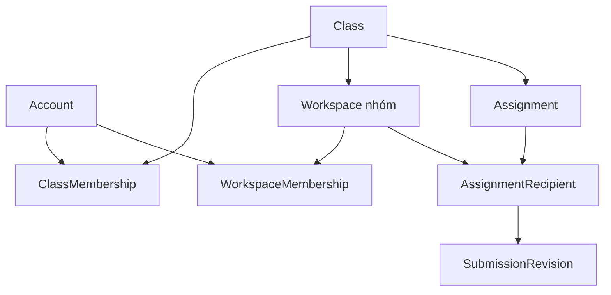
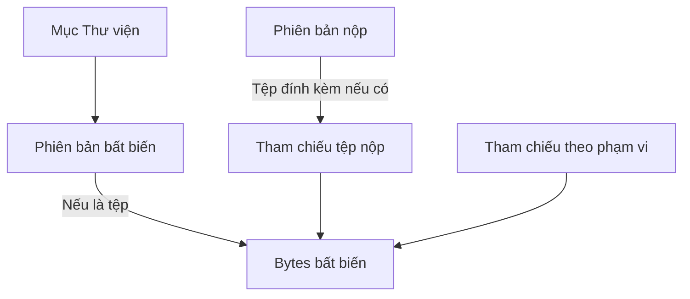

# Mô hình dữ liệu, giao dịch và lược đồ triển khai

| Trường | Giá trị |
| --- | --- |
| Trạng thái | Thiết kế logic bản đầu theo [SRC-27](../../review/provenance.md), không tự khẳng định mọi ràng buộc đã chạy trong schema/migration ở commit mới nhất |
| Nguồn quy tắc | [Cấu trúc](../requirements/structural-rules.md), [Thư viện](../requirements/library.md), [bài giao](../requirements/assignments-and-submissions.md) |

| Cụm thực thể | Khóa quan hệ và ràng buộc logic |
| --- | --- |
| Account, AccountUsage, Workspace loại default | Một workspace cá nhân cố định/account; usage Sinh viên/Giáo viên/Quản lý cá nhân có thể đổi và ghi lịch sử; chủ lớp tồn tại độc lập usage hiện tại |
| Class, Workspace | Workspace.kind = independent/default/class_group; class_group có đúng một class_id, không đổi lớp; default không share/transfer/archive |
| ClassMembership, WorkspaceMembership, Invitation, JoinRequest | Lưu trạng thái và mốc hiệu lực/kết thúc. Tư cách nhóm có hiệu lực đòi tư cách lớp còn hiệu lực; lời mời hết hiệu lực không hồi sinh. Lớp trưởng là vai trò cấp lớp, trưởng nhóm là quyền cấp workspace |
| Grant, ClassPolicy, các trường override của Assignment | Quyền theo action, scope, principal và trạng thái; cấp riêng không cấp tiếp. Cấu hình lớp là mặc định, hai quyền sau hạn được override tường minh trên bài giao; không giả định có bảng PolicyOverride riêng |
| Task, ChecklistItem, TaskAudit, PrivateWorkSession | Một người phụ trách chính tối đa; lịch làm có owner riêng; lịch sử ghi người/thời điểm, không xóa theo giao lại |
| Event, EventAudience | Event có scope + audience; timed lưu instant và timezone tạo, all_day lưu cặp ngày [start,endExclusive) và timezone nguồn; hủy là trạng thái, không xóa dấu vết theo quyền |
| LibraryItem, ContentRevision, Blob, TrashEntry | Item có revision hiện hành và scope; revision bất biến; Blob bytes bất biến; rác giữ item/revision 30 ngày, blob giữ lâu hơn nếu bản nộp còn tham chiếu |
| Assignment, AssignmentRecipient, SubmissionRevision, Feedback | Mỗi cặp assignment+workspace nhận có một recipient; chuỗi revision của nó bất biến; feedback trỏ đúng revision; deadline/cài đặt hiệu lực lúc nộp được chụp vào receipt |
| QuotaReference, OperationReceipt, UploadStaging | QuotaReference theo scope + nội dung xác minh; trong cùng workspace tính một lần, bản nộp là lý do giữ ref. OperationReceipt khóa (principal, scope, action, clientKey) và fingerprint, trả lại kết quả cũ khi thử lại. Staging không nhìn thấy như mục hoàn chỉnh |

Không dùng một cột số nhóm như nguồn sự thật của giới hạn có thể thay đổi. Giao dịch kích hoạt tư cách khóa/tuần tự hóa theo cặp người học + lớp; đếm tư cách đang hoạt động và áp giới hạn hiện hành. Khôi phục nhóm kiểm mọi thành viên có xung đột trước khi đổi trạng thái; lỗi không khôi phục một phần. Chuyển chủ có một yêu cầu còn hiệu lực và xác nhận người nhận trước khi chuyển nguyên tử.

**Quan hệ cốt lõi (sơ đồ khái niệm, không thay khóa ngoại trong Prisma):** một workspace nhóm thuộc một lớp; tư cách lớp và tư cách workspace là hai bản ghi độc lập; mỗi bài giao thuộc một lớp và có một recipient cho mỗi nhóm nhận. Cặp bảng/khóa cụ thể nằm ở phần lược đồ dưới đây. [STR-01/04/05](../requirements/structural-rules.md), [ASG-01](../requirements/assignments-and-submissions.md).

Văn bản/đường dẫn có thể không có Blob. Một bản nộp giữ snapshot nội dung của chính nó; tệp nộp giữ tham chiếu đủ để đọc lại sau khi mục Thư viện gốc đổi hoặc vào rác. Hình chỉ biểu diễn đường giữ dữ liệu, không tuyên bố có khóa ngoại trực tiếp từ mọi bản nộp tới `ContentRevision`. [LIB-12/16](../requirements/library.md), [ASG-04](../requirements/assignments-and-submissions.md).

**Quy trình tải/nộp:** (1) xác nhận idempotency key và quyền khởi đầu; (2) tải tạm, xác minh loại và kích thước thực; (3) kiểm lại quyền, tư cách, trạng thái lưu trữ, phiên bản nền, hạn và quota tại điểm chốt; (4) ghi revision, quota, biên nhận cùng giao dịch dữ liệu; (5) phát thông báo sau commit; (6) đối soát và dọn staging không tham chiếu. Cùng key khác fingerprint trả lỗi, không trả nhầm kết quả. Giao dịch cạnh tranh cần thử lại toàn bộ quyết định, không chỉ câu lệnh ghi. Nếu lần gửi đã commit nhưng phản hồi mất, biên nhận cũ giữ thời điểm chấp nhận cũ.

**Quota:** tệp hiện hành và snapshot nộp tính một lần theo nội dung trong workspace; bản sao sang workspace khác tính ở đích; tệp đề bài thuộc quota lớp riêng. Rác/lịch sử chỉ còn bản cũ không tính quota người dùng, vẫn theo dõi vật lý. Ngân sách vật lý có thể chặn thao tác tăng thêm trong khi quota logic còn chỗ; bản cũ phải được giữ. Giữ chỗ dung lượng nguyên tử cho upload đồng thời, trả lại khi thất bại/hết hạn; khôi phục rác thiếu quota không mất mục trước hạn 30 ngày. Không tối ưu trùng bytes liên người dùng khi chưa có cách chống lộ dữ liệu. Phải đo mức tiêu thụ để đặt ngưỡng vật lý theo máy chủ; không tự đặt con số chưa có cấu hình.

**Đối soát:** GC đánh dấu đối tượng chờ dọn, ngăn tham chiếu mới rồi kiểm lại trước xóa. Phiên bản nộp tham chiếu nội dung còn truy cập được sau khi mục nguồn bị dọn. Sao lưu/khôi phục phải đọc được cả metadata và bytes trong cùng mốc; xem [vận hành](../operations/README.md).

## Lược đồ quan hệ để triển khai v2

| Trường | Giá trị |
| --- | --- |
| Phạm vi | Bảng/khóa/quan hệ thiết kế để đối chiếu [Prisma schema](../../apps/api/prisma/schema.prisma) và migrations; logic nguồn ở phần trên của chính tài liệu |
| Trạng thái | Quyết định kỹ thuật v2 theo SRC-27; bằng chứng migration chạy theo SHA ở [hồ sơ foundation](../../review/foundation-audit.md), không suy từ tài liệu thiết kế |

Khóa chính dùng ID opaque (UUID hoặc chuỗi có độ ngẫu nhiên phù hợp). Mọi bảng nghiệp vụ có `createdAt`, `updatedAt` khi thích hợp; thay đổi có cạnh tranh có `version` tăng trong cùng giao dịch. Quan hệ `classId` và `workspaceId` luôn được kiểm cùng quyền, không tra bằng ID một mình rồi trả dữ liệu khác phạm vi.

| Bảng/nhóm | Cột bắt buộc và quan hệ | Ràng buộc/ý nghĩa |
| --- | --- | --- |
| `Account`, `AccountUsage`, `PasswordResetToken` | Account ID, email chuẩn hóa, hash, timeZone; Usage(accountId, usage); ResetToken(accountId, tokenHash, expiresAt, consumedAt?) | Email duy nhất; ít nhất một usage/account ở tầng giao dịch. Múi giờ từ đăng ký là nguồn khởi tạo workspace cá nhân/độc lập; reset token chỉ lưu hash, hết hạn và dùng một lần. Không chứa role lớp trong usage |
| `Class`, `ClassMembership` | Class(ownerId, timeZone, status, groupLimit, version); Membership(classId, accountId, role, status) | Một owner đang có hiệu lực/class; unique `(classId,accountId)` cho trạng thái hiện hành, lịch sử tách sang audit. Role cấp lớp chỉ Member/Monitor; tối đa một Monitor active/class theo PER-02. Owner từ Class. Tắt usage Teacher không làm Class.ownerId mất hiệu lực |
| `ClassJoinCode` | classId, codeHash?, enabled, createdAt, updatedAt | Mã lớp chỉ lưu hash của mã ngẫu nhiên; bật/tạo lại làm mã cũ vô hiệu, tắt xóa hash. Đổi mã dùng `If-Match` của Class.version và tăng version lớp trong cùng giao dịch; mã rõ chỉ trả trong phản hồi lúc tạo. Khi lớp archived, yêu cầu dùng mã bị từ chối. |
| `Workspace`, `WorkspaceMembership` | Workspace(name, kind, ownerId?, classId?, timeZone, status, version); Membership(workspaceId, accountId, role, status) | Tên workspace bắt buộc để tạo và đọc lại; Ngữ cảnh #29 đặt tên cho workspace mặc định. `class_group` có classId, hai loại khác không; `default` một/account và không share/archive. Unique active `(workspaceId,accountId)`; class membership còn hiệu lực trước khi kích hoạt group |
| `Invitation`, `JoinRequest`, `TransferRequest` | target kind/id, initiator, recipient (nếu là invitation/transfer), status, expiry?, acceptedAt?, version | Ba loại có ID và trạng thái riêng, không trả giả thành Membership. Archive vô hiệu invitation pending trong cùng giao dịch, restore không hồi sinh; join request còn pending cần kiểm/dò lại hiện trạng trước duyệt. Transfer chỉ một active pending cho mỗi target; version lưu thật. Lịch sử đổi trạng thái ở AuditEvent |
| `ClassPolicy`, `Grant` | ClassPolicy(classId, defaults JSON được validate/version); Grant(principalId, scopeType, scopeId, action, version, revokedAt?) | Unique active theo principal/scope/action; Grant có version lưu thật tương ứng response/ETag; không cho cấp tiếp hoặc mở dữ liệu riêng; action enum chung với OpenAPI |
| `Task`, `ChecklistItem`, `PrivateWorkSession`, `TaskAudit` | Task(workspaceId, assigneeId?, dueAt?, dueDateZone?, importance, status, version); Item(taskId, text, done, position); Session(taskId, ownerId, startAt, endAt, version); Audit(taskId, actorId, change, at) | Một assignee chính; session chỉ owner, không xóa audit khi giao lại; checklist dùng version Task làm nền; hạn ngày giữ zone gốc; checklist 0 mục không tính 100% |
| `Event`, `EventAudience` | Event(scopeType,scopeId,kind,title,timedStart?,timedEnd?,allDayStart?,allDayEndExclusive?,sourceZone?,status,version); Audience(eventId,classId?,workspaceId?) | CHECK đúng một bộ timed hoặc all-day; all-day end > start, timed end > start. Event lớp một nguồn, nhiều audience; cancel giữ row |
| `LibraryItem`, `ContentRevision`, `Blob`, `TrashEntry` | Item(workspaceId,folderId?,currentRevisionId?,type,status,version); Revision(itemId?,blobId?,text?,url?,actorId,at); Blob(hash,size,type,storageKey,status); Trash(itemId,deletedAt,purgeAfter) | Revision bất biến; Blob bytes bất biến; tránh truy cập chỉ bằng storageKey. Sao chép tạo Item mới; nội dung đã nộp có ref riêng kể cả sau xóa Item |
| `Folder`, `QuotaReference`, `QuotaReservation` | Folder(workspaceId,parentId?,name,version); Reference(scopeType,scopeId,blobId,reason); Reservation(scopeType,scopeId,bytes,expiresAt,operationKey) | Folder cùng workspace cha, không chu trình; version chống sửa/xóa từ nền cũ. Unique ref logic `(scopeType,scopeId,blobId,reason)` nhưng tính quota theo **distinct blobId trong scope**; reservation khóa tăng đồng thời; class attachments quota lớp |
| `Assignment`, `AssignmentRecipient`, `SubmissionRevision`, `SubmissionAttachment`, `Feedback` | Assignment(classId,title,deadline,lateFirst?,lateRevision?,version); Recipient(assignmentId,workspaceId,version); Submission(recipientId,version,actorId,acceptedAt,deadlineSnapshot,latePolicySnapshot,timeliness,text,links); Attachment(submissionId,blobId,sourceRevisionId?); Feedback(submissionId,teacherId,text) | Unique `(assignmentId,workspaceId)` và `(recipientId,version)`; recipient version chống ghi đè tiến độ, body/attachments nộp bất biến sau commit, feedback gắn đúng version; ít nhất một nội dung lúc nộp |
| `UploadStaging`, `OperationReceipt`, `OutboxEvent`, `AuditEvent` | Staging(actorId,scope,storageKey,status,expiresAt); Receipt(actorId,scope,action,key,fingerprint,result,status); Outbox(topic,payload,deliveredAt?); Audit(actorId,scope,action,targetId,at) | Unique Receipt(actorId,scope,action,key); ghi receipt + phiên bản + quota + outbox trong cùng giao dịch DB. Staging dọn sau đối soát; audit giữ người/thời điểm, không nhét nội dung riêng vào log |

**Ràng buộc DB không tự đủ:** `groupLimit` thay đổi được nên không dùng unique một nhóm/người. Kích hoạt tư cách dùng giao dịch khóa cặp `(classId,accountId)` rồi đếm nhóm active; khôi phục nhóm kiểm toàn bộ người bị ảnh hưởng trước khi chuyển trạng thái. `Folder` không chu trình và “rỗng mới xóa” cần kiểm giao dịch. `Class.ownerId` chuyển sau chấp nhận và đảm bảo người nhận hợp lệ. Nếu ORM không hỗ trợ CHECK/partial unique, ràng buộc ở migration SQL phải được kiểm trực tiếp trên PostgreSQL. Sự có mặt của bảng trong schema không chứng minh bất biến xuyên bảng đã được kiểm.

**Chỉ mục truy vấn:** `(classId,accountId,status)` tư cách; `(workspaceId,status,dueAt,id)` việc; `(ownerId,startAt,id)` buổi riêng; `(scopeType,scopeId,status,allDayStart,timedStart)` sự kiện; `(workspaceId,folderId,status,updatedAt,id)` Thư viện; `(assignmentId,workspaceId)` recipient; `(recipientId,version DESC)` nộp; `(scopeType,scopeId,blobId)` quota. Phân trang luôn bổ sung ID để thứ tự ổn định. SQL/Prisma phải kiểm EXPLAIN và phép đo trên bộ tải QA; không coi danh sách chỉ mục này là tối ưu đã được đo.

**Giới hạn dọn tệp:** Không xóa bytes chỉ vì Item vào rác hoặc trình duyệt timeout; phải kiểm tham chiếu bản nộp và backup còn cần giữ như quy trình đối soát phía trên. Bản sao độc lập ở cấp logic dù bytes có thể được dùng chung có kiểm soát. Một workspace tính cùng nội dung một lần; nếu quyết định hash trùng cần kiểm bytes thực và không dùng phản hồi đó để lộ dữ liệu nơi khác.
