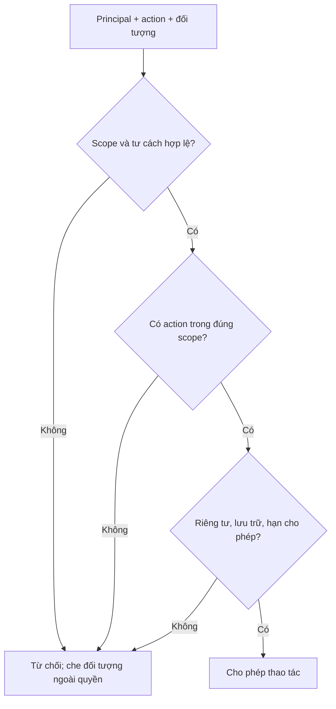
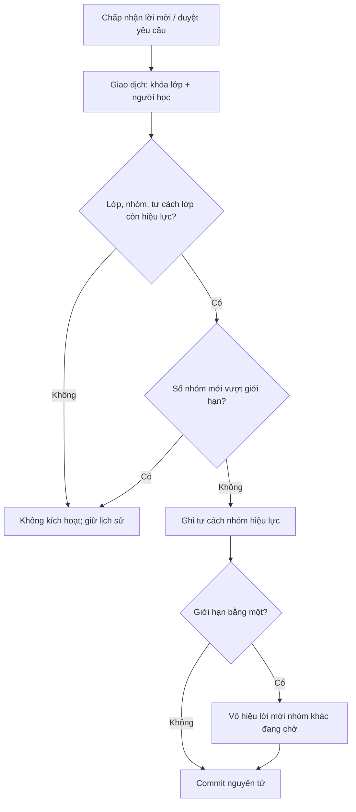
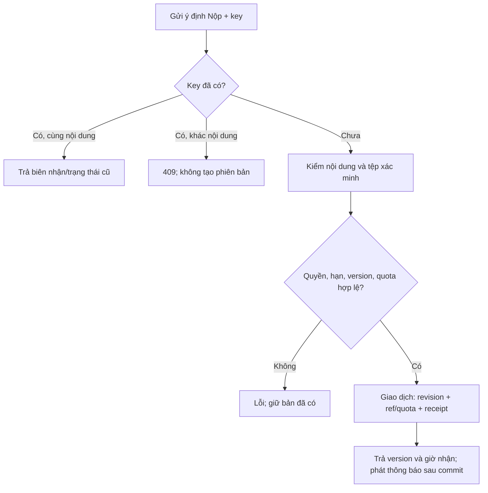
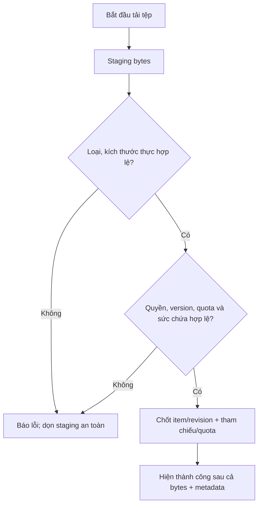
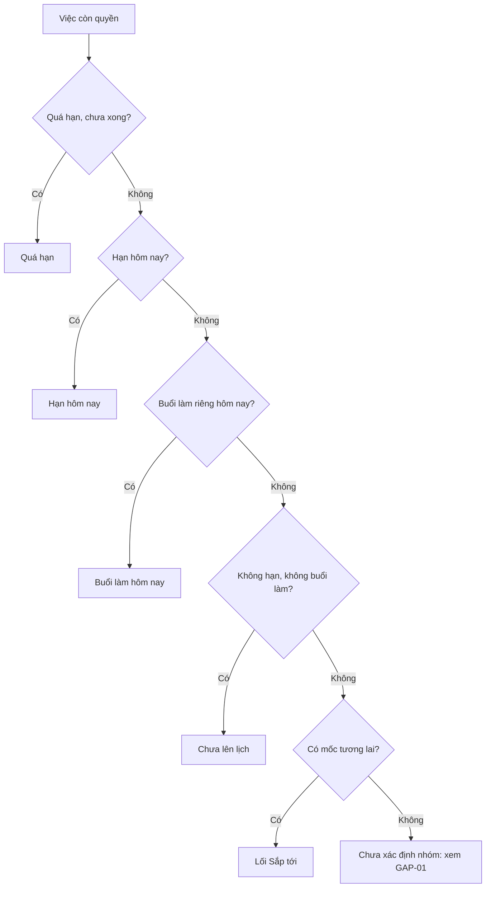

# Sơ đồ thuật toán và điểm chốt giao dịch v2

| Trường | Giá trị |
| --- | --- |
| Câu hỏi | Hệ thống quyết định quyền, tư cách nhóm, bản nộp, tệp và thứ tự việc ra sao khi có lỗi hoặc cạnh tranh? |
| Phạm vi | Mô hình quyết định của bản đầu; **không** là mã thực thi hay kết quả kiểm thử |
| Trạng thái | DCA-checked từ các mã quy tắc và thiết kế giao dịch v2 tại `bdc1df38`; bước triển khai là diễn giải `INFERRED` khi quy tắc chỉ nêu kết quả |
| Ký pháp | Mermaid `flowchart` khái niệm, không phải BPMN/DMN/UML chính thức. Mỗi nhánh phải đọc cùng điều kiện bằng chữ ngay dưới hình |

## A1. Quyết định quyền theo đối tượng

**Đầu vào:** principal đã xác thực, action, đối tượng và scope. **Đầu ra:** cho phép hoặc từ chối; dữ liệu ngoài quyền không được tiết lộ qua chi tiết, số đếm, tìm kiếm hay tệp. Cách dùng Giáo viên ở tài khoản chỉ mở hành động tạo lớp mới, không mở lớp người khác.[^ALG-01]

| Cạnh/điều kiện | Nguồn kiểm ngữ nghĩa | Trạng thái |
| --- | --- | --- |
| Scope/tư cách → hợp quyền theo action → ranh giới cứng → quyết định | [STR-11–14](../requirements/structural-rules.md), [PM-01–05](../requirements/access-control.md) | VERIFIED về thứ tự logic |
| Che đối tượng ngoài quyền trước khi đếm/tìm/tải | [STR-06](../requirements/structural-rules.md), [hợp đồng 404](../contracts/README.md) | VERIFIED về kết quả; mã HTTP theo hợp đồng |

Một người kiêm vai trò được **hợp quyền trong scope**; quyền sửa nội dung chung không vượt quyền riêng Hộp thu/buổi làm, trạng thái lưu trữ hay hạn. Kiểm lại tại điểm chốt, không tin trạng thái nút cũ trên UI.[^ALG-01]

## A2. Kích hoạt tư cách workspace nhóm

**Đầu vào:** lời mời đã được người học chấp nhận **hoặc** yêu cầu được người có quyền duyệt; lớp, nhóm và người học. **Bất biến:** không vượt giới hạn nhóm hiện hành; một lời mời vô hiệu không hồi sinh. Khóa/tuần tự hóa theo cặp lớp–người học là giải pháp thiết kế để đảm bảo kết quả khi hai yêu cầu đến đồng thời.[^ALG-02]

| Cạnh/điều kiện | Nguồn kiểm ngữ nghĩa | Trạng thái |
| --- | --- | --- |
| Trigger khác nhau nhưng chỉ hiệu lực ở chấp nhận/duyệt | [CLS-05](../requirements/class-membership.md), [STR-07](../requirements/structural-rules.md) | VERIFIED |
| Kiểm tư cách lớp, trạng thái lưu trữ và giới hạn hiện hành | [CLS-06/11/14](../requirements/class-membership.md), [STR-04/08](../requirements/structural-rules.md) | VERIFIED |
| Khóa cặp, đếm, ghi và vô hiệu lời mời trong một giao dịch | [data-and-transactions](data-model.md), [CLS-07](../requirements/class-membership.md) | INFERRED về cơ chế khóa; VERIFIED về kết quả |

Nếu giới hạn giảm dưới số nhóm đang có, giữ tư cách cũ và chặn lần gia nhập mới; khôi phục nhóm có xung đột thì giữ nhóm lưu trữ, không khôi phục một phần. Các nhánh này là cùng bất biến, không phải luồng tự động xóa thành viên.[^ALG-02]

## A3. Nộp bài có phiên bản và chống lặp

**Đầu vào:** recipient, nội dung, tệp đã xác minh, `If-Match` khi sửa, `Idempotency-Key`. **Điểm chốt:** thời điểm máy chủ chấp nhận trong giao dịch; hạn, quyền và policy hiệu lực lúc ấy. Receipt cùng key/nội dung trả cùng biên nhận; key khác nội dung báo 409.[^ALG-03]

| Cạnh/điều kiện | Nguồn kiểm ngữ nghĩa | Trạng thái |
| --- | --- | --- |
| Key và fingerprint, tra biên nhận khi mất phản hồi | [STR-16](../requirements/structural-rules.md), [hợp đồng](../contracts/README.md) | VERIFIED |
| Nội dung tối thiểu, quyền Nộp riêng, hai luật sau hạn, version nền | [ASG-03/05/06/12/14/15](../requirements/assignments-and-submissions.md) | VERIFIED |
| Revision, quota và receipt trong cùng giao dịch DB; thông báo sau commit | [data-and-transactions](data-model.md), [ASG-17](../requirements/assignments-and-submissions.md) | INFERRED về cơ chế; VERIFIED về kết quả cần giữ |

Lỗi version nền là 412; lỗi bytes/metadata không tạo phiên bản mới. Nếu client mất phản hồi sau commit, tra `/operations/by-key/{key}` hoặc gửi lại **cùng** key, không tạo ý định khác. Hạn sửa sau khi nộp không phân loại lại bản cũ. Sơ đồ không mô tả thuật toán upload bytes: xem A4.[^ALG-03]

## A4. Hoàn tất mục Thư viện có tệp

**Đầu vào:** tệp, scope đích, loại mục và quyền hiện hành. **Đầu ra:** mục/revision chỉ xuất hiện thành công khi bytes đã xác minh và metadata/ref/quota được chốt; nếu lỗi, bản hiện hành và phiên bản cũ còn nguyên.[^ALG-04]

| Cạnh/điều kiện | Nguồn kiểm ngữ nghĩa | Trạng thái |
| --- | --- | --- |
| Staging, xác minh bytes, chỉ hiện thành công sau metadata | [LIB-11/15](../requirements/library.md), [UX trạng thái tải](../ux/ui-and-motion.md) | VERIFIED |
| Version nền và lựa chọn ghi đè/bản sao; quota khi khôi phục | [LIB-12–17](../requirements/library.md), [STR-15](../requirements/structural-rules.md) | VERIFIED |
| Giữ bytes lịch sử/bản nộp, GC kiểm tham chiếu trước khi xóa | [data-and-transactions](data-model.md), [physical-schema](data-model.md) | INFERRED về cơ chế, VERIFIED về yêu cầu giữ |

Sơ đồ không đồng nhất “dọn staging” với xóa bytes đã được tham chiếu: dọn chỉ sau đối soát. Hạn mức logic và ngân sách vật lý là hai điều kiện khác nhau; ngân sách máy chủ thực còn mở ở ENV-01.[^ALG-04]

## A5. Chọn “Việc tiếp theo”

**Đầu vào:** việc người xem còn quyền, múi giờ người xem và buổi làm riêng của chính người đó. **Đầu ra:** mỗi việc ở tối đa một nhóm. Công thức ưu tiên và khóa phá hòa nằm ở TASK-10/11/17; sơ đồ chỉ mô tả phép gán nhóm.[^ALG-05]

Nhóm 1 theo hạn cũ nhất; nhóm 2 theo hạn gần nhất; nhóm 3 theo buổi làm sớm nhất; khi bằng mốc dùng mức quan trọng rồi thời điểm tạo/ID ổn định. Nhóm 4 theo Cao → Vừa → Thấp, thời điểm tạo rồi ID. Hôm nay/Ngày mai không nhân đôi việc khi vừa có hạn vừa có buổi làm. Sắp tới chỉ hiện số cạnh bộ lọc trước khi bấm. Việc không hạn, chỉ có buổi làm **đã qua** mà chưa hoàn thành chưa được TASK-11/17 xếp nhóm: giữ mở [GAP-01](../../review/unresolved.md), không tự gán vào Chưa lên lịch.[^ALG-05]

| Cạnh/điều kiện | Nguồn kiểm ngữ nghĩa | Trạng thái |
| --- | --- | --- |
| Quyền lọc trước tổng hợp và buổi làm riêng | [STR-06](../requirements/structural-rules.md), [TASK-01/07](../requirements/tasks.md) | VERIFIED |
| Bốn nhóm, thứ tự, không lặp và lối Sắp tới | [TASK-10/11/17](../requirements/tasks.md), [STR-19](../requirements/structural-rules.md) | VERIFIED |

**Giới hạn kiểm định:** năm hình được đối chiếu bằng chữ với mã quy tắc ở từng bảng; chưa có bằng chứng renderer Mermaid hoặc phép đo thuật toán trên commit hiện tại. Ca kiểm tương ứng ở [QA-02/04–09/11](../quality/README.md). Các bằng chứng chạy theo môi trường và SHA được giữ tại `review/`, không nằm trong đặc tả này.

[^ALG-01]: [SRC-02/24/27](../../review/provenance.md), [STR-06/11–14](../requirements/structural-rules.md), mốc `bdc1df38`. Quy tắc quyền, không phải kết quả security test.
[^ALG-02]: [SRC-02/10/27](../../review/provenance.md), [CLS-05–07/11](../requirements/class-membership.md), [thiết kế giao dịch](data-model.md), mốc `bdc1df38`.
[^ALG-03]: [SRC-05/26/27](../../review/provenance.md), [ASG-03–08/12/14–18](../requirements/assignments-and-submissions.md), [STR-16](../requirements/structural-rules.md), mốc `bdc1df38`.
[^ALG-04]: [SRC-25/26/27](../../review/provenance.md), [LIB-11–17](../requirements/library.md), [thiết kế dữ liệu](data-model.md), mốc `bdc1df38`.
[^ALG-05]: [SRC-04/15/26/27](../../review/provenance.md), [TASK-10/11/17](../requirements/tasks.md), [STR-19](../requirements/structural-rules.md), mốc `bdc1df38`.
