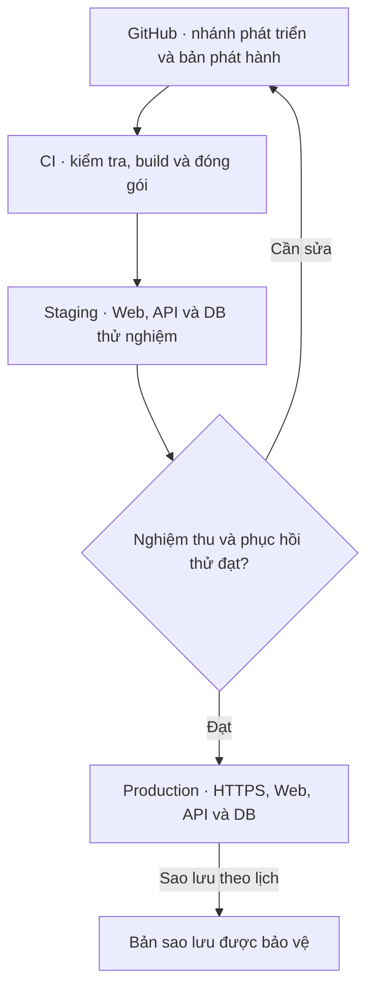

# SNOTE v2 — Sơ đồ triển khai và vận hành

**Mô hình đích đề xuất.** Chọn nhà cung cấp, kích cỡ máy, vùng dữ liệu và ngân sách trước khi triển khai. Dev chạy cục bộ. Staging và production tách cấu hình, cơ sở dữ liệu và tài khoản.

| Bước | Kiểm soát và bằng chứng |
|---|---|
| Dev | Biến môi trường mẫu dùng giá trị giả, kèm cách dựng DB và dữ liệu mẫu. Xác định lệnh cài đặt, kiểm tra và migration khi có mã nguồn. |
| CI | Lint, kiểm tra kiểu, kiểm thử, build và kiểm tra migration trên DB tạm. Mỗi artifact truy về commit nguồn. |
| Staging | Triển khai artifact đã kiểm tra, chạy AT và kiểm tra cấu hình HTTPS, nhật ký, lỗi, tải mẫu, migration và phục hồi. Dùng dữ liệu giả hoặc đã được phép. |
| Phát hành | Chọn cùng artifact đã nghiệm thu, sao lưu trước migration, kiểm tra sức khỏe và chạy luồng ngắn sau triển khai. Cấu hình và bí mật nằm ngoài repo. |
| Quay lui | Quay về artifact đã biết tốt khi schema tương thích. Nếu schema không tương thích, áp dụng kế hoạch phục hồi hoặc sửa tiến đã diễn tập. Đánh giá phần dữ liệu ghi sau thời điểm sao lưu trước khi phục hồi. |
| Vận hành | Theo dõi tỷ lệ lỗi, độ trễ, tình trạng DB, dung lượng và tuổi bản sao. Chốt người trực và kênh báo sự cố trước khi phát hành. Chạy diễn tập phục hồi định kỳ theo RPO/RTO đã duyệt. |

Bộ tài liệu này chuẩn bị thiết kế phát hành. Việc chạy CI, tạo hạ tầng và triển khai ứng dụng thuộc [kế hoạch bàn giao](../delivery/plan.md).
