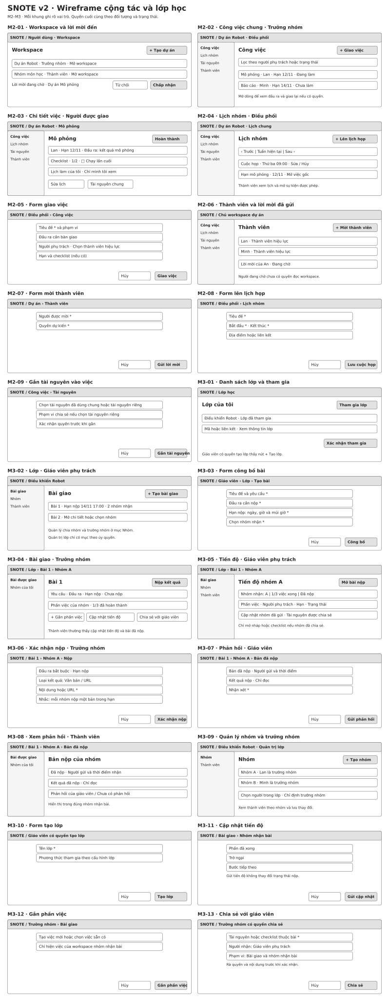

# SNOTE v2 — Wireframe M2–M3 · Cộng tác và lớp học

**Bố cục đề xuất theo vai trò.** Các form và trạng thái bên dưới cụ thể hóa [Use Case](../requirements/use-cases.md) và [ma trận quyền](../requirements/permissions.md). Endpoint, chính sách thu hồi lời mời, chuyển nhóm và quyền sau khi rời nhóm vẫn đi qua cổng hợp đồng của từng mốc trong [hồ sơ sẵn sàng coding](../delivery/coding-readiness.md).

## M2 · Workspace cộng tác

| Khung | Đối tượng, vị trí và đích |
|---|---|
| **M2-01 · Workspace và lời mời đến** | Danh sách workspace dưới tiêu đề, **+ Tạo dự án** ở đầu nếu có quyền. Lời mời ở vùng riêng, **Từ chối / Chấp nhận** cuối dòng. Chỉ mở workspace khi đã có quyền. |
| **M2-02, M2-05 · Công việc và giao việc** | Bảng chung có việc, người phụ trách, hạn và trạng thái. Điều phối thấy **+ Giao việc** cạnh tiêu đề, và giao lại trong chi tiết. Form gồm phạm vi, đầu ra, người phụ trách, hạn và checklist nếu có. Thành viên đọc bảng theo quyền. |
| **M2-03 · Việc được giao** | Đầu trang có việc gốc và ngữ cảnh workspace, tiếp đến hạn, đầu ra, checklist và lịch làm riêng. Người được giao thấy nút cập nhật checklist/trạng thái theo điều kiện. Điều phối không tự động có quyền cập nhật checklist của người khác. |
| **M2-04, M2-08 · Lịch nhóm** | Chọn tuần ở đầu, lịch họp và hạn phía dưới. Điều phối có **+ Lên lịch họp** ở đầu và **Sửa / Hủy** cạnh sự kiện. Chọn hạn mở việc gốc. Lịch làm cá nhân nằm ở chi tiết việc của người dùng. |
| **M2-06, M2-07 · Thành viên** | Người đã tham gia và lời mời đang chờ ở hai vùng. Chủ dự án có **+ Mời thành viên** ở đầu. Form chọn người nhận và quyền trước khi gửi. |
| **M2-09 · Tài nguyên** | Nút gắn nằm trong vùng tài nguyên của công việc khi có quyền. Chọn tài nguyên dùng chung hoặc xác nhận chia sẻ tài nguyên riêng trước khi gắn. Sau thu hồi, trạng thái liên kết không được phép mở. |

## M3 · Lớp học và bài giao

| Khung | Đối tượng, vị trí và đích |
|---|---|
| **M3-01, M3-10 · Danh sách lớp** | Người học có **Tham gia lớp** ở đầu, nhập mã/liên kết, xem thông tin rồi xác nhận. Giáo viên đủ quyền có **+ Tạo lớp**. Thành viên lớp chưa được xếp nhóm thấy trạng thái chờ nhóm. |
| **M3-02, M3-09 · Lớp và nhóm** | Giáo viên có vùng Bài giao, Nhóm và Thành viên. **+ Tạo bài giao** ở vùng Bài giao. Tạo nhóm và chỉ định trưởng nhóm ở vùng Nhóm. Quản trị lớp chỉ thấy các mục được ủy quyền, không có nút công bố bài. Người học chỉ có bài được giao và nhóm của mình. |
| **M3-03 · Công bố bài** | Yêu cầu và đầu ra ở đầu form, hạn nộp chính xác và nhóm nhận bên dưới, **Hủy / Công bố** ở cuối. Thiếu dữ liệu hoặc nhóm sai phạm vi thì giữ form và chỉ rõ lỗi. |
| **M3-04, M3-11, M3-12 · Bài giao của nhóm** | Yêu cầu, đầu ra, hạn và trạng thái nộp ở đầu. Phần việc và tiến độ ở dưới. Trưởng nhóm có **Gắn phần việc**. Thành viên được phép có **Cập nhật tiến độ**. Gửi tiến độ giữ nguyên trạng thái nộp. |
| **M3-05, M3-13 · Giáo viên xem tiến độ** | Chọn nhóm nhận bài. Hiện số việc hoàn thành, trạng thái nộp, người phụ trách, hạn, trạng thái và cập nhật đã gửi. **Mở bài nộp** chỉ hiện khi có bản nộp. Trưởng nhóm chia sẻ nháp hoặc checklist ở form riêng. Giáo viên mở phần đã chia sẻ và còn quyền. |
| **M3-06 · Nộp kết quả** | **Nộp kết quả** chỉ hiện khi trưởng nhóm hiện tại có thể nộp theo D-04. Form nhắc hạn và nhận văn bản/URL. **Xác nhận nộp** ở chân form. Sau thành công thay bằng trạng thái đã nộp và đường mở bản nộp. |
| **M3-07, M3-08 · Bản nộp và phản hồi** | Bản nộp, người gửi, thời điểm và nội dung ở trên. Giáo viên phụ trách có form nhận xét và **Gửi phản hồi** bên dưới. Thành viên đúng nhóm chỉ đọc nội dung và phản hồi. |

## Trạng thái cần duyệt cùng wireframe

- **Lời mời:** đang chờ, đã chấp nhận, bị hủy hoặc hết hạn. Khi mất quyền, đóng vùng thao tác và bỏ dữ liệu ngoài phạm vi.
- **Tiến độ:** chưa có việc thì hiện **Chưa có dữ liệu tiến độ**. Chưa nộp, đã nộp và đã phản hồi là thông tin riêng với số việc hoàn thành.
- **Nộp bài:** khi đang gửi, chặn bấm lặp. Lỗi mạng giữ nội dung và dùng lại khóa yêu cầu khi thử lại cùng bản. Hết hạn, đã nộp hoặc không còn là trưởng nhóm thì hiển thị lý do tương ứng.
- **Điện thoại:** giữ thứ tự tiêu đề, ngữ cảnh vai trò, hành động chính, bộ lọc, nội dung. Bảng rộng chuyển thành dòng có nhãn, form một cột. Chi tiết điện thoại của M2–M3 sẽ được rà khi chốt hợp đồng từng mốc.

Đọc cùng [wireframe M1](frontend-wireframes.md) để giữ khung điều hướng và hành vi lỗi nhất quán.
