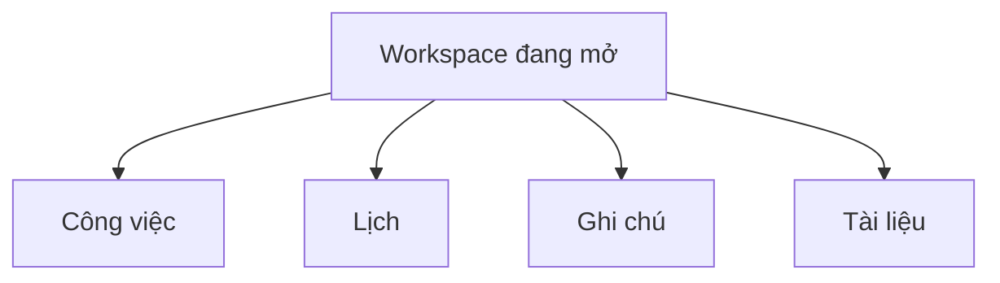

# SNOTE v2 — Cấu trúc frontend và đặc tả thành phần

**Đề xuất để duyệt trước khi vẽ lại wireframe.** Tài liệu này quy định quan hệ cha–con, vị trí tương đối, loại thành phần, hành vi và điểm gọi dữ liệu. [Điều hướng](frontend-navigation.md) ghi đường dẫn. [Hợp đồng API M1](m1-api-contract.md) ghi các endpoint đã đặc tả. Phạm vi phát hành theo [SRS](../requirements/srs.md).

## 1. Ba cấp và một vùng nội dung

1. **Cấp ứng dụng** có ba lối vào ngang cấp: **Workspace**, **Hộp thu nhanh**, **Lớp học**. Chúng nằm cạnh nhau trong một thanh hoặc cùng một nhóm trên menu điện thoại. Tài khoản nằm tách ở mép thanh vì là thao tác tiện ích.
2. **Cấp workspace** có bốn mục ngang cấp theo thứ tự **Công việc | Lịch | Ghi chú | Tài liệu**. Đặt bốn liên kết trong **cùng một hàng**, ngay dưới tên workspace đang mở. Trên điện thoại cho hàng này cuộn ngang hoặc xuống dòng như một cụm. Chọn một mục thay vùng nội dung, giữ workspace và các mục ngang cấp tại chỗ.
3. **Cấp tính năng** chứa chế độ hiển thị, bộ lọc và thao tác của mục đang mở. **Danh sách | Gantt** thuộc **Công việc**. **Ngày | Tuần** thuộc **Lịch** hoặc là độ thu phóng bên trong **Gantt**, tùy ngữ cảnh. Các điều khiển đó chỉ hiện bên trong tính năng tương ứng.

**Quy tắc bố cục:** chỉ một vùng nội dung chính hoạt động. Ví dụ, ở **Lịch**, người dùng thấy lịch, điều khiển lịch và các mục thời gian có liên quan. **Ghi chú** vẫn nằm ngay cạnh **Lịch** trên hàng điều hướng. Khi bấm **Ghi chú**, nội dung lịch được thay bằng nội dung ghi chú. Một cuộc hẹn hoặc hạn việc có thể mở đối tượng liên quan theo thao tác rõ ràng. Điều đó không biến lịch thành bảng tổng hợp ghi chú hay công việc.

## 2. Cách đếm và phân loại

Số dưới đây là **thành phần cấp trực tiếp** của từng vùng ở bố cục đích, có tính khối chứa. Một nhóm bộ lọc được tính một lần ở màn hình. Các điều khiển con được đếm ở phần riêng. Một hàng công việc lặp nhiều lần vẫn là một kiểu thành phần. Khối thay thế khi tải, trống hoặc lỗi dùng cùng vị trí với vùng dữ liệu và không cộng thêm thành phần cùng lúc.

| Mã | Thành phần | Kiểu | Cha và các mục đứng cạnh | Hành vi hoặc gọi dữ liệu |
|---|---|---|---|---|
| A1 | Điều hướng ứng dụng · **3 liên kết** | Liên kết điều hướng | Khung ứng dụng, cùng nhóm **Workspace / Hộp thu nhanh / Lớp học** | Mở đường dẫn đích. Chỉ màn hình đích nạp dữ liệu cần thiết khi chưa có dữ liệu phù hợp. |
| A2 | Tài khoản · **1 nút mở menu** | Nút tiện ích | Khung ứng dụng, tách nhóm A1 | Mở menu là thao tác tại chỗ. Chọn **Đăng xuất** mới gọi `DELETE /api/session`. |
| A3 | Vùng nội dung ứng dụng · **1 vùng** | Vùng hiển thị | Khung ứng dụng, dưới A1/A2 | Hiện duy nhất nội dung Workspace, Hộp thu hoặc Lớp học theo đường dẫn. |
| W1 | Workspace hiện tại · **1 điều khiển** | Bộ chọn ngữ cảnh | Đầu trang Workspace, trên W2 | Chọn workspace cập nhật định danh trong đường dẫn và dữ liệu phạm vi. M1 cá nhân có thể chỉ hiển thị tên vì chỉ có một lựa chọn. `GET /api/me/workspace` lấy ngữ cảnh cá nhân. |
| W2 | Điều hướng tính năng · **4 liên kết** | Liên kết điều hướng cùng cấp | Dưới W1, thứ tự **Công việc / Lịch / Ghi chú / Tài liệu** | Đổi tính năng trong cùng workspace. Không ghi dữ liệu. |
| W3 | Vùng nội dung workspace · **1 vùng** | Vùng hiển thị | Dưới W2 | Chứa duy nhất tính năng đã chọn. |
| W4 | Quản lý workspace · **tối đa 1 lối vào** | Liên kết hoặc nút mở menu quản lý theo quyền | Cạnh W1, ngoài hàng W2 | Mở vùng quản lý thành viên và lời mời. Chỉ hiện ở workspace phù hợp và với người có quyền xem khu vực quản lý. Điểm gọi M2 chờ hợp đồng. |

Khung đã đăng nhập có **3 khối cấp trực tiếp** A1–A3. Bên trong Workspace có **3 khối cơ bản** W1–W3 và **1 lối vào có điều kiện** W4. W2 có đúng **4 vị trí** theo kiến trúc đích. **Lớp học** là vùng nghiệp vụ cấp ứng dụng với phân quyền riêng. **Hộp thu nhanh** là nơi lưu URL/văn bản theo hợp đồng hiện có. Ghi chú và Tài liệu là các mục đích riêng trong Workspace, phạm vi dữ liệu của chúng phải được chốt trước khi phát hành.

## 3. Đặc tả từng tính năng

### 3.1 Công việc · 5 thành phần cấp trực tiếp

**Một hàng đầu trang** gồm tiêu đề, bộ đổi chế độ và nút chính. Dưới đó là điều khiển của chế độ, rồi vùng kết quả.

| Mã | Thành phần | Kiểu và vị trí | Hành vi và điểm gọi |
|---|---|---|---|
| CV1 | Tiêu đề **Công việc** hoặc **Việc của tôi** | Văn bản đầu trang | Xác nhận ngữ cảnh. Không gọi dữ liệu riêng. |
| CV2 | **Danh sách / Gantt** · **2 lựa chọn** | Hai liên kết hoặc nút chọn loại trừ nhau, đặt cạnh nhau bên phải đầu trang | Đổi cách xem cùng việc, lưu lựa chọn theo ngữ cảnh đường dẫn. Danh sách đọc truy vấn danh sách. Gantt đọc truy vấn kỳ xem sau khi có hợp đồng. Không gửi lệnh ghi. |
| CV3 | **+ Tạo việc** · **1 nút** | Nút chính, cạnh CV2 nhưng tách nhóm chế độ xem | Mở form tại chỗ hoặc trang con. Chỉ **Lưu việc** gọi `POST /api/tasks` trong M1. |
| CV4 | Điều khiển của chế độ đang chọn | Một vùng bên dưới đầu trang | **Danh sách** có sáu lựa chọn liền nhau: Tất cả, Hôm nay, Ngày mai, Quá hạn, Cần xử lý, Quan trọng. Đổi bộ lọc nạp `GET /api/me/tasks?view=…` khi cần. **Gantt** thay cả vùng này bằng bộ lọc trạng thái, điều khiển kỳ và độ thu phóng của trục. |
| CV5 | Kết quả công việc | Một vùng dữ liệu dưới CV4 | Danh sách hoặc trục Gantt. Mỗi dòng mở cùng chi tiết việc. Đường dẫn chi tiết tải `GET /api/tasks/:taskId`. Trang giữ nút quay lại đúng chế độ đã mở. |

CV4 ở Gantt có **3 nhóm con**: một bộ lọc trạng thái, bốn điều khiển kỳ **Trước / Ngày đang xem / Sau / Hôm nay**, và hai nút thu phóng **Ngày / Tuần**. Các nhóm đứng cạnh nhau ở phía trên trục. **Ngày đang xem** là nút mở bộ chọn ngày. Chỉ đổi kỳ khi xác nhận ngày mới. **Trước / Sau / Hôm nay** đổi khoảng đọc. **Ngày / Tuần** đổi độ thu phóng và chỉ nạp dữ liệu khi kỳ cần đọc thay đổi hoặc bộ nhớ đệm không còn phù hợp. CV5 ở Gantt có **2 vùng con** là **trục theo hàng công việc** và **việc chưa có lịch lẫn hạn**. Chú giải nằm cạnh trục. Quy tắc thanh lịch làm và mốc hạn nằm trong [đặc tả Gantt](task-views.md).

### 3.2 Lịch · 4 thành phần cơ bản và 1 nút có điều kiện

| Mã | Thành phần | Kiểu và vị trí | Hành vi và điểm gọi |
|---|---|---|---|
| L1 | Tiêu đề **Lịch** | Văn bản đầu trang | Xác nhận đang xem lịch cá nhân hoặc lịch nhóm. |
| L2 | **Ngày / Tuần** · **2 lựa chọn** | Nút chọn cách hiển thị, cạnh nhau ở đầu trang | Đổi cách trình bày của Lịch. Nạp kỳ mới nếu cần. |
| L3 | **+ Lên lịch họp** · **tối đa 1 nút** | Nút hành động cạnh L2, chỉ dành cho người điều phối lịch nhóm | Mở form. Chỉ lưu form mới gửi lệnh tạo cuộc họp. Hợp đồng ghi M2 chờ chốt. Lịch cá nhân dùng khoảng làm từ chi tiết việc theo phạm vi hiện có. |
| L4 | **Trước / Kỳ đang xem / Sau / Hôm nay** · **4 điều khiển** | Một cụm ngay trên lưới lịch | Trước, Sau và Hôm nay đổi kỳ. Kỳ đang xem mở bộ chọn ngày. Chỉ đọc dữ liệu lịch của phạm vi hiện tại. Endpoint lịch theo kỳ chờ chốt. |
| L5 | Lưới thời gian · **1 vùng** | Vùng trực quan, dưới L4 | Hiện sự kiện, hạn và khoảng làm được phép theo phạm vi. Bấm một mục mở chi tiết sự kiện hoặc việc gốc. Ghi chú, Hộp thu và danh sách công việc có khu vực riêng. |

Lịch trả lời **ngày này có gì**. Gantt ở Công việc trả lời **mỗi việc nằm ở đâu trên trục thời gian**. Hai cách nhìn có thể dùng cùng mốc hạn và cùng việc gốc. Lịch nhóm dùng lịch họp và mốc chung, lịch riêng chỉ hiện cho chủ lịch.

### 3.3 Ghi chú và Tài liệu · mỗi mục 4 thành phần cấp trực tiếp

| Tính năng | Bốn thành phần theo thứ tự | Hành vi và phạm vi |
|---|---|---|
| **Ghi chú** | **1** Tiêu đề văn bản. **2** Nút **+ Ghi chú** theo quyền. **3** Nhóm tìm/lọc. **4** Danh sách ghi chú hoặc trang chi tiết trong cùng vùng. | Mở mục Ghi chú mới đọc dữ liệu ghi chú. Nút tạo mở form. Chỉ lưu mới gọi lệnh ghi. Phạm vi ghi chú riêng và việc tái sử dụng dữ liệu văn bản từ Hộp thu chờ quyết định. |
| **Tài liệu** | **1** Tiêu đề văn bản. **2** Nút **+ Thêm tài liệu** theo quyền. **3** Nhóm tìm/lọc. **4** Danh sách tài liệu hoặc trang chi tiết trong cùng vùng. | Mở mục Tài liệu mới đọc dữ liệu tài liệu. Nút thêm mở form. Chỉ xác nhận mới ghi. Tải tệp, phạm vi chia sẻ và endpoint chờ hợp đồng. |

**Hộp thu nhanh** giữ vai trò lưu URL/văn bản. Có **4 khối trực tiếp** gồm tiêu đề, **+ Lưu nhanh**, nhóm tìm/lọc và vùng danh sách hoặc chi tiết. Mở form không tạo mục. Chỉ **Lưu** gọi `POST /api/inbox`. Tìm/lọc gọi `GET /api/inbox`, mở mục gọi `GET /api/inbox/:id`, **Lưu sửa** gọi `PATCH /api/inbox/:id`.

### 3.4 Lớp học · phạm vi cấp ứng dụng

Danh sách lớp có **3 khối cơ bản** gồm tiêu đề, nhóm hành động theo vai trò và danh sách lớp. Nhóm hành động có **Tham gia lớp** cho người học hoặc **Tạo lớp** cho giáo viên có quyền. Nút chỉ mở form. Xác nhận mới gửi lệnh. Mở lớp đọc phạm vi lớp đang chọn. Các liên kết con, quyền và điểm gọi theo vai trò được quy định khi chốt M3. [Điều hướng lớp học](frontend-navigation.md#cấp-lớp-học) ghi đích bài giao và tiến độ.

## 4. Phân biệt mở giao diện, đọc và ghi

| Thao tác | Mở giao diện | Đọc | Ghi |
|---|---|---|---|
| Chọn Lịch hoặc Ghi chú | Chuyển đường dẫn tính năng và thay vùng nội dung | Chỉ nạp dữ liệu của đích khi cần | — |
| Chọn Danh sách hoặc Gantt | Thay bố cục trong Công việc | Nạp truy vấn của chế độ khi cần | — |
| Chọn **+ Tạo việc** hoặc **+ Lưu nhanh** | Mở form | — | — |
| Chọn **Lưu việc** hoặc **Lưu** ở Hộp thu | Giữ form đến khi biết kết quả | Làm mới vùng liên quan sau thành công | POST tương ứng |
| Mở **Lịch làm của tôi** | Mở vùng hoặc form riêng của việc | `GET /api/me/task-plans/:taskId` khi cần | — |
| Chọn **Lưu lịch** | Phản hồi đang lưu, lỗi hoặc thành công | Làm mới dữ liệu liên quan sau thành công | `PUT /api/me/task-plans/:taskId` |
| Đánh dấu mục checklist | Cập nhật trạng thái của điều khiển | Làm mới tổng hợp liên quan | `PATCH /api/tasks/:taskId/check-items/:itemId` với trạng thái đích |
| Chọn **Hoàn thành / Mở lại** | Phản hồi trạng thái ở chi tiết | Làm mới việc, bộ đếm và chế độ liên quan | `PATCH /api/tasks/:taskId` với trạng thái đích |

Tiêu đề, bộ đếm, trạng thái, chú giải và đường thời gian là phần hiển thị. Chúng nhận dữ liệu từ màn hình cha. Nếu một bộ đếm cũng được dùng để lọc, **điều khiển lọc** là phần tương tác và số đếm chỉ là nhãn của nó. Điều khiển chưa có hành vi được đặc tả chỉ xuất hiện trong tài liệu bố cục đích. Khi phát hành, chỉ hiện liên kết có đích sử dụng được và hợp đồng phù hợp.

## 5. Bàn giao và tiêu chí duyệt trước khi vẽ lại

1. Từ **Công việc**, thấy **Lịch** và **Ghi chú** đứng cạnh nhau trong W2. Bấm **Lịch** vẫn giữ đúng workspace, bỏ nội dung Công việc khỏi vùng chính. Bấm **Ghi chú** thay vùng Lịch bằng nội dung ghi chú, giữ nguyên hàng W2.
2. **Gantt** chỉ ở CV2, cạnh **Danh sách**. Khi Gantt mở, bộ lọc của Danh sách nhường chỗ cho điều khiển thời gian. Công việc gốc vẫn mở đúng định danh.
3. Điện thoại giữ quan hệ ngang cấp và một vùng nội dung. Kiểm tra vị trí điều hướng, tiêu điểm bàn phím và thao tác quay lại khi mở form hoặc chi tiết.
4. Kiểm tra yêu cầu mạng khi đổi tính năng, mở form và lưu. Mở Lịch không gọi dữ liệu Ghi chú. Mở form tạo không gửi lệnh ghi. Không tải dữ liệu chỉ để hiển thị một liên kết điều hướng.
5. Trước khi vẽ lại từng màn, duyệt số khối, kiểu thành phần, vị trí với các mục ngang cấp, quyền và đích thao tác. Trước coding, đối chiếu mục sẽ phát hành với SRS và endpoint. Ghi chú, Tài liệu và truy vấn lịch/Gantt theo kỳ còn cần khóa phạm vi và hợp đồng.

Các wireframe đã có dùng để tham khảo chi tiết form. Vị trí điều hướng và phân cấp trong bản vẽ cần được đối chiếu lại với tài liệu này trước khi dùng để bàn giao.
