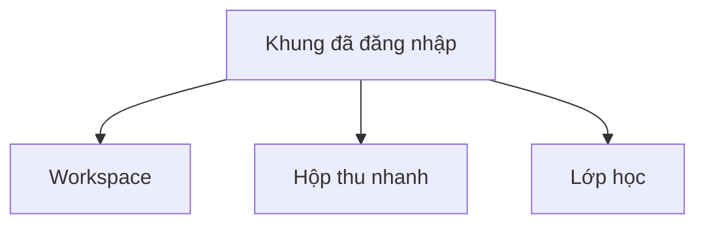

# SNOTE v2 — Sơ đồ điều hướng frontend

Đọc [cấu trúc và đặc tả thành phần](frontend-information-architecture.md) trước khi bố trí màn hình. Đường dẫn dưới đây là đề xuất frontend. M1 giữ đường dẫn cá nhân hiện có. Một số đích trong kiến trúc đầy đủ cần chốt phạm vi và API trước khi phát hành.

## Cấp ứng dụng

| Đích | Đường dẫn đề xuất | Hành vi |
|---|---|---|
| Đăng nhập | `/login` | Khi phiên hết, quay lại đích nội bộ hợp lệ sau xác thực và kiểm tra quyền lần nữa. |
| Workspace | `/workspaces`, `/workspaces/:workspaceId` | Mở workspace hợp lệ. Khi vào chi tiết workspace, mặc định mở Công việc nếu chưa chọn mục. Workspace cá nhân dùng `/me/tasks` cho Công việc. |
| Hộp thu nhanh | `/inbox`, `/inbox/:resourceId` | Lưu và tìm URL hoặc văn bản theo quyền. Chi tiết tài nguyên mở trong Hộp thu. |
| Lớp học | `/classes`, `/classes/:classId` | Hiện lớp được phép truy cập. Nhóm, bài giao và tiến độ mở theo vai trò. |

## Cấp workspace

**Công việc | Lịch | Ghi chú | Tài liệu** là một hàng điều hướng. Đổi mục chỉ thay vùng nội dung chính. Đổi workspace thay phạm vi dữ liệu. Khi mục cũ khả dụng ở workspace mới, có thể giữ mục. Nếu không khả dụng, quay về mục mặc định được phép.

| Đích | Đường dẫn đề xuất | Cần kiểm tra |
|---|---|---|
| Công việc | `/me/tasks` hoặc `/workspaces/:workspaceId/tasks` | Danh sách và [Gantt](task-views.md) là hai chế độ trong Công việc. Chuyển chế độ giữ phạm vi đang xem. |
| Chi tiết việc | `/workspaces/:workspaceId/tasks/:taskId` | Mở đúng việc gốc và kiểm tra quyền. Quay lại chế độ đã mở việc. Lịch làm riêng chỉ hiện cho chủ lịch. |
| Lịch | `/me/calendar` hoặc `/workspaces/:workspaceId/calendar` | Hiện lịch của phạm vi. Chọn hạn mở việc gốc. Chọn cuộc họp mở chi tiết sự kiện. API lịch theo kỳ chờ hợp đồng. |
| Ghi chú | `/me/notes` hoặc `/workspaces/:workspaceId/notes` | Thay nội dung bằng danh sách hoặc chi tiết ghi chú. Mục này nằm ngay cạnh Lịch. Phạm vi và API chờ chốt. |
| Tài liệu | `/me/documents` hoặc `/workspaces/:workspaceId/documents` | Thay nội dung bằng danh sách hoặc chi tiết tài liệu. Phạm vi và API chờ chốt. |
| Quản lý workspace | `/workspaces/:workspaceId/members` | Lối vào cạnh tên workspace khi người dùng có quyền xem khu vực quản lý. Hiện thành viên và lời mời theo quyền. |

## Cấp lớp học

| Đích | Đường dẫn đề xuất | Cần kiểm tra |
|---|---|---|
| Bài giao | `/classes/:classId/assignments/:assignmentId` | Giáo viên quản lý bài theo quyền. Thành viên thấy bài giao cho nhóm của mình. |
| Tiến độ và bài nộp | `/classes/:classId/assignments/:assignmentId/groups/:groupId` | Hiện tiến độ, trạng thái nộp và phản hồi theo đúng nhóm và vai trò. Thành viên có thể mở việc nhóm trong workspace gốc. |

Mở đích mới tải dữ liệu cần cho đích đó. Không tải Ghi chú để dựng thanh điều hướng khi đang ở Lịch. Đường dẫn trực tiếp kiểm tra cùng quyền như đi từ menu. Khi làm mới trang hoặc dùng Quay lại, lấy đúng workspace, mục và chế độ từ đường dẫn hoặc trạng thái điều hướng có thể phục hồi.

[Wireframe M1](frontend-wireframes.md) và [wireframe M2–M3](frontend-collaboration-wireframes.md) là bản minh họa trước khi quy định hệ phân cấp này. Dùng chúng để tham khảo chi tiết form. Trước bàn giao giao diện, kiểm tra và vẽ lại khung điều hướng theo đặc tả thành phần.
