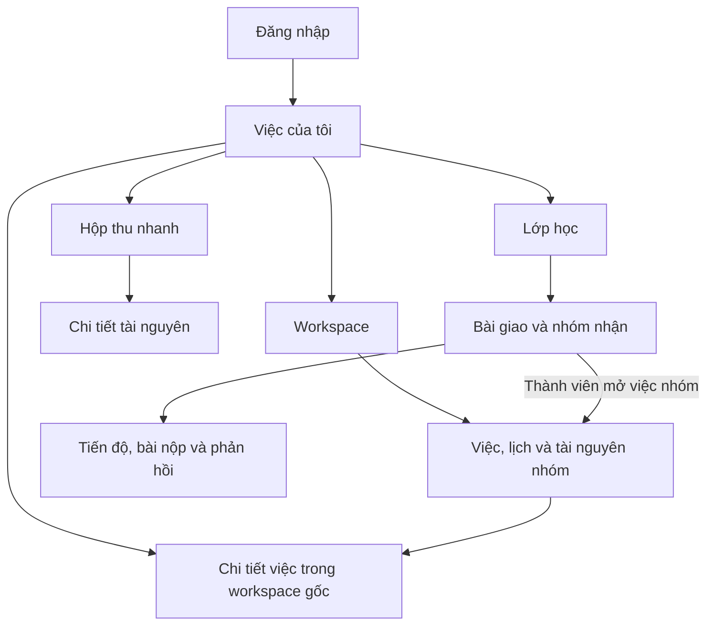

# SNOTE v2 — Sơ đồ điều hướng frontend

Các đường dẫn là đề xuất. Điều hướng xuất phát từ nhu cầu đang làm, và chi tiết việc nhóm giữ ngữ cảnh workspace gốc. Phạm vi màn hình ưu tiên theo [SRS](../requirements/srs.md). Vị trí nút, biểu mẫu và vùng nội dung của M1 nằm ở [wireframe frontend](frontend-wireframes.md).

| Màn hình | Đường dẫn đề xuất | Điểm cần nghiệm thu |
|---|---|---|
| Đăng nhập | `/login` | Khi phiên hết, quay lại đích nội bộ hợp lệ sau xác thực và kiểm tra quyền lần nữa. |
| Việc của tôi | `/me/tasks` | Có mục hôm nay, ngày mai, quá hạn và danh sách chung. Việc được giao có nhãn nguồn, mở đúng việc gốc. |
| Hộp thu nhanh | `/inbox`, `/inbox/:resourceId` | Lưu và tìm nhanh, có trạng thái trống, lỗi, đang lưu và đã lưu. Chia sẻ cần xác nhận riêng. |
| Workspace | `/workspaces/:workspaceId` | Xem việc, lịch và tài nguyên theo quyền. Lịch nhóm hiển thị mốc chung. |
| Chi tiết việc | `/workspaces/:workspaceId/tasks/:taskId` | Hiện phạm vi, đầu ra, hạn, người được giao và checklist. Lịch làm của tôi là thao tác riêng tư. |
| Lớp và bài giao | `/classes/:classId`, `/classes/:classId/assignments/:assignmentId` | Giáo viên quản lý bài và chọn nhóm. Thành viên thấy bài giao cho nhóm của mình. |
| Tiến độ và bài nộp | `/classes/:classId/assignments/:assignmentId/groups/:groupId` | Có trạng thái chưa có dữ liệu, chưa nộp, đã nộp và có phản hồi. Hành động khác nhau theo vai trò. |

Trạng thái tải, trống, lỗi, đang ghi, xung đột và mất quyền cần có trên luồng tương ứng. Chỉ cập nhật trạng thái nộp đã thành công khi API xác nhận. Nếu vai trò đổi khi màn hình đang mở, lần truy cập sau dùng quyền mới. Dùng dữ liệu giả để duyệt luồng trước khi tạo mockup chi tiết.
