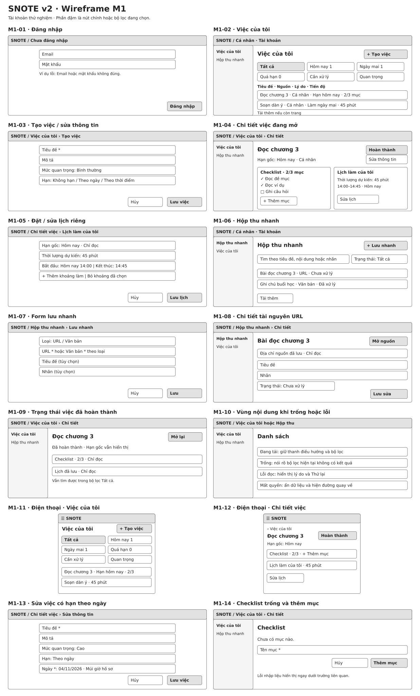

# SNOTE v2 — Wireframe M1 · Cá nhân

> **Phân cấp giao diện:** Dùng [đặc tả thành phần](frontend-information-architecture.md) để xác định thanh điều hướng, vị trí nhóm và dữ liệu được tải. Thanh điều hướng trong hình dưới đây là minh họa cũ.

**Bản sửa để duyệt bố cục trước coding.** [Điều hướng](frontend-navigation.md) mô tả đường đi. Tài liệu này đặt nút, vùng dữ liệu và form vào màn hình. Dữ liệu trong hình là ví dụ. Xem [wireframe Gantt](task-views.md) cho bố cục chuyển giữa Danh sách và trục thời gian. Thứ tự thao tác, phạm vi và lỗi đối chiếu với [hợp đồng API M1](m1-api-contract.md).

## Màn hình, nút và đích

| Khung | Vị trí và thao tác | Kết quả hoặc giới hạn |
|---|---|---|
| **M1-01 · Đăng nhập** | Email → mật khẩu → lỗi → **Đăng nhập** cuối form. Menu tài khoản ở thanh đầu sau khi đăng nhập có **Đăng xuất**. | Thành công vào **Việc của tôi** hoặc đích nội bộ đã kiểm tra quyền. Phiên hết hạn chuyển lại đăng nhập. M1 dùng tài khoản thử nghiệm. |
| **M1-02, M1-11 · Việc của tôi** | **+ Tạo việc** cạnh tiêu đề. Sáu bộ lọc phía dưới điều khiển **một** danh sách, chỉ một bộ lọc đang chọn. Mỗi dòng mở việc gốc. **Tải thêm** nằm cuối. | Tất cả mặc định và gồm việc đã xong. Hôm nay, Ngày mai và Quá hạn có số đếm toàn bộ. Cần xử lý và Quan trọng là hai bộ lọc riêng, có thể chứa cùng một việc. |
| **M1-03, M1-13 · Tạo/sửa việc** | Tiêu đề → mô tả → mức quan trọng → loại hạn. Chọn Theo ngày thì hiện trường ngày. Chọn Theo thời điểm thì hiện ngày và giờ. **Hủy / Lưu việc** ở chân form. | Tạo thành công mở chi tiết mới. Sửa thành công trả về chi tiết đang sửa. Hạn có thể trống. Thay lịch làm ở form riêng. |
| **M1-04, M1-12, M1-14 · Chi tiết việc mở** | Đầu trang có quay lại, tiêu đề, **Hoàn thành** và **Sửa thông tin**. Dưới hạn gốc là checklist và vùng kế hoạch riêng. **+ Thêm mục** mở trường tên ở cuối checklist. | Đánh dấu từng mục cập nhật số mục xong và mục chưa xong đầu tiên. Xong hết checklist giữ trạng thái việc đang mở đến khi bấm **Hoàn thành**. M1 hỗ trợ thêm và đánh dấu mục. |
| **M1-05 · Lịch làm** | Hạn gốc chỉ đọc → thời lượng → các khoảng bắt đầu/kết thúc → thêm/bỏ khoảng → **Hủy / Lưu lịch**. | Gửi toàn bộ kế hoạch. Có thể lưu danh sách khoảng rỗng. Xung đột giữa các khoảng trong cùng việc và giờ kết thúc không hợp lệ hiển thị tại trường tương ứng. |
| **M1-06 · Hộp thu** | **+ Lưu nhanh** cạnh tiêu đề, tìm và lọc ngay dưới, danh sách ở giữa. **Tải thêm** nằm cuối. | Mở từng tài nguyên bằng dòng tương ứng. Tìm cả mục đã xử lý khi bộ lọc là Tất cả. |
| **M1-07 · Lưu nhanh** | Loại → đúng một trường nội dung bắt buộc → tiêu đề/nhãn tùy chọn → **Hủy / Lưu**. | URL hoặc văn bản. Lưu thành công trở về Hộp thu và có đường mở mục mới kể cả khi bộ lọc hiện tại ẩn mục đó. |
| **M1-08 · Tài nguyên** | Quay lại, tiêu đề, **Mở nguồn** khi là URL, vùng nội dung gốc chỉ đọc, rồi tiêu đề/nhãn/trạng thái và **Lưu sửa**. | Mục văn bản không có nút mở nguồn. Không có tải tệp, xóa hay nút chia sẻ trong M1. |
| **M1-09 · Việc đã xong** | **Mở lại** thay nút Hoàn thành. Checklist và kế hoạch đã lưu được hiển thị chỉ đọc. | Việc rời số đếm đang mở, còn trong Tất cả. Mở lại giữ checklist và lịch làm đã lưu. |
| **M1-10 · Trạng thái danh sách** | Đang tải, trống theo bộ lọc, lỗi đọc và mất quyền thay nội dung của vùng danh sách. | Lỗi đọc có **Thử lại** khi phù hợp. Khi mất quyền, loại dữ liệu riêng khỏi màn hình và đưa đường quay lại. |

## Điểm dễ nhầm khi triển khai

- **Hạn gốc khác lịch làm.** Ví dụ việc đến hạn hôm nay, bạn lên lịch hai khoảng trong hôm nay, danh sách vẫn có một dòng và tính một lần. Dòng có thể nêu cả hai lý do. Dời hai khoảng làm giữ nguyên hạn.
- **Khối gợi ý khác bộ đếm.** Sáu lựa chọn gọi cùng danh sách với các giá trị `all`, `today`, `tomorrow`, `overdue`, `actionable`, `important`. Không dựng sáu danh sách riêng. API trả ba bộ đếm ngày. Dùng đúng thứ tự, quyền và múi giờ theo hợp đồng.
- **Lưu và lỗi.** Nút lưu đứng cuối form. Khi đang gửi, chặn gửi lặp. Lỗi trường đặt ngay cạnh trường và giữ nội dung. Lỗi tải đặt tại vùng nội dung. Sau cập nhật thành công, đọc lại dữ liệu việc và phần tổng hợp liên quan.
- **Điện thoại.** Điều hướng nằm trong menu trên thanh đầu. Bộ lọc xuống dòng. Chi tiết xếp checklist trước kế hoạch. Form dùng một cột và giữ thứ tự bàn phím. Khi đóng form, trả tiêu điểm về nút mở nếu nó còn hiện.

**Phạm vi bàn giao:** A0 sở hữu khung điều hướng và phiên, B1 sở hữu Hộp thu, C1 sở hữu việc và checklist, D1 sở hữu danh sách và vùng kế hoạch. D1 bàn giao vùng kế hoạch để C1 lắp vào trang chi tiết theo hợp đồng chung. Q1 kiểm tra thao tác, quyền, lỗi và thứ tự tiêu điểm. Xem tiếp [wireframe M2–M3](frontend-collaboration-wireframes.md).
