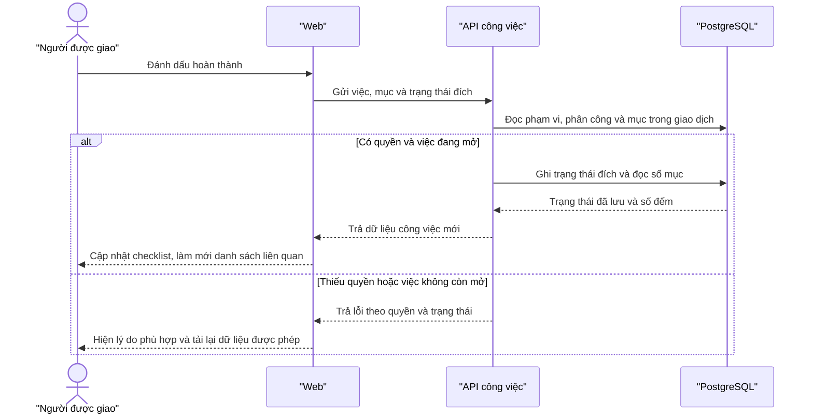
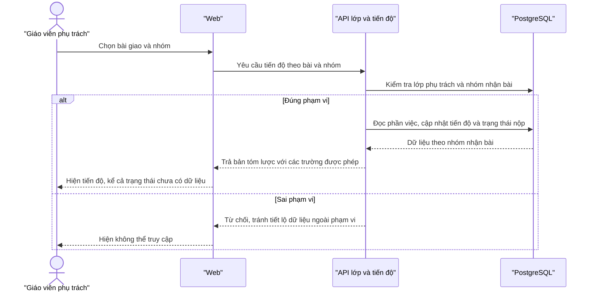
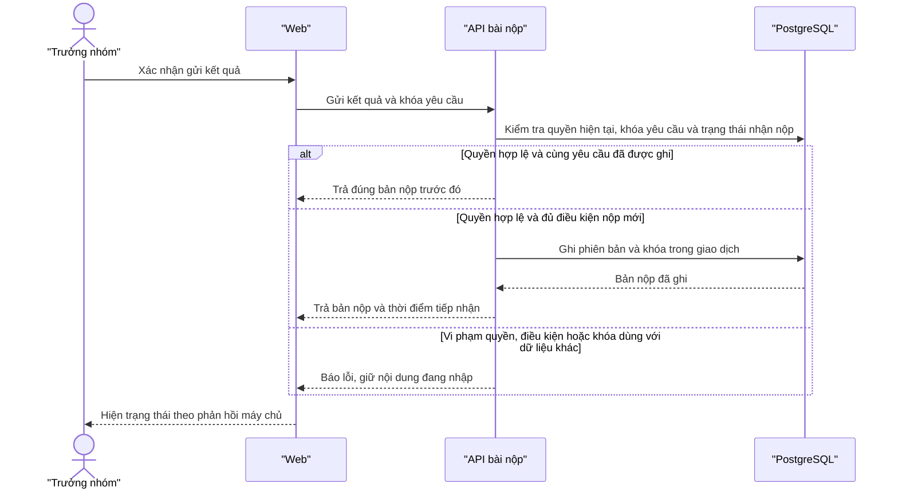

# SNOTE v2 — Sơ đồ 6 · Trình tự và hợp đồng API

**Đề xuất để duyệt.** Tên thao tác biểu thị hợp đồng nghiệp vụ, có thể đổi khi chuẩn hóa API. Mọi yêu cầu dữ liệu cần phiên hợp lệ. Máy chủ lấy vai trò và phạm vi từ dữ liệu hiện hành.

## 6A — Thành viên cập nhật một mục checklist

**UC-05, UC-09 · FR-06, FR-11.** Gửi trạng thái đích để thao tác lặp không đảo trạng thái. Khi quyền bị thay đổi đồng thời, thao tác phải được sắp thứ tự với lần ghi liên quan. Bảng nhóm và Việc của tôi đọc lại từ cùng việc.

## 6B — Giáo viên mở tiến độ một nhóm

**UC-18, UC-27 · FR-15.** Chiếu người phụ trách, hạn và trạng thái của việc gắn bài. Checklist chi tiết và nháp mở qua luồng tài nguyên được chia sẻ, kiểm tra quyền riêng ở mỗi lần mở.

## 6C — Trưởng nhóm nộp bài và thử lại

**UC-17 · FR-16.** Kiểm tra quyền đọc hiện hành trước khi trả bản nộp cũ. Một yêu cầu đã ghi được trả lại với cùng khóa dù hạn vừa qua. Nộp mới sau hạn, nộp lại và nộp thay theo D-04. Khóa duy nhất và giao dịch xử lý cả hai yêu cầu đồng thời.

## Hợp đồng API tối thiểu

| Thao tác đề xuất | Đầu vào / đầu ra | Điều kiện chính |
|---|---|---|
| `GET /api/me/tasks` | Khoảng ngày tùy chọn. Trả việc, nhãn nguồn, lý do vào nhóm ngày, trạng thái và checklist tóm tắt. | Duy nhất việc trong mỗi nhóm ngày. Tôn trọng múi giờ hồ sơ. |
| `PATCH /api/tasks/:taskId/check-items/:itemId` | Trạng thái đích. Trả mục, số mục xong và bước tiếp theo. | Mục thuộc việc. Người dùng là chủ việc cá nhân hoặc người đang được giao việc nhóm. |
| `GET /api/classes/:classId/assignments/:assignmentId/groups/:groupId/progress` | Trả tiến độ trong phạm vi bài và nhóm. | Giáo viên phụ trách và nhóm nhận bài hợp lệ. |
| `POST /api/classes/:classId/assignments/:assignmentId/groups/:groupId/submissions` | Nội dung kết quả và khóa yêu cầu. Trả mã bản nộp và thời điểm tiếp nhận. | Trưởng nhóm hiện tại. Kiểm tra cả D-04 và khóa thử lại. |

Quy ước lỗi đề xuất: 401 khi cần xác thực, 403 khi hành động bị từ chối trong phạm vi có thể tiết lộ, 404 khi tài nguyên không tìm thấy trong phạm vi được đọc, 409 khi xung đột trạng thái hoặc khóa và 422 khi đầu vào nghiệp vụ không hợp lệ. Trả mã lỗi ổn định để giao diện chọn thông báo. Chốt hợp đồng đầy đủ cho từng mốc trước khi lập trình.
