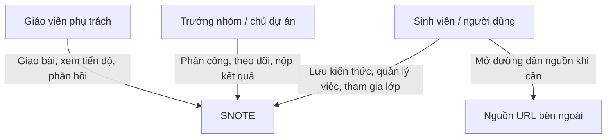
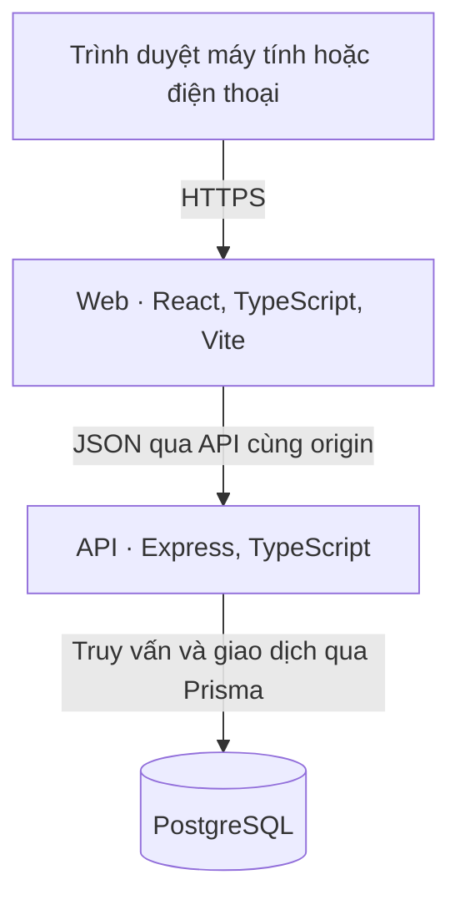
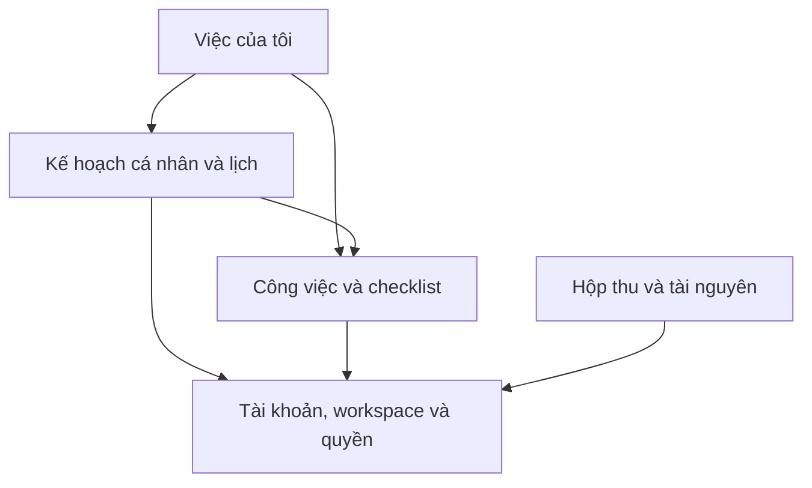
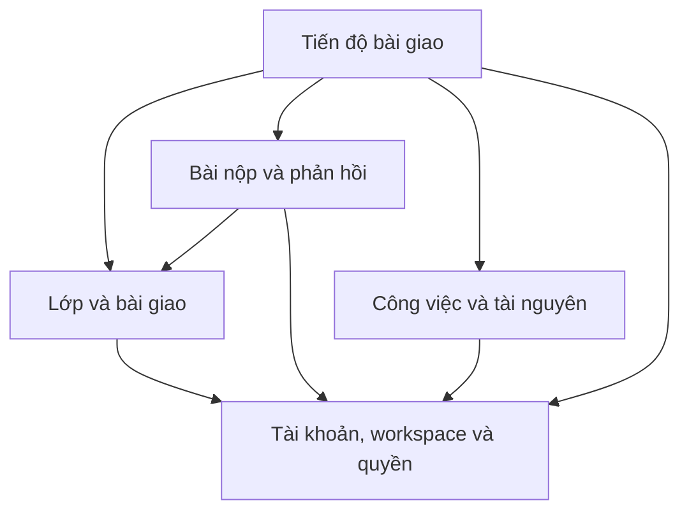

# SNOTE v2 — Sơ đồ 3 và 4 · Kiến trúc hệ thống

**Kiến trúc đích đề xuất.** Các lựa chọn dưới đây xuất phát từ [SRS](../requirements/srs.md) và tài liệu thiết kế SNOTE trước đây. Nhánh v2 tại thời điểm lập bộ hồ sơ dùng làm nền tài liệu. Tên module và container bên dưới là ranh giới thiết kế.

## Sơ đồ 3A — Ngữ cảnh hệ thống

Trong phạm vi ban đầu, người dùng có thể mở URL ở trình duyệt. SNOTE lưu URL và văn bản người dùng nhập. Tự lấy nội dung từ website và nhận chia sẻ trực tiếp là phạm vi cần duyệt sau.

## Sơ đồ 3B — Container ứng dụng

| Container | Trách nhiệm | Ranh giới |
|---|---|---|
| Web | Hiển thị theo vai trò, điều hướng, biểu mẫu, cache dữ liệu và trạng thái lỗi. | Kiểm tra giao diện hỗ trợ người dùng. API quyết định quyền cuối cùng. |
| API | Xác thực, kiểm tra đầu vào, đánh giá quyền theo bản ghi và ghi dữ liệu nhất quán. | Một ứng dụng nguyên khối chia module. Một thao tác nghiệp vụ có thể dùng giao dịch xuyên module trong cùng cơ sở dữ liệu. |
| PostgreSQL | Dữ liệu nghiệp vụ, khóa và ràng buộc phạm vi. | Chỉ API hoặc tác vụ vận hành được cấp quyền truy cập. Staging và production tách dữ liệu, cấu hình và tài khoản. |

## Sơ đồ 4 — Ranh giới và phụ thuộc giữa các module

Mũi tên từ module cần dữ liệu hoặc quyết định sang module cung cấp. Các báo cáo tổng hợp đọc từ nguồn nghiệp vụ sau khi áp dụng phạm vi. Chúng có thể được triển khai dưới dạng lớp truy vấn trong API.

| Phần | Sở hữu | Quan hệ cần giữ |
|---|---|---|
| Tài khoản và quyền | Phiên, tài khoản, workspace, vai trò, lời mời, membership. | Trả phạm vi hiệu lực cho module cần đọc hoặc ghi. Phạm vi lớp do module Lớp và bài giao đánh giá từ dữ liệu lớp và phiên đã xác thực. |
| Công việc | Công việc gốc, người được giao, checklist và hạn. | Module lớp dùng giao diện nghiệp vụ để xác nhận phần việc thuộc nhóm. Việc của tôi và lịch hiển thị hạn từ cùng nguồn. |
| Kế hoạch và lịch | Khoảng làm riêng, thời lượng dự kiến theo người và sự kiện chung. | Khoảng làm tham chiếu công việc và người dùng. Đổi khoảng làm giữ nguyên hạn gốc. |
| Hộp thu và tài nguyên | URL, văn bản, nhãn và quyền chia sẻ tài nguyên. | Liên kết từ công việc không tự cấp quyền. Tìm kiếm áp dụng phạm vi của tài nguyên. |
| Lớp và bài giao | Lớp, nhóm, nhóm nhận bài, yêu cầu, hạn nộp và liên kết phần việc. | Workspace nhóm giữ phần việc, lớp giữ phạm vi giám sát. |
| Bài nộp và phản hồi | Bản đã nộp, thời điểm nhận, khóa yêu cầu và phản hồi theo phiên bản. | Khi nộp, xác minh quyền, hạn và điều kiện từ bài giao. |
| Tiến độ bài giao | Cập nhật do nhóm gửi và truy vấn tiến độ được phép. | Trạng thái nộp đọc từ Bài nộp. Khi ghép dữ liệu, bộ đọc tiến độ cũng tham chiếu Bài nộp theo chiều Tiến độ → Bài nộp. |
| Việc của tôi | Truy vấn gộp theo người dùng, múi giờ và quyền hiện hành. | Nguồn việc và kế hoạch đọc riêng rồi gộp bằng mã công việc. |

### Các thao tác cần nhất quán

- Chia nhóm và cấp workspace nhóm trong một giao dịch. Thay trưởng nhóm đồng thời cập nhật quyền điều phối.
- Khi giao lại việc, cập nhật phân công và quyền suy ra từ phân công trong cùng giao dịch. Các lần đọc sau kiểm tra quyền hiện hành.
- Gắn việc vào bài xác minh đồng thời nhóm nhận bài và workspace của việc. Nộp kết quả ghi đúng bản, người, thời điểm và khóa thử lại.
- Khi cần ghi giữa các module, điều phối qua API nội bộ và dùng chung giao dịch. Luồng gọi tránh phụ thuộc hai chiều.

Xem tiếp [ERD](data-model.md), [trình tự](sequences.md) và [triển khai](deployment.md).
