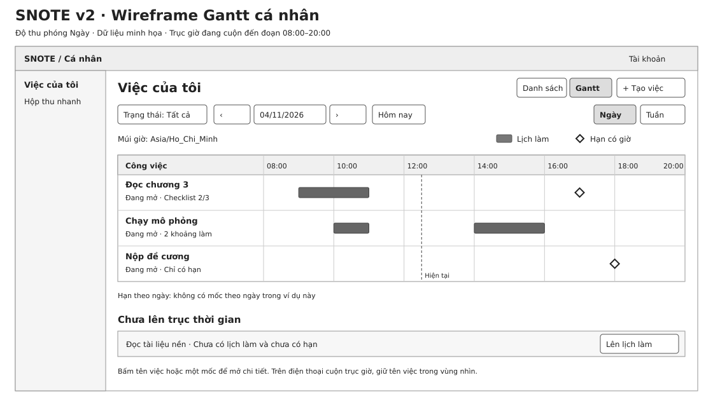

# SNOTE v2 — Chế độ xem công việc · Gantt

**Thiết kế đề xuất.** Sau Danh sách hiện có, **Gantt là chế độ xem bổ sung đầu tiên**. Các chế độ dùng cùng mã công việc, trạng thái, quyền và trang chi tiết. Chuyển chế độ giữ ngữ cảnh cá nhân hoặc workspace đang mở. Bộ lọc riêng của mỗi chế độ được giữ khi chuyển qua lại.

| Chế độ | Câu hỏi người dùng cần trả lời | Thứ tự đề xuất |
|---|---|---|
| Danh sách | Tôi cần làm việc gì, việc nào gần hạn hoặc quan trọng? | Giữ nguyên hành vi M1 hiện tại. |
| Gantt | Tôi dự định làm việc nào vào lúc nào, và hạn của nó nằm ở đâu? | Xây đầu tiên sau khi luồng việc và lịch làm M1 chạy được. |
| Kanban | Công việc đang ở trạng thái nào? | Ứng viên sau Gantt. Chốt các cột và quyền đổi trạng thái trước khi triển khai. |
| Lịch | Ngày hoặc tuần này có những cuộc họp, khoảng làm và hạn nào? | Ứng viên sau Gantt. Lịch nhóm đã có phạm vi riêng trong M2. |

## Gantt cá nhân · Màn hình Việc của tôi

- **Đầu trang:** cạnh **+ Tạo việc** là bộ chuyển **Danh sách / Gantt**. Chọn Gantt giữ nguyên công việc nguồn và mở trục thời gian trong cùng khu vực.
- **Thanh điều khiển:** trạng thái **Tất cả / Đang mở / Đã xong**, lùi/tiến một khoảng, ngày đang xem, **Hôm nay** và **Ngày / Tuần**. Mặc định mở tuần hiện tại, từ thứ Hai đến hết Chủ nhật theo múi giờ hồ sơ. Chuyển Ngày/Tuần giữ ngày đang xem. Ở chế độ Ngày có thể cuộn đủ 24 giờ. Nhãn múi giờ đặt cạnh trục.
- **Cột bên trái:** mỗi việc một hàng, hiện tên, trạng thái và checklist nếu có. **Cột bên phải:** thanh lịch làm, mốc hạn và đường thời điểm hiện tại khi nó nằm trong khung. Tên việc, thanh và mốc có thể mở cùng chi tiết việc gốc. Sửa lịch dùng form **Lịch làm của tôi**. Sửa hạn dùng form **Sửa thông tin**. Bản đầu xem theo trục và sửa qua form, thao tác kéo thanh để đổi ngày và quan hệ phụ thuộc cần đặc tả sau.
- **Bên dưới trục:** mục **Chưa lên trục thời gian** chứa việc phù hợp bộ lọc chưa có cả lịch làm lẫn hạn. Việc đang mở có **Lên lịch làm**. Việc có mốc nhưng nằm ngoài kỳ xem vẫn tìm thấy trong Danh sách và không được đưa vào mục này.
- **Điện thoại:** cuộn trục theo chiều ngang, giữ cột tên việc và nút đổi chế độ trong vùng dễ tiếp cận. Có thể đọc tên, từng khoảng và hạn bằng danh sách thông tin đi kèm khi không thuận tiện thao tác trên trục. Mỗi điểm tương tác có tên đọc được bằng bàn phím và trình đọc màn hình. Dạng nét và nhãn phân biệt loại mốc.

## Quy tắc đặt dữ liệu trên trục

| Dữ liệu | Biểu diễn |
|---|---|
| Khoảng làm có đầu và cuối | Một thanh từ bắt đầu đến kết thúc. Hai khoảng tạo hai thanh trên cùng hàng. Khi vượt mép kỳ xem, cắt phần vẽ và giữ giờ gốc trong chi tiết. Thanh hẹp vẫn có vùng tương tác dễ chọn. |
| Hạn có giờ | Hình thoi tại đúng thời điểm. Nếu trùng thanh, đặt ở làn mốc trong cùng hàng hoặc trên cạnh thanh và giữ nhãn riêng. |
| Hạn chỉ có ngày | Nhãn **Hạn ngày** ở cột của ngày đã nhập. Trong độ thu phóng Ngày, đặt nhãn tại đầu hàng và giữ nguyên ngày, không gán giờ. Quy tắc quá hạn vẫn theo D-07. |
| Chỉ có hạn | Một hàng có mốc hạn, không có thanh. |
| Chỉ có thời lượng dự kiến | Chưa đủ để vẽ thanh. Nếu cũng chưa có hạn thì đặt ở mục Chưa lên trục thời gian. |
| Trạng thái và checklist | Hiện độc lập với thanh. Ví dụ `2/3 mục` là số mục đã xong. Thanh chỉ diễn tả thời gian đã lên lịch. |
| Khoảng qua nửa đêm | Chia phần vẽ theo các cột ngày, dùng khoảng nửa mở `[startsAt, endsAt)`. Kết thúc lúc 00:00 không vẽ sang ngày mới. |

**Mẫu đọc hình:** Việc **Chạy mô phỏng** có hai khoảng làm, 10:00–11:00 và 14:00–16:00. Việc **Nộp đề cương** chỉ có hạn lúc 18:00 nên chỉ có hình thoi. Việc **Đọc tài liệu nền** chưa có cả hai nên nằm dưới trục.

## Dữ liệu và phạm vi tích hợp

- Dùng `Task.due`, `Task.status` và các khoảng `blocks` của người đang đăng nhập theo [hợp đồng API M1](m1-api-contract.md). Giữ ngày lịch đã nhập của hạn theo ngày. Tính vị trí hạn có giờ và khoảng làm theo múi giờ hồ sơ, với ranh giới ngày thực tế.
- Khi triển khai, D sở hữu truy vấn và bố cục Gantt cá nhân, C sở hữu việc gốc và form sửa hạn, A quản lý thay đổi hợp đồng. API Danh sách phân trang theo danh sách việc, nên **không thể suy ra toàn bộ kỳ Gantt chỉ bằng lọc trang đầu**. Cần chốt truy vấn đọc theo kỳ xem, gồm ngày bắt đầu/kết thúc loại trừ, lọc trạng thái, phân trang ổn định theo hàng và vùng việc chưa có mốc. Chỉ lấy phần dữ liệu người dùng còn quyền đọc. Nếu còn trang, giao diện báo rõ và cho tải tiếp.
- Một việc xuất hiện trên trục nếu có ít nhất một khoảng làm giao kỳ xem, hạn có giờ thuộc kỳ, hoặc hạn theo ngày thuộc các ngày đang xem. Gộp kết quả theo mã việc. Khi đổi kỳ xem, lấy dữ liệu kỳ mới. Khi lưu lịch hoặc hạn thành công, cập nhật lại danh sách và trục.
- Sau M1, **Gantt workspace** chỉ dùng lịch kế hoạch chung và hạn chung. Lịch làm riêng của thành viên không xuất hiện ở bảng nhóm. Hợp đồng hiện có chưa có khoảng làm chung cho mỗi việc. Trước M2 cần chốt trường bắt đầu/kết thúc chung, múi giờ workspace, quyền xem/sửa, cách hiển thị việc được giao và trường hợp chỉ có hạn. Bảng giáo viên chỉ dùng dữ liệu trong phạm vi bài giao được phép. Xem [phân quyền](../requirements/permissions.md).
- Quan hệ phụ thuộc, đường găng, tự dời việc và kéo thả chưa thuộc Gantt đầu tiên.

## Nghiệm thu thiết kế trước khi coding

1. Chuyển Danh sách → Gantt → Danh sách. Cùng việc mở ra cùng mã và trang chi tiết. Bộ lọc danh sách vẫn giữ giá trị.
2. Tạo hai khoảng làm cho một việc. Gantt vẽ hai thanh, một hàng. Đổi lịch làm chỉ dời thanh, mốc hạn gốc giữ nguyên.
3. Kiểm tra riêng hạn có giờ, hạn chỉ có ngày, việc không mốc, việc ngoài kỳ và việc đã xong. Chuyển Ngày/Tuần, kiểm tra qua nửa đêm và kiểm tra khi người dùng đổi múi giờ.
4. Với nhiều hơn một trang dữ liệu, kiểm tra không bỏ sót hàng trong kỳ và không lặp hàng khi tải thêm. Khi không có dữ liệu, hiện trạng thái trống và lối sang kỳ khác hoặc Danh sách.
5. Tài khoản khác không thấy việc, hạn hoặc lịch riêng của người tạo. Trong Gantt nhóm về sau, việc mất quyền bị loại khỏi kết quả, cả khi đổi bộ lọc hoặc mở liên kết cũ.
