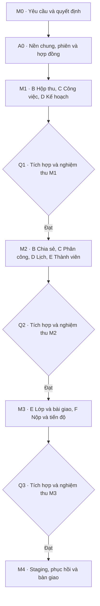

# SNOTE v2 — Phân công coding và thứ tự tích hợp

**Điểm dừng của kế hoạch: giao phạm vi và điều kiện bắt đầu cho từng agent.** Mỗi mã bên dưới là một gói có thể giao cho một agent coding. Các vai trò là vị trí công việc. Mã nguồn và nhánh tính năng được tạo khi bắt đầu triển khai gói tương ứng.

Đọc [quyết định M0](../requirements/decisions.md), [hợp đồng phối hợp](../architecture/implementation-contracts.md), [SRS](../requirements/srs.md) và [ma trận nghiệm thu](plan.md#3-ma-trận-nghiệm-thu) trước khi bắt đầu. [Hồ sơ sẵn sàng coding](coding-readiness.md) có phiếu A0/Q0, tiêu chí từng cổng và điều kiện mở nhánh.

## 1. Thứ tự thực hiện

1. **M0:** Tài liệu phân công, quyết định mặc định, SRS, quyền và ca nghiệm thu đã có để chuyển sang chuẩn bị nền.
2. **A0:** A dựng khung repo, cơ sở dữ liệu, phiên và workspace cá nhân, gói hợp đồng, lệnh CI và dữ liệu giả. Sau khi build, kiểm tra kiểu và migration trên DB trắng đạt, A công bố commit gốc, sơ đồ thư mục và hợp đồng thực tế. Đây là cổng mở các nhánh tính năng.
3. **M1:** B, C và D làm song song từ cùng commit A0. D dùng ví dụ hợp đồng đọc việc của C để phát triển. Q viết ca tích hợp và dữ liệu thử song song. Ghép hợp đồng và migration trước, rồi C và B theo thứ tự thuận tiện, D sau C. Chạy Q1 trước M2.
4. **M2:** A khóa hợp đồng membership và quyền, sau đó B, C, D và E có thể triển khai với dữ liệu giả. E cung cấp membership, C cung cấp phân công, B cung cấp chia sẻ, D tích hợp việc được giao và lịch. Ghép E → C → B → D. Chạy Q2 trước M3.
5. **M3:** A khóa hợp đồng phạm vi nhóm nhận bài. E và F làm song song, F dùng dữ liệu giả cho phần đọc phạm vi bài giao. Ghép E trước F. Q chạy cổng quyền, luồng nộp, phản hồi và thử lại.
6. **M4:** A phụ trách staging và vận hành, Q phụ trách bằng chứng. Người phụ trách sản phẩm xác nhận mốc phát hành theo [kế hoạch bàn giao](plan.md).

Nếu một cổng chưa đạt, sửa lỗi ở gói sở hữu rồi chạy lại cổng. Các agent có thể chuẩn bị ca kiểm thử và rà hợp đồng của mốc sau trong thời gian chờ.

## 2. Phạm vi và quyền sửa

Đường dẫn dưới đây là phạm vi dành cho từng gói sau khi A0 tạo nền. Chủ module có thể sửa thư mục chức năng của mình. Thay đổi tệp dùng chung, dữ liệu gốc hoặc thư mục agent khác được chuyển cho chủ sở hữu.

| Agent | Mốc và phạm vi | Tệp/thư mục sở hữu | Bàn giao và kiểm tra |
|---|---|---|---|
| **A · Nền và tích hợp** | A0: phiên, workspace cá nhân, scaffold, cơ chế quyền chung. M1–M4: khóa hợp đồng và ghép thay đổi, staging. | Cấu hình root, CI, lockfile, router gốc, `prisma/`, `apps/{web,api}/src/session/`, `apps/api/src/platform/`, tệp chỉ mục xuất `packages/contracts`. | FR-01, UC-21. Tài khoản mẫu, phiên và workspace cá nhân. Build, kiểm tra kiểu, migration DB trắng, kiểm tra quyền cơ bản. |
| **B · Hộp thu và tài nguyên** | M1: lưu URL/văn bản, phân loại, tìm. M2: chia sẻ, gắn tài nguyên vào việc theo quyền. | `apps/{web,api}/src/features/resources/`, `packages/contracts/src/resources/`. | FR-02, FR-03, FR-12. Chạy AT-01 và phần tài nguyên của AT-05. Tài nguyên riêng không lộ qua truy vấn hoặc URL. |
| **C · Công việc và checklist** | M1: việc cá nhân, checklist, cổng đọc việc cho D. M2: giao lại, quản lý hạn và cập nhật việc theo quyền. | `apps/{web,api}/src/features/tasks/`, `packages/contracts/src/tasks/`. | FR-04, FR-06, FR-10 phần việc, FR-11. Công việc gốc có một ID. Người cũ mất quyền cập nhật khi đổi phân công. Kiểm tra UC-09. |
| **D · Kế hoạch và lịch** | M1: thời lượng, lịch làm, Việc của tôi và gợi ý. M2: lịch nhóm và tổng hợp việc được giao. | `apps/{web,api}/src/features/planning/`, `packages/contracts/src/planning/`. | FR-05, FR-07, FR-08, FR-10 phần lịch. Chạy AT-02 và phần lịch của AT-03. Kiểm tra đổi hạn, trùng việc và ranh giới múi giờ. |
| **E · Workspace cộng tác và lớp** | M2: thành viên, lời mời và quyền điều phối. M3: tạo lớp, chia nhóm, bài giao, liên kết việc vào bài. | `apps/{web,api}/src/features/workspaces/`, `apps/{web,api}/src/features/classes/`, `packages/contracts/src/{workspaces,classes}/`. | FR-09, FR-13, FR-14. Cung cấp cổng đọc membership và nhóm nhận bài cho C, B, D và F. Kiểm tra giao chéo nhóm, tham gia lại và quyền sau đổi vai trò. |
| **F · Tiến độ, nộp và phản hồi** | M3: báo cáo tiến độ, bản nộp, thử lại, phản hồi và xem dữ liệu giáo viên. | `apps/{web,api}/src/features/submissions/`, `apps/{web,api}/src/features/progress/`, `packages/contracts/src/{submissions,progress}/`. | FR-15 đến FR-17. AT-04 đến AT-06. Tích hợp cổng đọc của E, C và quyền chia sẻ của B. Hai yêu cầu nộp đồng thời ghi đúng một bản. |
| **Q · Kiểm thử độc lập** | Chuẩn bị ca theo mốc, rà quyền và kiểm thử xuyên module. M4: đo NFR, kiểm tra nghiệm thu và phục hồi. | `tests/e2e/`, `tests/fixtures/`, báo cáo kiểm thử. Tệp CI do A sửa. | Báo cáo từng AT/NFR theo commit, dữ liệu, kết quả và bước tái hiện. Chuyển lỗi cho chủ module. |

`apps/{web,api}` là viết gọn cho hai thư mục riêng. Dịch vụ phiên và workspace cá nhân do A sở hữu. E mở rộng workspace cộng tác qua cổng nền, mọi sửa đổi trực tiếp vào nền do A thực hiện. Mỗi agent giữ kiểm thử đơn vị và tích hợp gần module mình sở hữu. Q quản lý ca xuyên module.

## 3. Cổng bàn giao giữa các agent

| Bên cung cấp | Bên dùng | Cần chốt trước khi tách nhánh |
|---|---|---|
| A → B, C, D, E, F, Q | Nền chung | Phiên, ID tài khoản, cách kiểm tra phạm vi, gói hợp đồng, dữ liệu giả, script kiểm tra và quy tắc migration. |
| C → B, D, E, F | Công việc | ID, workspace, hạn, phân công, trạng thái, checklist tóm tắt và phương thức đọc đúng phạm vi. B gắn tài nguyên qua điểm mở rộng được chốt. |
| E → B, C, D, F | Quyền và bài giao | Membership hiệu lực, điều phối, nhóm nhận bài, kiểm tra liên kết việc cùng workspace và phạm vi lớp. |
| B → E, F | Tài nguyên | Đọc quyền chia sẻ hiệu lực, cấp/thu hồi trong ngữ cảnh bài giao và chặn đường dẫn cũ. |
| F → Q và giao diện lớp của E | Bài nộp và tiến độ | Trạng thái theo nhóm nhận bài, bản nộp, mã lỗi, trường dữ liệu được chiếu và tham chiếu phản hồi. |

Nhóm cung cấp gửi chữ ký, ví dụ dữ liệu và hành vi lỗi. Nhóm sử dụng phát triển bằng dữ liệu giả cùng hợp đồng. Khi ghép, chạy kiểm tra trên dịch vụ thật. Nếu thấy cần đổi trường, endpoint hoặc quy tắc quyền, hai bên xác nhận tác động và A ghép thay đổi hợp đồng trước khi tiếp tục.

## 4. Quy tắc nhánh, PR và migration

- Mỗi gói có một nhánh riêng, ví dụ `v2/m1-inbox`, `v2/m1-tasks`, `v2/m1-planning`. Mỗi nhánh bắt đầu từ commit tích hợp của mốc do A công bố. Mỗi agent dùng thư mục làm việc riêng khi chạy cùng máy.
- PR ghi mã mốc, FR/UC/AT, phần sở hữu, thay đổi hợp đồng, nhu cầu migration, lệnh kiểm tra và lỗi còn mở. Chủ module tự kiểm tra phạm vi diff trước khi bàn giao.
- Tệp dùng chung có một chủ ghi tại một thời điểm. A ghép router, lockfile và migration theo thứ tự, chạy trên DB trắng và bản sao dữ liệu mốc trước. Agent không tạo migration cạnh tranh trên nhánh tính năng.
- Khi chuẩn bị ghép, cập nhật nhánh từ đầu tích hợp mới và chạy lại kiểm tra. Nếu hai PR cùng sửa một nghiệp vụ hoặc hợp đồng, A dừng ghép và giao một chủ xử lý quyết định đó trước.
- A kiểm tra build, kiểm tra kiểu, kiểm thử tự động và hành vi qua cổng trước khi công bố commit gốc mốc mới. Q ghi bằng chứng theo AT và NFR. Đầu mối sản phẩm duyệt hành vi và phát hành.

**Phân công đầu tiên:** giao **A0** cho agent nền và **Q0** cho agent kiểm thử để chuẩn bị dữ liệu và ca nghiệm thu. Sau khi A0 qua cổng, mở song song **B1**, **C1**, **D1** và bộ ca **Q1**. E và F có thể rà hợp đồng mốc sau trong thời gian này. Nhánh triển khai của họ mở theo các cổng M2 và M3.
