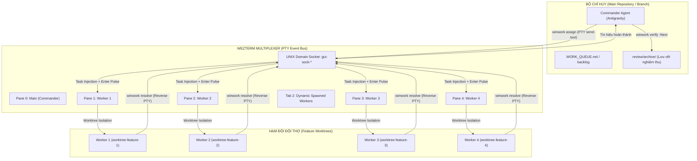
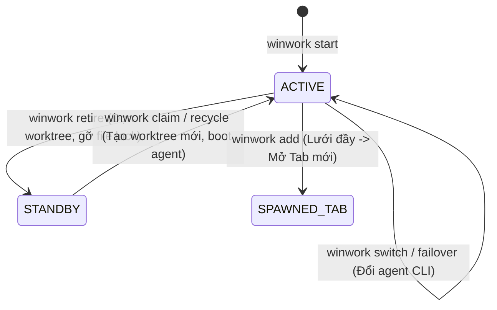

# Đặc tả kỹ thuật nền tảng WinWork (WinWork Technical Specification)

| Trường | Giá trị |
| --- | --- |
| Phiên bản | 2.1.0 |
| Trạng thái | Đặc tả kỹ thuật chính thức cho môi trường Windows 11 + WezTerm |
| Nền tảng hỗ trợ | Windows 11 (NT Kernel), PowerShell 7+, WezTerm Multiplexer, Git Worktrees |
| Tác nhân hỗ trợ | Google Antigravity (`agy`), OpenAI Codex CLI (`codex --yolo`), Generic PTY Shells |

---

## 1. Mục tiêu & Tổng quan kiến trúc

WinWork là nền tảng điều phối đa tác nhân AI (Multi-Agent Orchestration Harness) chạy cục bộ trên môi trường Windows. Hệ thống giải quyết bài toán cốt lõi: **Cho phép một "Bộ chỉ huy" (Commander) điều phối nhiều "Đội thợ" (Worker Agents) chạy song song trên các Git Worktree cô lập mà không xảy ra xung đột khóa file (file locking), không làm vỡ giao diện chia ô (multiplexer geometry) và duy trì chu trình làm việc bất đồng bộ liên tục (zero-idle async pipeline).**



---

## 2. Các phân hệ kỹ thuật cốt lõi

### 2.1. Phân hệ Giao tiếp Đa tác nhân qua PTY Event Bus
WinWork không sử dụng HTTP server hay Message Broker cồng kềnh. Hệ thống giao tiếp thông qua **WezTerm Unix Domain Socket** trên Windows (`~/.local/share/wezterm/gui-sock-<PID>`).

- **Giao thức bơm lệnh (Task Injection Protocol):**
  - Khi Bộ chỉ huy chạy `winwork assign <worker> "<prompt>" [-File <file>]`:
    1. Ghi tệp nhiệm vụ vào `review/inbox/<worker>/task-<id>.md` (Bảo đảm tính bền vững trên đĩa).
    2. Quét danh sách Pane trong WezTerm qua lệnh `wezterm cli list --format json`.
    3. Định vị chính xác Pane mục tiêu thông qua tiêu đề Pane hoặc đường dẫn CWD tương ứng.
    4. Bơm chuỗi lệnh qua `wezterm cli send-text --pane-id <id> --no-paste`.
    5. Phát chuỗi xung Enter 2 pha (2-pulse Enter) cách nhau 150-200ms để kích hoạt sự kiện submit trong TUI của Agent (agy/codex).
- **Giao thức báo cáo ngược (Reverse PTY Signaling):**
  - Khi Worker hoàn thành, chạy `winwork resolve <TASK_ID> -Sha <COMMIT_SHA> -Note "<ghi chú>"`:
    1. Cập nhật trạng thái nhiệm vụ trong thư mục inbox.
    2. Bắn tín hiệu văn bản về lại Pane của Bộ chỉ huy: `[RESOLVED] Worker <branch> da hoan thanh task <id> (commit <sha>)`.
    3. Bộ chỉ huy lập tức nhận được thông báo trong terminal mà không cần chạy vòng lặp kiểm tra (polling).

---

### 2.2. Cơ chế Giải phóng Khóa File Windows NTFS & Bảo toàn Hình học Lưới

Trên Windows NT Kernel, nếu một tiến trình PowerShell hoặc Agent đang mở CWD tại một thư mục, thư mục đó bị khóa hoàn toàn (`ERROR_SHARING_VIOLATION`). Mọi thao tác `git worktree remove` sẽ thất bại. Nếu người dùng đóng Pane để giải phóng, cấu trúc lưới WezTerm (2x2) sẽ bị co giật (reflow), làm vỡ toàn bộ các cửa sổ còn lại.

WinWork triển khai **Thuật toán Đỗ an toàn (Dual-Phase Parking)**:

```mermaid
sequenceDiagram
    participant User as Người dùng / Bộ chỉ huy
    participant WW as winwork retire
    participant PTY as WezTerm Pane
    participant OS as Windows Kernel & Git

    User->>WW: winwork retire feat/auth-service
    WW->>PTY: Gửi Ctrl+C (x2) + /exit (Hạ cánh mềm Agent)
    WW->>PTY: Gửi Set-Location $mainPath (Rút lui CWD)
    WW->>PTY: Gửi ANSI OSC 7 (\e]7;file:///main\e\) (Cập nhật CWD Multiplexer)
    Note over PTY,OS: File Handle trên thư mục Worktree được giải phóng 100%
    WW->>OS: git worktree remove + git worktree prune -v
    OS-->>WW: Xóa thư mục thành công trên ổ đĩa
    WW->>PTY: Đổi Window Title = [STANDBY (shell)]
    Note over PTY: Pane vẫn sống nguyên vị trí làm "Ghế Chờ", layout lưới giữ nguyên
```

---

### 2.3. Vòng đời Worktree & Cơ chế Tái chế Không Khởi động lại (Zero-Restart Recycle)

WinWork quản lý trạng thái của từng Pane trong WezTerm theo máy trạng thái (FSM):



1. **`winwork retire <branch>`:** Chuyển Pane từ `ACTIVE` $\rightarrow$ `STANDBY`. Xóa worktree cũ, bảo toàn lưới.
2. **`winwork claim <new_branch>`:** Chuyển Pane từ `STANDBY` $\rightarrow$ `ACTIVE`. Tạo worktree mới, sync rules, boot agent.
3. **`winwork recycle <old_branch> <new_branch>`:** Hoán đổi tức thì. Dọn dẹp nhánh cũ và triển khai nhánh mới ngay trong cùng một Pane.
4. **`winwork add <new_branch>`:** Kiểm tra thông minh:
   - Nếu có ô `[STANDBY]` $\rightarrow$ tự động Claim slot đó.
   - Nếu tất cả các ô đều đang bận $\rightarrow$ tự động gọi `wezterm cli spawn --cwd <newPath>` mở thêm Tab mới mà không làm hẹp lưới màn hình hiện có.

---

### 2.4. Chuỗi Luân chuyển Tác nhân (Failover Chain) & Cầu dao Đóng băng (Circuit Breaker)

Để bảo đảm hạm đội hoạt động xuyên đêm không bị tê liệt do giới hạn hạn ngạch (Rate Limit / Quota Exhaustion):

1. **Chuỗi Fallback:** Mặc định `agy` (Antigravity) $\rightarrow$ `codex --yolo` (Codex CLI tự hành toàn quyền, bỏ qua câu hỏi xác nhận `Proceed?`).
2. **Cơ chế Failover (`winwork failover` / `winwork switch`):**
   - Tự động hạ cánh agent cũ bằng `Ctrl+C` và `/exit`.
   - Cập nhật tiêu đề cửa sổ: `[$branch (codex)]`.
   - Khởi động agent mới kèm prompt tiếp quản: *"CHUYEN GIAO TIEN TRINH: Hay kiem tra git status, git log -1 va review/inbox/ de tiep tuc task dang do"*.
3. **Bộ quét Hạn ngạch (`winwork check-quota` / `winwork monitor`):**
   - Quét ngầm văn bản hiển thị trên các terminal tìm các dấu hiệu: `Quota exceeded`, `rate limit`, `429 Too Many Requests`.
   - Tự động kích hoạt failover cho Pane tương ứng.
4. **Cầu dao Đóng băng (`winwork freeze` / `winwork resume`):**
   - Khi toàn bộ tác nhân trong chuỗi luân chuyển đều cạn hạn ngạch:
     * Quét toàn bộ worktree, tự động tạo commit snapshot lưu vết: `git commit -m "wip(freeze): auto snapshot before quota freeze"`.
     * Ghi trạng thái hạm đội vào `review/freeze-state.json`.
     * Thông báo cho Bộ chỉ huy tạm dừng an toàn.
   - Khi hạn ngạch phục hồi, chạy `winwork resume`:
     * Đọc `freeze-state.json`.
     * Đánh thức các agent, tiếp tục công việc từ commit WIP và hàng đợi task.

---

### 2.5. Ma trận Phân quyền 3 Vùng (The 3-Zone Permission Matrix)

| Vùng quyền lực | Thao tác | Quyền hạn của Bộ chỉ huy |
| :--- | :--- | :--- |
| **VÙNG XANH (Green - 100% Tự quyết)** | Nghiệm thu task đạt test (`winwork verify`), giao việc từ backlog (`WORK_QUEUE.md`), yêu cầu sửa lint/test/build, tự động Nudge phím Enter, tự động failover quota. | **Tự động thực thi ngay**, không cần xin phép người dùng. |
| **VÙNG VÀNG (Yellow - Tự làm & Báo cáo)** | Đóng băng an toàn (`winwork freeze`), yêu cầu Worker mở Pull Request, chạy kiểm thử tích hợp E2E toàn hệ thống (`npm run test:e2e`). | **Tự động thực thi** và gửi thông báo tóm tắt cho người dùng. |
| **VÙNG ĐỎ (Red - Bắt buộc dừng hỏi)** | Sửa schema Prisma/OpenAPI cốt lõi phá vỡ hợp đồng liên nhóm, xóa vĩnh viễn worktree/branch có uncommitted data, ra quyết định môi trường máy chủ thực tế (ENV-01 đến ENV-06), merge PR vào production. | **BẮT BUỘC DỪNG LẠI**, xuất trình phương án và chờ người dùng phê duyệt rõ ràng. |

