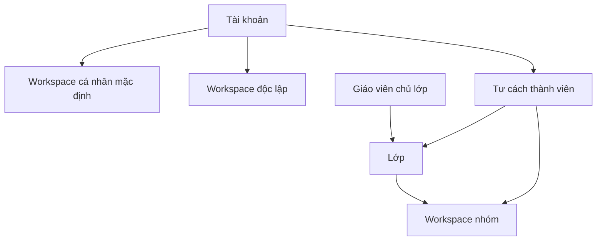

# SNOTE v2: sản phẩm, khái niệm và phạm vi

| Trường | Giá trị |
| --- | --- |
| Mục đích | Thống nhất đối tượng, bài toán và tên gọi giữa tài liệu nghiệp vụ, giao diện và thiết kế |
| Phạm vi | Khái niệm sản phẩm của `s_note_v2` |
| Kiểm định | DCA-checked theo quyết định về sản phẩm |
| Bằng chứng duyệt | [SRC-01 đến SRC-04, SRC-07 đến SRC-11, SRC-20, SRC-25, SRC-31](../../review/provenance.md) |

SNOTE hướng tới người học, người quản lý công việc cá nhân và giáo viên. Người dùng cần lưu nhanh thông tin để tìm lại, biết việc nào cần làm tiếp và giữ dự án riêng theo từng workspace. Khi cộng tác, nhóm cần thấy rõ người phụ trách, hạn, lịch và tiến độ. Giáo viên cần theo dõi bài giao và kết quả của nhiều nhóm trong lớp. [Nguồn sản phẩm](../../review/provenance.md)

**Quan hệ khái niệm:** lớp ở trên workspace nhóm một cấp; nhóm là một workspace trong lớp, không phải loại công cụ khác. Tài khoản còn có workspace cá nhân mặc định và có thể tạo workspace độc lập. Các cạnh trong hình là quan hệ chứa/quản lý khái niệm, không biểu diễn quyền hay số lượng thành viên. [SRC-01/02](../../review/provenance.md), [STR-01](../requirements/structural-rules.md).

| Khái niệm | Nghĩa trong SNOTE |
| --- | --- |
| Cách dùng tài khoản | Mọi tài khoản có phạm vi cá nhân; người dùng có thể bật Người học, Giáo viên hoặc cả hai cho nhu cầu lớp học. Quyền trên dữ liệu còn phụ thuộc vai trò tại lớp hoặc workspace cụ thể. |
| Workspace | Không gian làm việc có Công việc, Lịch và Thư viện. Một người có thể dùng nhiều workspace và mời người khác cộng tác. |
| Workspace cá nhân mặc định | Workspace được tạo khi đăng ký cho mọi tài khoản, không cho thêm thành viên, đổi chủ, lưu trữ hoặc chuyển thành nhóm. Hộp thu luôn có đích lưu tại đây trong bản đầu. Muốn cộng tác, người dùng tạo workspace khác. |
| Lớp | Cấp trên các workspace nhóm thuộc lớp. Giáo viên chủ lớp tổ chức người học, bài giao và các nhóm. |
| Member (thành viên lớp) | Vai trò ban đầu của người học khi tư cách tham gia lớp có hiệu lực. Giáo viên có thể chọn vai trò khác cho người đó trong bảng thành viên; quyền của vai trò được cấu hình ở Cài đặt lớp. |
| Nhóm trong lớp | Tên gọi của workspace thuộc lớp. Nhóm và workspace dùng chung khái niệm không gian làm việc. |
| Lớp trưởng | Vai trò trong lớp, có quyền mặc định và quyền do giáo viên cấu hình. |
| Trưởng nhóm | Người quản lý chính của workspace nhóm, trong phạm vi nhóm đó. |
| Thư viện | Nơi lưu văn bản hoặc ghi chú, đường dẫn và tệp, có thư mục để phân loại. |
| Hộp thu | Phần riêng tư của Thư viện trong workspace cá nhân mặc định, nhận mục lưu nhanh. |
| Việc của tôi | Phạm vi tổng hợp việc cá nhân và việc được giao từ các workspace người dùng còn quyền truy cập. |
| Lịch của tôi | Phạm vi tổng hợp lịch liên quan đến người dùng xuyên workspace. |

Quy tắc theo các khái niệm trên được ghi theo chủ đề ở [yêu cầu nghiệp vụ](../requirements/README.md). Phạm vi phát hành được trình bày ngay dưới đây.

## Phạm vi bản đầu

| Trường | Giá trị |
| --- | --- |
| Mục đích | Xác định các luồng chính mà thiết kế v2 phải phục vụ |
| Phạm vi | Bản phát hành đầu của SNOTE v2 |
| Kiểm định | DCA-checked ở mức chức năng và ranh giới sản phẩm |
| Bằng chứng duyệt | [SRC-07 đến SRC-10, SRC-25/26, J1–J11, Q02, Q16, Q18 đến Q20, I1–I13](../../review/provenance.md) |

| Phần | Phạm vi đã chốt | Tài liệu chi tiết |
| --- | --- | --- |
| Tài khoản và cá nhân | Chọn cách dùng khi đăng ký, có workspace cá nhân, Công việc, Lịch và Thư viện. Giáo viên tạo lớp khi có nhu cầu. | [Tài khoản và workspace](../requirements/accounts-and-workspaces.md) |
| Cộng tác workspace | Tách không gian theo công việc, thêm thành viên, giao việc và theo dõi nội dung chung theo quyền. | [Công việc](../requirements/tasks.md) và [quyền](../requirements/access-control.md) |
| Vòng đời workspace | Chuyển chủ/rời/lưu trữ workspace độc lập; nhóm ở trong lớp. Bản đầu không có nút xóa vĩnh viễn workspace độc lập. | [Workspace](../requirements/accounts-and-workspaces.md) và [nhóm](../requirements/class-membership.md) |
| Thư viện và tệp | Văn bản có danh sách tự động, URL xem trước, bản sao độc lập, ghi đè có lịch sử hoặc tạo bản sao, Thùng rác 30 ngày. Loại tệp và hạn mức thử nghiệm theo LIB-11; cách tính, lịch sử và nguồn xem trước theo LIB-16–18. | [Thư viện](../requirements/library.md) |
| Lớp và bài giao | Tạo lớp, tham gia, lập nhóm và giao bài cơ bản. Theo dõi tiến độ và phản hồi theo phiên bản nộp bằng nhận xét. | [Lớp và nhóm](../requirements/class-membership.md) và [bài giao](../requirements/assignments-and-submissions.md) |
| Lịch | Có sự kiện có giờ và cả ngày; hủy sự kiện chung giữ dấu vết theo quyền. Bản đầu không có sự kiện lặp. | [Lịch](../requirements/calendar.md) |
| Cách xem công việc | Gantt mặc định và Danh sách cùng cấp. Sửa việc qua màn chi tiết trong bản đầu. | [Chế độ xem việc](../ux/workspace-and-tasks.md) |
| Nền tảng | Web trên máy tính và điện thoại. Lưu nhanh từ giao diện web. | [Điều hướng](../ux/workspace-and-tasks.md) |

**Ranh giới đã duyệt.** Bản đầu dùng nhận xét theo phiên bản. Điểm số và thang điểm ở ngoài phạm vi bản đầu. Không có nút Thu hồi bản nộp; sửa bằng phiên bản mới theo ASG-18. Sự kiện lặp ở ngoài phạm vi bản đầu theo CAL-10. Giáo viên chủ lớp ủy quyền từng chức năng, vai trò đồng giáo viên riêng ở ngoài phạm vi bản đầu. Tích hợp nhận chia sẻ trực tiếp từ ứng dụng khác được tách thành phần đặc tả sau. [Q02, Q16, Q19, Q20](../../review/provenance.md)

Độ chi tiết màn và chuyển động theo [đặc tả UX](../ux/ui-and-motion.md); giải pháp dữ liệu, giao tiếp và vận hành theo [chỉ mục docs](../README.md). Giá trị máy chủ/chi phí/diễn tập phục hồi cần điền từ [môi trường thật](../../review/unresolved.md).
