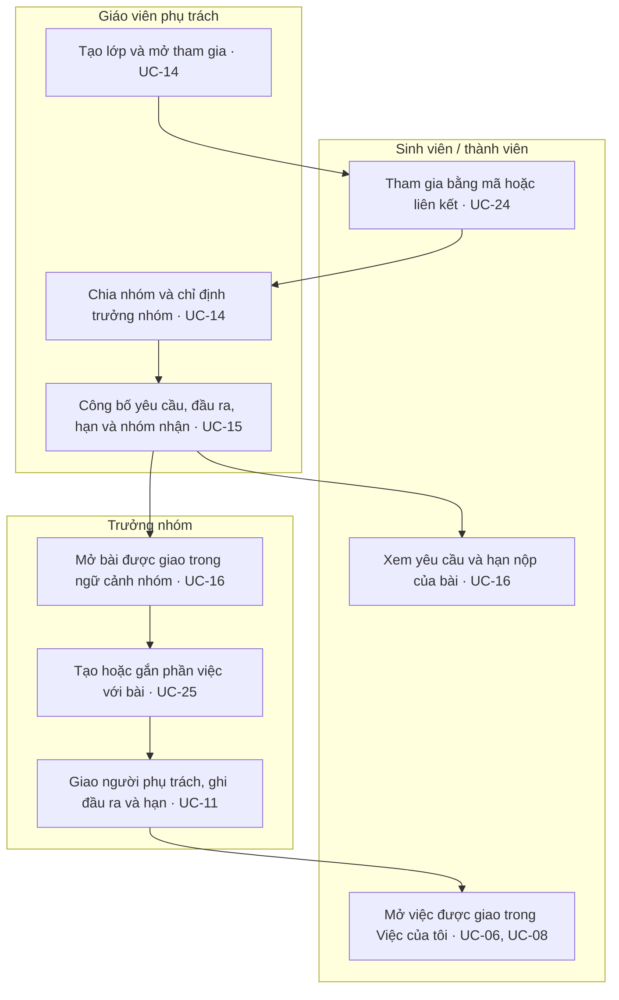
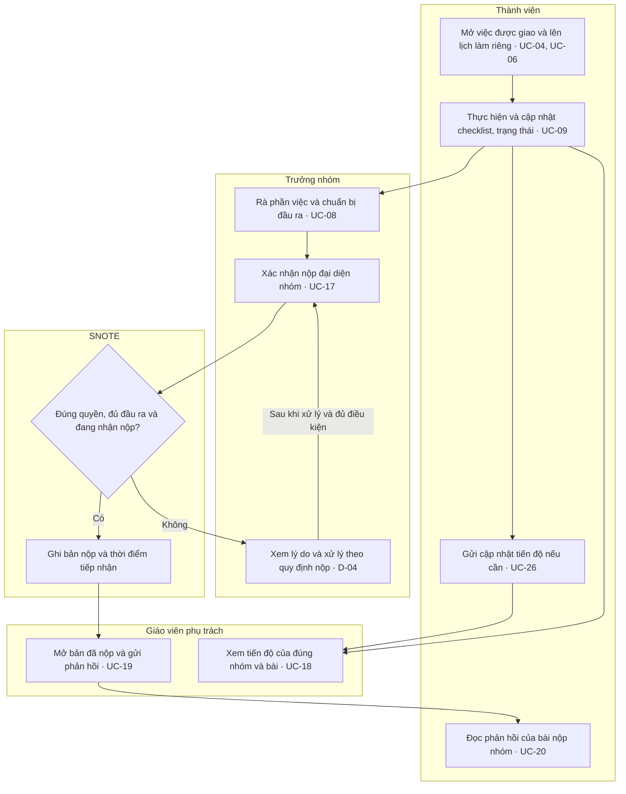
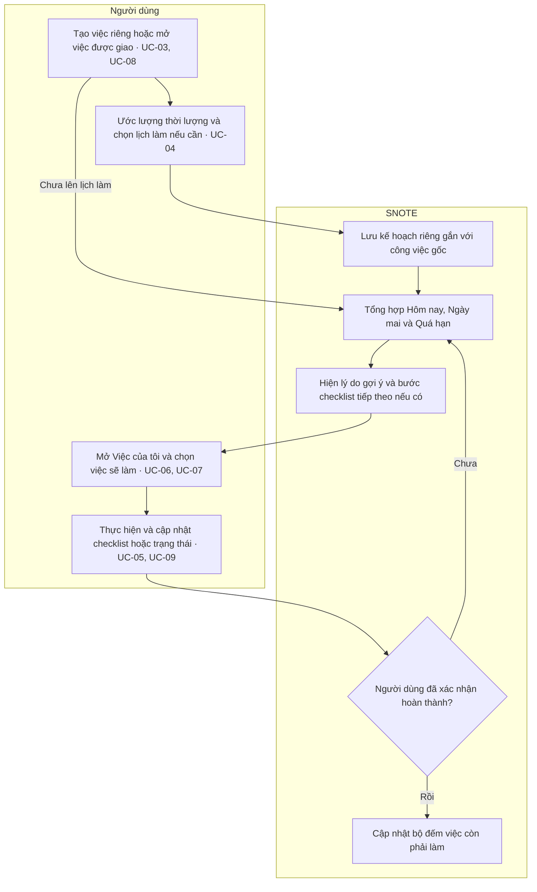
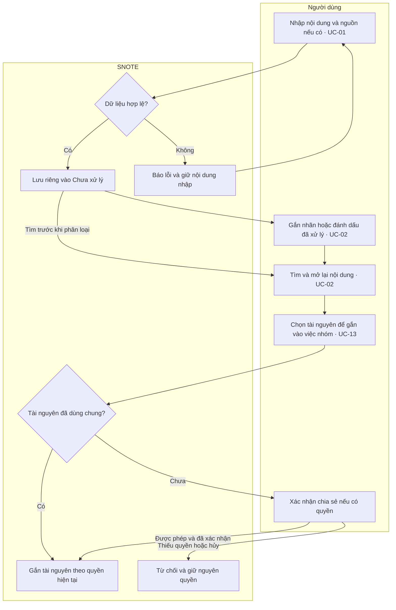

# SNOTE v2 — Sơ đồ 2 · Luồng nghiệp vụ theo vai trò

**Trạng thái: đề xuất để duyệt.** Tài liệu mô tả hành vi mong muốn và nối các bước với [Sơ đồ 1 — Use Case](use-cases.md). Mỗi làn là một vai trò. Mũi tên qua làn thể hiện một lần bàn giao hoặc một kết quả có thể quan sát. Một người có thể giữ nhiều vai trò tùy workspace và lớp.

## 1. Lớp học — Từ giao bài đến phản hồi

### 1.1 Chuẩn bị lớp, giao bài và phân công

### 1.2 Thực hiện, gửi tiến độ và nộp bài

Các nhánh cần kiểm tra cùng luồng chính:

| Điểm bàn giao | Điều kiện và kết quả cần quan sát |
|---|---|
| Sinh viên → lớp | Mã sai, hết hiệu lực hoặc lớp đóng thì chưa tạo tư cách thành viên. Vào lớp thành công chỉ cấp phạm vi lớp. Quyền vào nhóm được cấp khi sinh viên được xếp nhóm. |
| Giáo viên → nhóm | Chỉ nhóm nhận bài mở được yêu cầu. Việc thuộc nhóm khác hoặc thuộc bài không giao cho nhóm bị từ chối khi gắn. |
| Trưởng nhóm → người phụ trách | Khi giao lại, người mới thấy việc trong Việc của tôi. Người cũ mất quyền cập nhật theo phân công, dù vẫn có thể xem việc chung nếu còn là thành viên. |
| Nhóm → giáo viên | Tiến độ gồm dữ liệu việc gắn với đúng bài và cập nhật do nhóm gửi. Nháp và checklist chi tiết chỉ mở được khi có chia sẻ theo UC-27. |
| Trưởng nhóm → bản nộp | Việc cập nhật tiến độ vẫn để bài ở trạng thái chưa nộp. Yêu cầu nộp bị từ chối không tạo bản nộp. Gửi lại cùng yêu cầu sau lỗi mạng chỉ ghi nhận một lần. Nộp muộn và nộp lại theo D-04. |
| Giáo viên → nhóm | Phản hồi gắn đúng bản nộp. Thành viên nhóm nhận bài mở được phản hồi của nhóm mình. Nhóm khác bị từ chối qua cả danh sách và liên kết trực tiếp. |

## 2. Cá nhân — Tạo việc, lên lịch và chọn bước tiếp theo

- Hôm nay và Ngày mai lấy theo múi giờ người dùng. Một việc vừa đến hạn vừa có lịch làm trong cùng một ngày chỉ tính một lần trong mục ngày đó. Việc chưa có lịch và hạn vẫn mở được từ danh sách chung.
- Nếu giờ kết thúc không sau giờ bắt đầu, giữ dữ liệu nhập và yêu cầu sửa. Đổi lịch làm riêng không đổi hạn của công việc gốc. Nếu quyền cập nhật việc nhóm bị thu hồi trong lúc đang mở, từ chối thao tác và đọc lại trạng thái.
- Đề xuất trong Sơ đồ 1 tách việc cần xử lý hôm nay hoặc quá hạn khỏi nhóm việc quan trọng. Xong hết checklist có thể gợi ý xác nhận hoàn thành. Thứ tự gợi ý và cách tính hoàn thành còn chờ D-03 và D-05.

## 3. Hộp thu nhanh — Lưu, phân loại, tìm lại và dùng

- Người dùng có thể lưu trước, phân loại sau và tìm lại cả mục đã xử lý. Tìm kiếm chỉ trả về nội dung được phép đọc. Nếu không có kết quả, hiển thị trạng thái trống.
- Khi gắn tài nguyên, kiểm tra quyền sửa việc và quyền dùng hoặc chia sẻ tài nguyên. Việc chung chỉ mở tài nguyên trong phạm vi đã chia sẻ. Sau thu hồi, truy cập qua liên kết cũ cũng bị từ chối.
- Cách nhận nội dung trực tiếp từ nền tảng khác và giới hạn tệp chờ quyết định D-02. Sơ đồ áp dụng được cho thao tác nhập trực tiếp trên web.

## 4. Kiểm tra xuyên luồng

| Kịch bản | Kết quả cần quan sát | Tham chiếu Sơ đồ 1 |
|---|---|---|
| Giáo viên giao cùng một bài cho hai nhóm. Nhóm A gửi tiến độ rồi nộp và nhận phản hồi. | Gửi tiến độ chưa đổi trạng thái nộp. Nhóm B chưa nộp và không đọc được bài nộp của nhóm A. | AT-04 |
| Thành viên đặt lịch làm riêng rồi trưởng nhóm đổi hạn. | Lịch nhóm hiển thị hạn mới. Lịch cá nhân giữ khoảng làm cũ. Công việc chỉ xuất hiện một lần trong mỗi danh sách ngày. | AT-02, AT-03 |
| Giáo viên mở nháp riêng, sau đó thử lại khi nhóm chia sẻ rồi thu hồi. | Lần đầu bị từ chối, lần hai mở được và lần cuối bị từ chối kể cả qua URL cũ. | AT-05 |
| Trưởng nhóm gửi lại cùng thao tác nộp sau mất kết nối. | Bản nộp chỉ được ghi nhận một lần. Nếu phiên đã hết, SNOTE yêu cầu xác thực lại. Nếu quyền nộp đã bị thu hồi, thao tác bị từ chối. | AT-06 |
| Người dùng lưu một URL trên web, tải lại rồi tìm và chia sẻ vào nhóm. | Mục tìm lại được trước khi phân loại. Thành viên được cấp quyền mở từ việc chung, tài khoản ngoài nhóm bị từ chối. | AT-01 |
