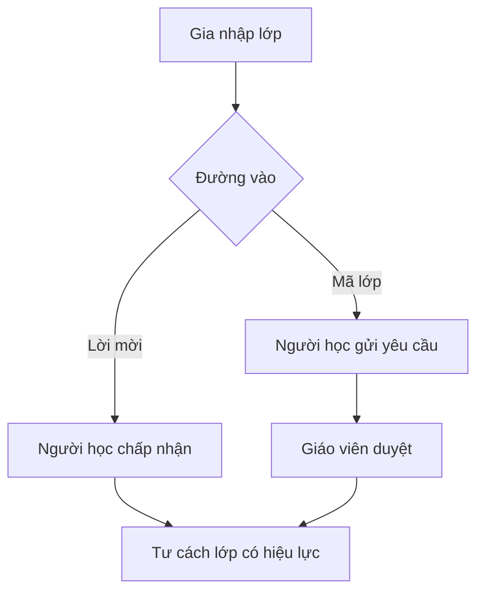
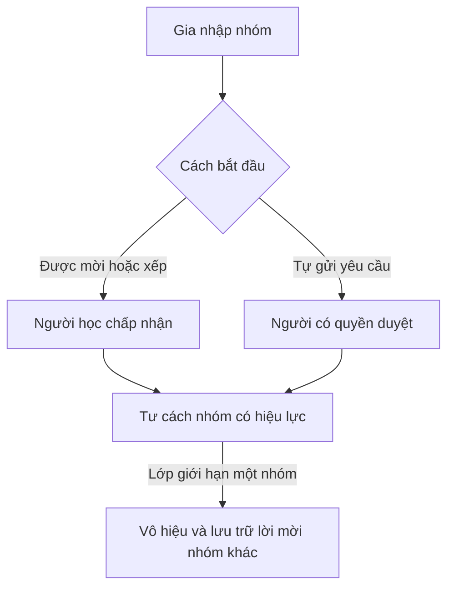

# Tư cách trong lớp và nhóm

| Trường | Giá trị |
| --- | --- |
| Mục đích | Mô tả đường vào lớp, đường vào nhóm và điều kiện rời hoặc bàn giao |
| Phạm vi | Lớp và các workspace nhóm thuộc lớp |
| Kiểm định | DCA-checked theo quyết định về tư cách và giới hạn nhóm |
| Bằng chứng duyệt | [SRC-01, SRC-02, SRC-07 đến SRC-10, Q02 đến Q04](../../review/provenance.md) |

## Tạo và vào lớp

| Mã | Hành vi | Nguồn |
| --- | --- | --- |
| CLS-01 | Tài khoản chọn Giáo viên có thể tạo lớp. Lớp mới mặc định không công khai. Lớp là cấp trên các workspace nhóm thuộc lớp. | SRC-01, SRC-07, SRC-08 |
| CLS-02 | Với lời mời do giáo viên gửi, chấp nhận của người học là bước cuối để tư cách thành viên lớp có hiệu lực. | SRC-08 |
| CLS-03 | Với mã lớp, người học gửi yêu cầu. Giáo viên duyệt thì tư cách thành viên lớp có hiệu lực. | SRC-07, SRC-08 |

Luồng gia nhập lớp thể hiện hai đường thành công trong CLS-02 và CLS-03.

## Lập và vào nhóm

| Mã | Hành vi | Nguồn |
| --- | --- | --- |
| CLS-04 | Giáo viên mặc định lập nhóm. Giáo viên có thể cấp quyền lập nhóm cho lớp trưởng hoặc người học cụ thể. Người được ủy quyền lập nhóm mặc định là trưởng nhóm chính kiêm admin workspace vừa tạo. Giáo viên có thể đổi người giữ vai trò này. | SRC-02, SRC-08, SRC-09 |
| CLS-05 | Khi được mời hoặc xếp vào nhóm, chấp nhận của người học là bước cuối để tư cách nhóm có hiệu lực. Khi tự gửi yêu cầu, quyết định duyệt của người có quyền là bước cuối. | SRC-01, SRC-02, SRC-08 |
| CLS-06 | Mặc định mỗi người học có tối đa một nhóm đang hoạt động trong cùng lớp. Giáo viên có thể chỉnh giới hạn của lớp. | SRC-02, SRC-07 |
| CLS-07 | Có thể có nhiều lời mời đang chờ. Khi lớp giới hạn một nhóm và người học đã vào một nhóm, các lời mời đang chờ đến nhóm khác trong cùng lớp hết hiệu lực, rời danh sách chờ và được lưu trữ làm lịch sử. | SRC-10, Q04 |

Luồng nhóm áp dụng khi gia nhập thành công theo giới hạn đang dùng. Người duyệt mặc định và cách chỉnh quyền nằm tại [PER-04](permissions.md).

## Rời hoặc bàn giao

| Mã | Hành vi | Nguồn |
| --- | --- | --- |
| CLS-08 | Thành viên có thể tự rời nhóm. Trưởng nhóm hoặc người đang phụ trách việc hoàn tất bàn giao trước khi rời. Công việc và lịch sử vẫn thuộc workspace. | SRC-02 |
| CLS-09 | Người học có thể tự rời lớp sau khi rời các nhóm thuộc lớp và bàn giao vai trò hoặc việc đang phụ trách. Lịch sử công việc và bản nộp vẫn được giữ. | SRC-09 |
| CLS-10 | Giáo viên có thể lưu trữ lớp. Chủ lớp muốn rời lớp đang hoạt động thì bàn giao quyền chủ lớp cho một tài khoản Giáo viên khác và người nhận chấp nhận. | Q03 |

Xem [R-02, R-10 và R-13](../../review/unresolved.md) về quyền sau rời lớp, giới hạn khi cấu hình đổi, thủ tục bàn giao và trạng thái lưu trữ.
