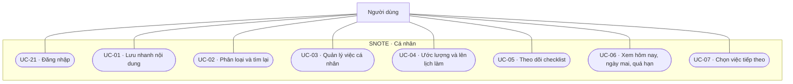
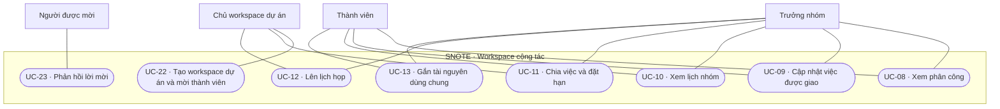
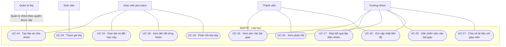

# SNOTE v2 — Sơ đồ 1 · Use Case

**Trạng thái: bản đề xuất để duyệt.** Tài liệu mô tả hành vi mong muốn, vai trò, ngoại lệ và tiêu chí nghiệm thu để làm đầu vào cho SRS. Xem [kiến trúc đích v2](../architecture/system.md) để đối chiếu với thiết kế đề xuất. Các mã UC-01 đến UC-20 giữ nguyên từ bản phác thảo. UC-21 đến UC-27 bổ sung các thao tác cần để hoàn thành luồng.

## 1. Phạm vi và tác nhân

Một tài khoản có thể dùng workspace cá nhân, là trưởng nhóm A và là thành viên nhóm B. Quyền được xét theo tài nguyên và phạm vi cụ thể. Trong sơ đồ, đường nối biểu thị vai trò có thể thực hiện ca sử dụng theo các điều kiện bên dưới.

| Tác nhân | Phạm vi và mục tiêu |
|---|---|
| Người dùng | Đăng nhập, quản lý dữ liệu cá nhân, lưu nội dung để tìm lại và lên kế hoạch cho việc của mình. |
| Chủ workspace dự án | Tạo workspace dự án độc lập, quản lý lời mời và phân quyền theo workspace. |
| Thành viên | Làm việc trong nhóm hoặc dự án mình đã tham gia. Với lớp học, chỉ truy cập bài giao và dữ liệu nhóm trong phạm vi được cấp. |
| Trưởng nhóm | Có quyền làm việc của thành viên, thêm quyền điều phối việc và lịch nhóm, liên kết việc với bài giao và đại diện nộp kết quả. |
| Giáo viên phụ trách | Quản lý lớp và nhóm, giao bài, xem tiến độ và phản hồi bài nộp trong lớp phụ trách. |
| Quản trị lớp | Vai trò được cấp trong từng lớp để hỗ trợ quản lý thành viên và nhóm. Phạm vi chi tiết cần duyệt ở D-01. |

### 1.1 Cá nhân và việc của tôi

### 1.2 Workspace nhóm và dự án

### 1.3 Lớp học, tiến độ và bài nộp

## 2. Đặc tả ca sử dụng

Các ca sau UC-21 yêu cầu phiên hợp lệ và quyền trên bản ghi tại thời điểm thao tác. Nếu ghi thất bại, hệ thống báo lỗi và giữ phần nhập có thể khôi phục. Khi quyền đã thay đổi hoặc dữ liệu đã được cập nhật bởi người khác, hệ thống kiểm tra lại trạng thái trước khi áp dụng thao tác.

### 2.1 Cá nhân

| Mã · Mục tiêu | Tiền điều kiện và kích hoạt | Luồng chính và hậu điều kiện | Ngoại lệ và nghiệm thu |
|---|---|---|---|
| **UC-01 · Lưu nhanh** | Người dùng gặp liên kết, văn bản, kiến thức hoặc tệp muốn giữ. | Nhập hoặc chuyển nội dung vào Hộp thu nhanh. Lưu nguồn nếu có. Mục xuất hiện ở Chưa xử lý trong phạm vi cá nhân và mở lại được. | Dữ liệu trống, liên kết sai định dạng hoặc tệp vượt giới hạn được báo tại đầu vào. Nghiệm thu bằng lưu một liên kết, tải lại và mở lại nguồn. Phạm vi gửi từ ứng dụng khác thuộc D-02. |
| **UC-02 · Phân loại và tìm lại** | Người dùng có mục đã lưu hoặc có từ khóa cần tìm. | Đổi tiêu đề, gắn nhãn hoặc tổ chức vào workspace được phép. Tìm theo tiêu đề, nhãn hoặc văn bản mà hệ thống hỗ trợ tìm. Người dùng có thể đánh dấu đã xử lý mà vẫn tìm lại được. | Kết quả trống có thông báo. Di chuyển hoặc chia sẻ sang vùng cộng tác cần quyền và hành động xác nhận. Nghiệm thu bằng tìm lại mục theo nhãn và thử tìm từ tài khoản khác. |
| **UC-03 · Quản lý việc cá nhân** | Người dùng mở Việc của tôi hoặc workspace cá nhân. | Tạo việc với tiêu đề, có thể thêm mô tả, mức quan trọng, hạn và tài nguyên liên quan. Lưu, sửa hoặc đánh dấu hoàn thành. | Từ chối tiêu đề trống và hạn sai định dạng. Có thể lưu việc chưa có hạn. Nghiệm thu bằng tạo, tải lại, sửa mức quan trọng và hoàn thành việc. |
| **UC-04 · Ước lượng và lên lịch làm** | Người dùng có việc cá nhân hoặc việc đang được giao. | Nhập thời lượng dự kiến và chọn khoảng thời gian sẽ làm. Khoảng làm xuất hiện trên lịch riêng. Thay đổi lịch làm giữ nguyên hạn gốc của việc. | Khoảng giờ kết thúc trước hoặc bằng giờ bắt đầu bị từ chối. Nghiệm thu bằng dời lịch làm một việc nhóm và kiểm tra hạn trên bảng nhóm vẫn giữ nguyên. |
| **UC-05 · Theo dõi checklist** | Người dùng mở việc có quyền xem. Chủ việc cá nhân được quản lý checklist của việc đó. | Xem số mục hoàn tất trên tổng số, cùng mục chưa xong đầu tiên theo thứ tự. Khi đánh dấu một mục, cập nhật số đếm. Việc nhóm cập nhật theo UC-09. | Checklist trống hiển thị chưa có mục. Đánh dấu lại cùng trạng thái giữ nguyên kết quả. Nghiệm thu bằng kiểm tra 2/5 sau tải lại và thử bỏ đánh dấu một mục. |
| **UC-06 · Xem hôm nay, ngày mai và quá hạn** | Người dùng mở Việc của tôi. | Tổng hợp việc cá nhân và việc được giao còn quyền truy cập. Xếp theo ngày của hạn hoặc lịch làm riêng, hiển thị nhãn nguồn và lý do xuất hiện. Việc trùng chỉ tính một lần trong mỗi mục ngày. | Việc chưa có hạn hoặc lịch vẫn tìm được ở danh sách chung. Việc đã hoàn tất được tách khỏi số việc còn phải làm. Nghiệm thu bằng một việc vừa đến hạn vừa được lên lịch hôm nay và kiểm tra bộ đếm chỉ tăng một. |
| **UC-07 · Chọn việc tiếp theo** | Có ít nhất một việc còn mở. | Hiện nhóm việc cần xử lý hôm nay hoặc đã quá hạn và nhóm việc quan trọng. Hiện lý do, thời lượng dự kiến nếu có và mục checklist tiếp theo nếu có. Người dùng chọn việc muốn mở. | Không có việc thì hiển thị trạng thái trống. Nghiệm thu bằng một việc ít quan trọng đến hạn hôm nay và một việc quan trọng còn ba ngày. Cả hai tìm được ở nhóm tương ứng. Quy tắc xếp thứ tự thuộc D-03. |
| **UC-21 · Đăng nhập** | Người dùng có tài khoản. | Xác thực, bắt đầu phiên và truy cập chức năng theo quyền. | Đăng nhập sai hoặc phiên hết hạn yêu cầu xác thực lại. Nghiệm thu bằng kiểm tra phiên hết hạn không đọc được dữ liệu riêng. |

### 2.2 Cộng tác

| Mã · Mục tiêu | Tiền điều kiện và kích hoạt | Luồng chính và hậu điều kiện | Ngoại lệ và nghiệm thu |
|---|---|---|---|
| **UC-08 · Xem phân công** | Là thành viên hợp lệ của workspace. | Xem việc chung, người phụ trách, đầu ra, hạn và trạng thái. Mở chi tiết từ bảng nhóm hoặc từ Việc của tôi nếu được giao. | Người ngoài nhóm bị chặn kể cả qua liên kết trực tiếp. Nghiệm thu bằng hai thành viên cùng thấy thay đổi hạn của một việc. |
| **UC-09 · Cập nhật việc được giao** | Việc còn mở và người dùng đang là người được giao. | Đánh dấu mục checklist hoặc đổi trạng thái trong phạm vi được phép. Bảng nhóm và Việc của tôi hiển thị dữ liệu từ cùng công việc. | Nếu đã bị thu hồi quyền, đổi người phụ trách hoặc việc bị khóa, từ chối thao tác và tải lại trạng thái. Nghiệm thu bằng người được giao cập nhật thành công, thành viên khác thử sửa bị từ chối. |
| **UC-10 · Xem lịch nhóm** | Là thành viên hợp lệ của workspace. | Mở lịch nhóm, xem cuộc họp và các hạn việc mà mình được phép xem. Mở được việc gốc từ hạn hiển thị. | Nhóm chưa có sự kiện hiện trạng thái trống. Nghiệm thu bằng đổi hạn công việc và kiểm tra lịch hiển thị ngày mới. Lịch làm riêng chỉ hiển thị cho chủ lịch. |
| **UC-11 · Chia việc** | Người điều phối có quyền quản lý việc trong workspace. | Tạo phần việc, ghi phạm vi và đầu ra, chọn người phụ trách, hạn và checklist nếu có. Có thể giao lại. Người được giao thấy việc trong Việc của tôi. | Từ chối người nhận ngoài workspace. Khi giao lại, người cũ mất quyền cập nhật theo vai trò người được giao, người mới có quyền sau khi lưu thành công. |
| **UC-12 · Lên lịch họp** | Người điều phối có quyền quản lý lịch chung. | Tạo, đổi hoặc hủy sự kiện có tiêu đề, giờ bắt đầu và kết thúc, địa điểm hoặc liên kết nếu có. Lịch nhóm thể hiện trạng thái mới. | Thời gian sai bị từ chối. Nghiệm thu bằng đổi giờ họp và mở lịch từ tài khoản thành viên khác. |
| **UC-13 · Gắn tài nguyên dùng chung** | Có quyền sửa liên kết của việc, đồng thời có quyền sử dụng hoặc chia sẻ tài nguyên. | Chọn tài nguyên đã dùng chung hoặc chia sẻ tài nguyên cá nhân trước khi gắn. Thành viên được phép có thể mở tài nguyên từ việc. | Liên kết đến tài nguyên riêng không tự cấp quyền. Nghiệm thu bằng kiểm tra thành viên thấy tài nguyên đã chia sẻ và không mở được tài nguyên riêng qua URL. |
| **UC-22 · Tạo workspace dự án và mời thành viên** | Người dùng đã đăng nhập, có quyền tạo workspace. | Tạo workspace dự án độc lập. Chủ workspace mời người dùng, đặt quyền dự kiến và xem trạng thái lời mời. | Lời mời đang chờ không cấp quyền đọc. Nghiệm thu bằng hai tài khoản, một người tạo dự án và một người chỉ có quyền sau khi chấp nhận. |
| **UC-23 · Phản hồi lời mời** | Người dùng nhận lời mời dành cho mình. | Chấp nhận để tham gia hoặc từ chối. Khi chấp nhận, workspace xuất hiện với đúng quyền được cấp. | Lời mời đã hủy hoặc sai người nhận không dùng được. Gửi lại cùng thao tác chấp nhận chỉ tạo một membership hiệu lực. |

### 2.3 Lớp học

| Mã · Mục tiêu | Tiền điều kiện và kích hoạt | Luồng chính và hậu điều kiện | Ngoại lệ và nghiệm thu |
|---|---|---|---|
| **UC-14 · Tạo lớp và chia nhóm** | Giáo viên có quyền tạo lớp. Quản trị lớp chỉ thao tác quản lý nhóm được cấp. | Tạo lớp, mở phương thức tham gia, chia thành viên thành nhóm và chỉ định trưởng nhóm. Mỗi nhóm có khu vực làm việc tương ứng. | Không thêm người ngoài lớp vào nhóm. Nghiệm thu bằng kiểm tra hai nhóm có không gian riêng và thay trưởng nhóm cập nhật quyền tương ứng. |
| **UC-15 · Giao bài và đặt hạn** | Giáo viên phụ trách lớp và có nhóm nhận bài hợp lệ. | Nhập yêu cầu, đầu ra và hạn nộp. Chọn nhóm nhận, công bố bài. Mỗi nhóm được giao thấy cùng yêu cầu và hạn của bài. | Thiếu yêu cầu hoặc nhóm nhận không hợp lệ thì từ chối công bố. Nghiệm thu bằng giao cho một nhóm và kiểm tra nhóm còn lại không thấy bài. |
| **UC-16 · Xem yêu cầu bài giao** | Người dùng thuộc nhóm được giao. | Mở bài từ lớp hoặc khu vực nhóm, xem yêu cầu, tài liệu đính kèm được phép, hạn và trạng thái bài nộp của nhóm mình. | Nhóm khác bị chặn qua danh sách và liên kết trực tiếp. |
| **UC-17 · Nộp kết quả nhóm** | Người dùng là trưởng nhóm hiện tại, bài được giao cho nhóm và nhận nộp theo quy tắc đã duyệt. | Chọn tệp, liên kết hoặc nội dung kết quả theo yêu cầu. Xác nhận nộp. Snote ghi nhận thời điểm và người nộp, nhóm và giáo viên xem được bản đã gửi. | Thiếu đầu ra, hết quyền hoặc bài đã khóa thì báo lý do. Gửi lại cùng yêu cầu sau lỗi mạng không sinh bản nộp trùng. Quy định nộp muộn và nộp lại thuộc D-04. |
| **UC-18 · Xem tiến độ nhóm** | Giáo viên phụ trách mở bài mình có quyền xem. | Xem từng nhóm nhận bài, trạng thái nộp, phần việc gắn bài cùng người phụ trách, hạn, trạng thái và cập nhật tiến độ đã gửi. | Nhóm chưa có phần việc hiển thị chưa có dữ liệu. Nghiệm thu bằng hai bài trong cùng lớp và kiểm tra dữ liệu bài kia không bị đưa vào báo cáo. |
| **UC-19 · Xem và phản hồi bài nộp** | Giáo viên có quyền xem bản đã nộp. | Mở bản nộp, nhập nhận xét và gửi cho nhóm. Phản hồi được gắn đúng bản nộp. | Không gửi được nếu bài nộp không còn hợp lệ hoặc thiếu quyền. Nghiệm thu bằng kiểm tra phản hồi chỉ xuất hiện ở đúng nhóm và đúng bài nộp. |
| **UC-20 · Xem phản hồi** | Là thành viên của nhóm có bài nộp. | Mở bài nộp của nhóm và đọc phản hồi gắn với bản đã gửi. | Nếu chưa có phản hồi, hiển thị đang chờ. Thành viên nhóm khác không mở được. |
| **UC-24 · Tham gia lớp** | Sinh viên có phương thức tham gia hợp lệ. | Nhập mã hoặc dùng liên kết của lớp, xem thông tin lớp và xác nhận tham gia. Sau khi thành công, quyền lớp được cấp theo tư cách thành viên. | Mã sai, hết hiệu lực hoặc lớp đóng thì báo phù hợp. Tham gia lớp chưa tự cấp quyền vào workspace nhóm. |
| **UC-25 · Gắn phần việc vào bài giao** | Là trưởng nhóm được nhận bài và có quyền quản lý việc nhóm. | Tạo phần việc mới cho bài hoặc gắn việc nhóm sẵn có. Phần việc xuất hiện trong bảng nhóm và đóng góp vào tiến độ bài tương ứng. | Từ chối gắn việc của nhóm khác hoặc bài không giao cho nhóm. Nghiệm thu bằng kiểm tra việc xuất hiện đúng bài và giữ nguyên liên kết khi mở từ Việc của tôi. |
| **UC-26 · Gửi cập nhật tiến độ** | Thành viên của nhóm nhận bài có quyền gửi cập nhật. | Chọn bài và gửi mô tả phần đã xong, trở ngại và bước tiếp theo. Giáo viên xem cập nhật ở đúng nhóm và bài. | Cập nhật tiến độ giữ nguyên trạng thái nộp bài. Nghiệm thu bằng gửi cập nhật trước khi nộp và kiểm tra bài vẫn ở trạng thái chưa nộp. |
| **UC-27 · Chia sẻ tài liệu với giáo viên** | Trưởng nhóm có quyền chia sẻ tài nguyên của nhóm cho bài giao. | Chọn tài liệu hoặc checklist của bài và xác nhận phạm vi chia sẻ. Giáo viên được cấp quyền có thể xem từ bài tương ứng. | Tài nguyên không thuộc phạm vi hoặc quyền đã thu hồi bị từ chối khi mở. Nghiệm thu bằng kiểm tra tài liệu riêng vẫn kín và tài liệu vừa thu hồi không mở được qua URL cũ. |

## 3. Phân quyền đề xuất

| Hành động | Người có quyền theo mặc định đề xuất | Giới hạn |
|---|---|---|
| Đọc Hộp thu và lịch làm cá nhân | Chủ dữ liệu | Lưu nhanh tạo dữ liệu riêng. Việc chia sẻ tài nguyên cần hành động riêng. |
| Xem việc và lịch nhóm | Thành viên hợp lệ, trưởng nhóm | Trong workspace tương ứng. Quyền đọc tiến độ của giáo viên được xét riêng theo bài giao. |
| Đánh dấu checklist hoặc đổi trạng thái việc nhóm | Người được giao | Trưởng nhóm có quyền điều phối việc. Nếu tự nhận việc, trưởng nhóm có quyền cập nhật với tư cách người được giao. |
| Tạo việc, giao lại, đổi hạn, lên lịch họp | Trưởng nhóm hoặc người điều phối dự án | Người nhận việc phải thuộc workspace tương ứng. |
| Tạo lớp và công bố bài | Giáo viên phụ trách | Quản trị lớp chỉ quản lý thành viên và nhóm theo quyền được cấp. |
| Xem tiến độ bài giao | Giáo viên phụ trách và thành viên nhóm theo phạm vi của mình | Giáo viên thấy các phần việc gắn với bài. Checklist chi tiết và tài liệu nháp cần được chia sẻ. |
| Gửi tiến độ và nộp kết quả | Thành viên gửi tiến độ. Trưởng nhóm nộp kết quả. | Cập nhật tiến độ và nộp bài là hai hành động riêng. |
| Gửi và đọc phản hồi | Giáo viên phụ trách gửi. Thành viên nhóm nhận bài đọc. | Phản hồi gắn với bài nộp của đúng nhóm. |

Mọi quyền trên áp dụng ở máy chủ khi đọc danh sách, mở chi tiết, tìm kiếm và ghi dữ liệu. Kiểm tra quyền theo membership và bản ghi ở thời điểm xử lý. Vai trò hoặc đường dẫn mà giao diện gửi lên chỉ là đầu vào.

## 4. Quy tắc dùng chung

1. **Một công việc gốc.** Bảng nhóm, Việc của tôi và lịch hạn tham chiếu cùng một công việc. Lịch làm riêng là dữ liệu của người dùng liên kết với việc gốc. Cập nhật hạn, phân công hoặc trạng thái được phản ánh khi các màn hình đọc lại dữ liệu.
2. **Ba mốc thời gian.** Hạn nộp của bài giao, hạn phần việc và thời gian cá nhân dự kiến làm có ý nghĩa riêng. Hôm nay và Ngày mai được tính theo múi giờ của người dùng. Quá hạn là việc còn mở có hạn đã qua.
3. **Checklist và trạng thái việc.** Checklist hiển thị số mục hoàn thành trên tổng số. Đề xuất giữ thao tác hoàn thành việc riêng để người phụ trách xác nhận đầu ra. Checklist xong hết có thể gợi ý xác nhận.
4. **Tiến độ và bài nộp.** Tiến độ lấy từ phần việc gắn bài và bản cập nhật nhóm gửi. Bài chỉ hiện đã nộp khi có bản nộp được ghi nhận. Nhóm chưa tạo việc hiển thị chưa có dữ liệu tiến độ.
5. **Ranh giới dữ liệu.** Thành viên nhóm A chỉ xem nhóm B khi có quyền độc lập. Vai trò giáo viên trong lớp chỉ mở phạm vi giám sát của lớp. Thu hồi quyền có hiệu lực cả với tìm kiếm, liên kết trực tiếp và thao tác ghi tiếp theo.

## 5. Kịch bản nghiệm thu xuyên suốt

| Mã | Liên kết | Kịch bản và kết quả cần quan sát |
|---|---|---|
| AT-01 | UC-01, UC-02, UC-13 | Lưu một liên kết riêng, tải lại và tìm được. Sau khi chia sẻ vào nhóm, tài khoản có quyền xem mở được từ việc chung. Tài khoản ngoài nhóm vẫn bị từ chối. |
| AT-02 | UC-03 đến UC-07 | Tạo việc quan trọng còn ba ngày và việc đến hạn hôm nay. Lên lịch việc đến hạn ngay hôm nay. Hôm nay chỉ tính việc trùng một lần. Làm 2/5 mục thì hiển thị đúng bước tiếp theo. |
| AT-03 | UC-08 đến UC-12 | Trưởng nhóm giao việc, thành viên đặt lịch làm riêng, rồi trưởng nhóm đổi hạn và giờ họp. Lịch nhóm phản ánh mốc mới. Việc của tôi còn đúng một mục và vẫn giữ lịch làm riêng. |
| AT-04 | UC-14 đến UC-20, UC-25, UC-26 | Giáo viên giao bài cho hai nhóm. Trưởng nhóm A chia việc, thành viên gửi tiến độ, trưởng nhóm nộp kết quả, giáo viên phản hồi. Nhóm A xem được phản hồi của mình, nhóm B không truy cập được bài nộp của A. |
| AT-05 | UC-09, UC-18, UC-23, UC-27 | Từ chối cập nhật việc khi bị gỡ khỏi nhóm. Giáo viên xem đúng tiến độ bài được giao nhưng không mở được nháp riêng. Sau khi chia sẻ rồi thu hồi, URL cũ bị từ chối. |
| AT-06 | UC-17, UC-21 | Mô phỏng gửi lại yêu cầu nộp bài sau mất kết nối. Hệ thống ghi nhận một lần cho cùng yêu cầu. Phiên hết hạn buộc xác thực lại và kiểm tra lại quyền nộp. |

## 6. Quyết định mở trước khi chốt SRS

| Mã | Nội dung cần duyệt | Đề xuất đang dùng trong sơ đồ |
|---|---|---|
| D-01 | Phạm vi quản trị lớp và giáo viên | Quản trị lớp hỗ trợ thành viên và nhóm. Giáo viên quản lý giao bài, tiến độ và phản hồi. Giáo viên xem người phụ trách, hạn, trạng thái của việc gắn bài. Nháp và checklist chi tiết cần chia sẻ. |
| D-02 | Phương thức lưu đa nền tảng và tài liệu | Ưu tiên dán nội dung và URL từ web trên máy tính, điện thoại. Cần chốt nền tảng nhận chia sẻ trực tiếp, hỗ trợ tệp, định dạng, dung lượng và phạm vi tìm trong tệp. |
| D-03 | Thứ tự việc tiếp theo | Tách việc cần xử lý hôm nay hoặc quá hạn khỏi nhóm quan trọng. Hạn gần và mức quan trọng là tiêu chí ban đầu. Cần duyệt thứ tự trong từng nhóm và cách xử lý khi đồng hạng. |
| D-04 | Nộp muộn, nộp lại và quyền nộp thay | Trưởng nhóm đại diện nộp. Trước khi triển khai cần chốt nộp muộn có được phép, khi nào mở lại, ai nộp thay và cách hiển thị các phiên bản. |
| D-05 | Đo tiến độ và trạng thái hoàn thành | Hiện số việc hoàn thành trên tổng số việc gắn bài và trạng thái nộp riêng. Duyệt quy tắc khi checklist đã xong nhưng đầu ra chưa được bàn giao. |
| D-06 | Phạm vi phát hành | Đề xuất lần lượt nghiệm thu cá nhân và lưu nhanh, việc nhóm xuất hiện trong Việc của tôi, rồi giao bài và nộp bài theo lớp. Chốt phạm vi phát hành trong SRS và timeline. |

## 7. Đối chiếu với thiết kế SNOTE trước đây

- Tài liệu kiến trúc trước đây đã mô tả đăng nhập, các loại workspace, membership, phân công, lịch có hạn công việc và lớp → nhóm → dự án lớp → báo cáo tiến độ.
- Thiết kế trước đây đã mô tả cơ chế hiển thị việc được giao từ nơi khác. UC-04 đến UC-07 bổ sung hành vi lập kế hoạch riêng, checklist và chọn việc tiếp theo cần đặc tả.
- Báo cáo tiến độ hiện có là đầu vào cho UC-26. Bài giao, phần việc gắn bài, bản nộp và phản hồi theo bản nộp là mô hình nghiệp vụ đề xuất, cần đối chiếu khi thiết kế SRS và dữ liệu.
- Hộp thu nhanh, nhận nội dung từ nền tảng khác và tải tệp cần xác nhận phạm vi triển khai. Tài liệu này dùng các mã UC làm điểm nối sang yêu cầu chức năng và ca kiểm thử.
