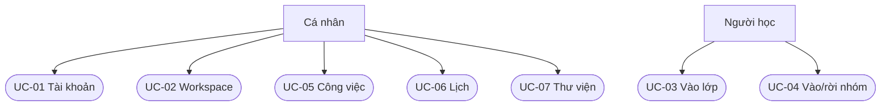
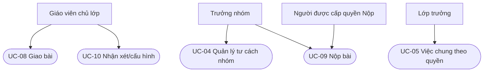

# Use case bản đầu SNOTE v2

| Trường | Giá trị |
| --- | --- |
| Câu hỏi | Tác nhân bên ngoài muốn đạt mục tiêu nào, điều kiện và đường ngoại lệ là gì? |
| Phạm vi | Tài khoản, workspace, lớp/nhóm, việc, lịch, Thư viện và bài giao của [bản đầu](../product/first-release.md) |
| Trạng thái | DCA-checked trên quy tắc v2 tại mốc `bdc1df38`; đây là **bản tổng hợp từ quy tắc**, không phải bằng chứng phần mềm đã chạy |
| Giới hạn ký pháp | Mermaid dưới đây là **sơ đồ tác nhân–mục tiêu khái niệm**, không tự nhận tuân UML Use Case 2.5.1. Thứ tự và điều kiện ở bảng kịch bản, quyền chi tiết ở ma trận quyền |

**Tác nhân:** Cá nhân là chủ tài khoản; Người học là thành viên hoặc người xin vào lớp; Giáo viên là **chủ lớp tương ứng**, không phải mọi tài khoản có cách dùng Giáo viên; Trưởng nhóm quản lý workspace nhóm của mình; Lớp trưởng có quyền được cấu hình trong đúng lớp. Một người có thể kiêm nhiều tư cách, nhưng quyền luôn xét theo hành động và phạm vi hiện hành.[^UC-SRC-01]

## Bản đồ mục tiêu

| ID | Mục tiêu của tác nhân | Điều kiện khởi đầu / kết quả mong đợi | Quy tắc chính và ca nghiệm thu |
| --- | --- | --- | --- |
| UC-01 | Cá nhân đăng ký, chọn hoặc đổi cách dùng | Có tài khoản và workspace cá nhân mặc định; bật Giáo viên mới được tạo lớp mới, tắt không mất lớp đang sở hữu | [ACC-01–06](accounts-and-workspaces.md), [STR-02/03](structural-rules.md), QA-01 |
| UC-02 | Cá nhân tạo/chọn workspace và quản lý thành viên workspace độc lập | Các workspace không trộn dữ liệu; workspace mặc định không chia sẻ; lời mời độc lập cần chấp nhận | [ACC-01–10](accounts-and-workspaces.md), [STR-01](structural-rules.md) |
| UC-03 | Người học vào lớp bằng lời mời hoặc mã lớp | Thành viên lớp hiệu lực sau chấp nhận lời mời **hoặc** sau giáo viên duyệt yêu cầu mã; vai trò đầu là Member | [CLS-01–03/13](class-membership.md), VT-02 |
| UC-04 | Người học vào/rời workspace nhóm | Chấp nhận lời mời hoặc được duyệt yêu cầu, kiểm giới hạn tại lúc kích hoạt; rời sau bàn giao nếu có trách nhiệm | [CLS-04–09/11/15](class-membership.md), [STR-04/07–09](structural-rules.md), QA-02/03 |
| UC-05 | Người phụ trách/điều phối quản lý việc và checklist | Việc thuộc một workspace, tối đa một người phụ trách chính; checklist cho tỷ lệ, hoàn thành do xác nhận riêng; lịch làm riêng thuộc chủ | [TASK-01–17](tasks.md), QA-11 |
| UC-06 | Cá nhân hoặc người có quyền quản lý sự kiện | Lịch của tôi tổng hợp theo quyền; sự kiện lớp/nhóm xuất hiện cho đối tượng nhận; hủy giữ dấu vết | [CAL-01–11](calendar.md), [STR-05/17](structural-rules.md), QA-10 |
| UC-07 | Cá nhân lưu nhanh, phân loại, sửa hoặc sao chép mục Thư viện | Hộp thu nằm trong workspace cá nhân mặc định; mục chung theo workspace; bản sao độc lập, tệp chỉ thành công sau bytes và metadata | [LIB-01–18](library.md), QA-05–07/12 |
| UC-08 | Giáo viên tạo bài giao và xem tiến độ nhóm | Bài thuộc lớp, có ít nhất một nhóm nhận; mỗi nhóm có tiến độ và chuỗi bản nộp riêng | [ASG-01/02/11/13](assignments-and-submissions.md), VT-10/11 |
| UC-09 | Trưởng nhóm hoặc người được cấp quyền Nộp/sửa bản nộp | Nội dung không rỗng, xét quyền/hạn/phiên bản tại commit; mỗi lần sửa tạo revision bất biến; mất phản hồi tra cùng mã thao tác | [ASG-03–08/12/14–18](assignments-and-submissions.md), [STR-16](structural-rules.md), QA-08/09 |
| UC-10 | Giáo viên nhận xét bản nộp và điều chỉnh quy tắc lớp | Nhận xét gắn đúng phiên bản; hai quyền sau hạn độc lập, giá trị tường minh của bài ưu tiên cài đặt lớp; quyền cấp riêng có scope | [ASG-05/06/09/15](assignments-and-submissions.md), [PER-01–12](permissions.md), QA-04/09 |

Hai hình dưới chỉ trả lời **ai theo đuổi mục tiêu nào**. Chúng không vẽ trình tự, không suy thêm quan hệ `include`/`extend` và không thay thế [ma trận hành động](permission-matrix.md). Mỗi cạnh trỏ tới ID use case trong bảng trên.[^UC-SRC-02]

**Chú giải:** cạnh là quan hệ tác nhân–mục tiêu trong đúng tư cách, không có nghĩa mọi thao tác trong mục tiêu đều mặc định được phép. Ví dụ Lớp trưởng không tự có quyền Nộp; Trưởng nhóm không quản lý lớp. Nút UC-05 của Lớp trưởng giới hạn bởi các action đang bật.[^UC-SRC-01]

## Ba kịch bản có rẽ nhánh quan trọng

| Use case | Tiền điều kiện | Luồng thành công | Ngoại lệ và kết quả không đổi |
| --- | --- | --- | --- |
| UC-03 Vào lớp | Lớp đang hoạt động; người học chưa có tư cách lớp hiệu lực | Giáo viên mời → người học chấp nhận; **hoặc** người học dùng mã → gửi yêu cầu → giáo viên duyệt. Member có hiệu lực ở bước cuối | Lớp lưu trữ chặn kích hoạt; lời mời/yêu cầu cũ không tự hồi sinh khi khôi phục. Không có bước tự vào nhóm. [CLS-02/03/13/14](class-membership.md), [STR-07/08](structural-rules.md) |
| UC-04 Vào nhóm | Tư cách lớp còn hiệu lực, nhóm hoạt động, giới hạn lớp cho phép tại thời điểm kích hoạt | Được mời/xếp → người học chấp nhận; **hoặc** tự yêu cầu → người có quyền theo cấu hình duyệt. Trong giao dịch kiểm giới hạn; khi giới hạn một nhóm, lời mời đến nhóm khác hết hiệu lực và vào lịch sử | Cạnh tranh hai lượt duyệt/chấp nhận không vượt giới hạn; giới hạn giảm không tự xóa tư cách đã có; nhóm lưu trữ không kích hoạt; lời mời vô hiệu không tự hồi sinh. [CLS-05–07/11](class-membership.md), [STR-04/08](structural-rules.md) |
| UC-09 Nộp/sửa | Người gọi còn quyền Nộp trong nhóm nhận bài; có văn bản, URL hoặc tệp hợp lệ | Kiểm mã ý định và phiên bản nền; xác minh tệp, kiểm lại quyền/hạn/chính sách, chốt revision và biên nhận; trả phiên bản/thời điểm máy chủ nhận | Sau hạn áp hai quyền độc lập; bản nền cũ báo 412; cùng key khác nội dung báo 409; mất phản hồi tra biên nhận, không tạo revision thứ hai; lỗi bytes/metadata giữ bản trước. [ASG-03–08/12/14–18](assignments-and-submissions.md), [STR-16](structural-rules.md) |

Quyết định thuật toán và ranh giới giao dịch ở [sơ đồ quyết định](../architecture/decision-algorithms.md). Kết quả chạy thực tế phải tra báo cáo theo commit trong `review/`, không suy từ hình này. Các giá trị hạ tầng cho pilot vẫn ở [sổ mở](../../review/unresolved.md).

[^UC-SRC-01]: [SRC-01/02/05/07–10/24/27](../../review/provenance.md) và [STR-01–14](structural-rules.md), `s_note_v2` tại `bdc1df38`. Chứng minh mục tiêu và phạm vi quyền của bản đặc tả, không chứng minh mã chạy.
[^UC-SRC-02]: [Phạm vi bản đầu](../product/first-release.md), [quy tắc theo chủ đề](README.md) và [ca nghiệm thu](../quality/acceptance-scenarios.md), `s_note_v2` tại `bdc1df38`. Bản đồ do DCA biên soạn từ các mục tiêu đã có; không tạo chức năng mới.
