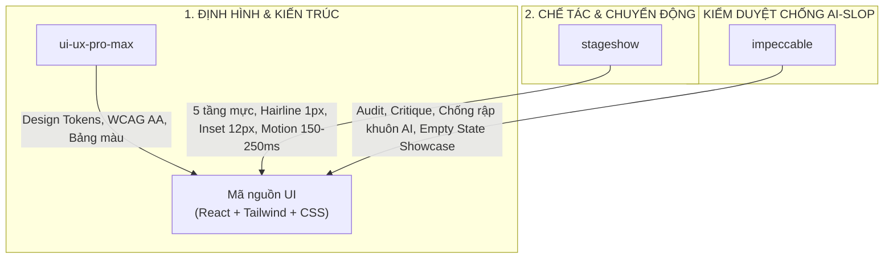

# Hướng dẫn Tác nhân: Ứng dụng Kỹ năng (Skills) Xây dựng Giao diện & Hiệu ứng SNOTE v2

| Thuộc tính | Giá trị |
| :--- | :--- |
| **Phạm vi** | Toàn bộ mã nguồn giao diện trong `apps/web/src/**` trên mọi worktree tính năng |
| **Trạng thái** | Đặc tả kỹ thuật giao diện chính thức; bổ sung quy chuẩn thực thi cho [ui-and-motion.md](ui-and-motion.md) theo [SRC-27](../../review/provenance.md) |
| **Bộ kỹ năng tích hợp** | `ui-ux-pro-max` (Nền tảng hệ thống, A11y, bảng màu), `stageshow` (Thẩm mỹ điềm tĩnh, hình học, chuyển động vi mô), `impeccable` (Định hình, kiểm duyệt chống AI-Slop) |

Tài liệu này là **kim chỉ nam bắt buộc** dành cho tất cả các AI Agent khi nhận nhiệm vụ xây dựng, sửa đổi hoặc nâng cấp giao diện người dùng (UI) và chuyển động/hiệu ứng (Motion/Micro-interactions) trong SNOTE v2.

---

## 1. Bản đồ Phân công Bộ ba Kỹ năng (Skill Synergy Map)

Mỗi kỹ năng sở hữu một vai trò cốt lõi trong chu trình chế tác giao diện:



| Kỹ năng | Khi nào kích hoạt? | Trách nhiệm chính trong mã nguồn |
| :--- | :--- | :--- |
| **`ui-ux-pro-max`** | Khi bắt đầu tạo component mới, chọn màu, thiết kế form hoặc bố cục lưới. | • Đảm bảo chuẩn tiếp cận WCAG AA (tương phản $\ge 4.5:1$).<br/>• Quản lý token màu sắc ngữ nghĩa từ `colors.csv`.<br/>• Kích thước vùng bấm tối thiểu $44 \times 44\text{px}$ trên mobile.<br/>• Bố cục thẻ và lưới co giãn responsive không gây vỡ dòng. |
| **`stageshow`** | Khi chế tác chi tiết visual, khoảng cách lề, viền, bóng đổ và chuyển động. | • Áp dụng 5 tầng mực `--ink-*` và 3 tầng mặt nổi `--surface-*`.<br/>• Chuẩn hóa lề thẻ (Card inset $\ge 12\text{px}$), viền Hairline $1\text{px}$.<br/>• Ngân sách chữ: Chỉ $3 - 7$ cụm từ thật cho tiêu điểm chính.<br/>• Chuyển động có nguyên do ($150 - 250\text{ms}$), bo góc lồng nhau.<br/>• Dựng khung minh họa thu nhỏ (Miniature Showcase) cho Empty State. |
| **`impeccable`** | Khi lập kế hoạch UX (`shape`), hoàn thiện tinh chỉnh (`polish`, `harden`) và rà soát lỗi anti-pattern. | • Quét lỗi anti-pattern bằng detector tự động (`impeccable.exe detect`).<br/>• Tuyệt đối triệt tiêu "AI-Slop" (cấm gradient tím, cấm icon lấp lánh AI).<br/>• Rà soát trạng thái biên (tên quá dài, mất mạng, lỗi 409/412). |

---

## 2. Quy trình 3 Bước Chuẩn mực khi Code Giao diện

Mọi Agent khi thực hiện một task UI bắt buộc phải đi qua 3 bước:

### Bước 1: Khởi tạo & Hệ thống Token (`ui-ux-pro-max` + `theme.css`)
1. **Tham chiếu Token chuẩn:** Luôn sử dụng biến CSS chuẩn hóa trong [apps/web/src/shared/theme.css](file:///d:/WORKSPACE/PROJECT/CLASS_PROJECT/MNM_PROJECT/SNOTE/apps/web/src/shared/theme.css). Nghiêm cấm viết mã màu hex thô (hardcoded `#123456`) trong component.
2. **5 Tầng mực (Typography Inks):**
   - `--ink-title` (`#09090b`): Tiêu đề màn hình, tên công việc chính, tiêu đề modal.
   - `--ink-body` (`#27272a`): Nội dung đọc chính, mô tả bài tập, văn bản hướng dẫn.
   - `--ink-subtle` (`#52525b`): Nhãn phụ, metadata, timestamp, số phiên bản.
   - `--ink-muted` (`#71717a`): Chú thích mờ, icon bổ trợ (đã kiểm định đạt chuẩn WCAG AA 4.58:1).
   - `--ink-faint` (`#a1a1aa`): Đường kẻ phân cách, placeholder trường nhập liệu.
3. **3 Tầng bề mặt & Viền:**
   - `--surface-ground` (`#f4f4f5`): Nền canvas bao quát.
   - `--surface-raised` (`#ffffff`): Thẻ card, panel danh sách, thanh điều hướng.
   - `--surface-overlay` (`#ffffff`): Hộp thoại Modal, Popover nổi bật có bóng đổ `--shadow-overlay`.
   - `--hairline`: Viền siêu mảnh $1\text{px}$ (`rgba(0,0,0,0.08)` trên nền sáng, `rgba(255,255,255,0.08)` trên nền tối).

---

### Bước 2: Chế tác Hình học & Hiệu ứng Chuyển động (`stageshow`)

#### A. Chuẩn mực Hình học (Geometric Craft Rules)
- **Lề an toàn (Insets):** Mọi chữ viết và nút bấm phải cách mép viền tối thiểu $12\text{px}$. Tuyệt đối không để chữ dính sát viền thẻ (lỗi `tight inset`).
- **Khoảng cách nút & trường nhập:** Nút bấm hành động cách trường nhập liệu hoặc lề thẻ từ $8\text{px}$ đến $12\text{px}$.
- **Công thức Bo góc lồng nhau (Nested Radius):**
  $$R_{\text{ngoài}} = R_{\text{trong}} + \text{Padding}$$
  *Ví dụ:* Khung input bo $6\text{px}$ nằm trong Card có padding $8\text{px} \implies$ Card phải bo đúng $14\text{px}$ để đường cong song song hoàn hảo.
- **Căn giữa số liệu (Centered Amounts):** Khi căn giữa số tiền hoặc dung lượng (ví dụ: `100 MB` hoặc `$45`), số thực tế nằm đúng trục tâm quang học; ký hiệu đơn vị/tiền tệ được treo tự do bên trái ngoài trục tâm.
- **Biểu tượng:** Thay thế $100\%$ emoji (`📁`, `🔗`, `📝`, `🕒`, `🗑️`) bằng icon vector `lucide-react` kích thước $14 - 16\text{px}$, stroke $1.75\text{px}$, căn lề baseline quang học.

#### B. Ngân sách Hiệu ứng & Chuyển động (Motion Budget)
- **Thời lượng:** Giới hạn từ $150\text{ms}$ đến $250\text{ms}$. Easing chuẩn: `cubic-bezier(0.16, 1, 0.3, 1)` (spring-like ease-out) hoặc `ease-out`. Không dùng transition quá $300\text{ms}$ gây cảm giác chậm chạp.
- **Tương quan vị trí (Spatial Continuity):**
  - Khi xóa một hàng trong danh sách: Hàng bị xóa mờ dần trong $120\text{ms}$, các hàng bên dưới trượt êm ái lên vị trí mới trong $180\text{ms}$. Không để biến mất đột ngột làm giật layout.
  - Khi mở rộng panel (Slide-over): Trượt từ cạnh phải với gia tốc giảm dần.
- **Micro-interactions trên phần tử:**
  - Checkbox hoàn thành việc: Nảy nhẹ (scale $1.15\times \to 1.0\times$ trong $120\text{ms}$) khi được bấm, tiêu đề gạch ngang đồng thời chuyển màu về `--ink-muted`.
  - Button bấm: Hiệu ứng active nhấn nhẹ (`scale: 0.98`) trong $80\text{ms}$.
- **Bắt buộc tuân thủ `@media (prefers-reduced-motion: reduce)`:**
  ```css
  @media (prefers-reduced-motion: reduce) {
    *, ::before, ::after {
      animation-duration: 0.01ms !important;
      animation-iteration-count: 1 !important;
      transition-duration: 0.01ms !important;
      scroll-behavior: auto !important;
    }
  }
  ```
  *(Đã được kiểm chứng tự động qua bộ test suite E2E `WEB-01` và `WEB-02`).*

#### C. Chế tác Trạng thái Rỗng (Empty States / Miniature Showcase)
- **Cấm:** Không bao giờ để một màn hình trắng trơn với dòng chữ buồn tẻ *"Chưa có dữ liệu"*.
- **Chuẩn:** Dựng một **Stageshow Miniature Demo Card**:
  - Mô phỏng một hình ảnh thu nhỏ của tính năng (ví dụ: Một chiếc thẻ bài tập mẫu có điểm số hoặc một cây thư mục mẫu).
  - Sử dụng các thanh placeholder mờ nhẹ cho dữ liệu phụ và chữ thật cho tiêu điểm.
  - Nút bấm Call-To-Action (CTA) nổi bật: `+ Tạo bài tập đầu tiên` hoặc `+ Tải tài liệu lên`.

---

### Bước 3: Kiểm duyệt Chất lượng & Chống Anti-pattern (`impeccable`)

Trước khi tạo commit và chạy `winwork resolve`, Agent bắt buộc phải tự kiểm tra qua các tiêu chí:

1. **Chạy Detector tĩnh:**
   ```powershell
   .agents\skills\impeccable\scripts\bin\windows-x64\impeccable.exe detect apps\web\src
   ```
2. **Bộ lọc Chống "AI-Slop" (Anti-pattern Checklist):**
   - [ ] **Không gradient tím:** Không sử dụng gradient `purple-to-blue` hay hiệu ứng glow hào nhoáng.
   - [ ] **Không icon ngôi sao AI lấp lánh:** Chỉ dùng icon mô tả đúng nghiệp vụ thực tế.
   - [ ] **Không lồng card vô tội vạ (Unearned Box):** Không bọc một chiếc thẻ bên trong một chiếc thẻ khác nếu không có sự phân cấp chức năng rõ rệt.
   - [ ] **Không nhồi nhét chữ:** Đếm số chuỗi chữ thật trên mỗi thẻ; nếu vượt quá 7 cụm từ, hãy tinh giản thông tin phụ.
   - [ ] **Khả năng điều hướng phím:** Mọi nút bấm, input, modal đều có thể tương tác hoàn toàn bằng phím `Tab`, `Enter`, `Space` và đóng bằng `Esc`.

---

## 3. Mẫu Code Tham khảo Chuẩn mực (Code Recipes)

### Recipe 1: Thẻ Danh sách Tinh xảo (Stageshow Card Pattern)

```tsx
import React from 'react';
import { CheckCircle2, Clock, MoreHorizontal } from 'lucide-react';

interface TaskRowProps {
  title: string;
  dueDate: string;
  completed: boolean;
  onToggle: () => void;
}

export const TaskRow: React.FC<TaskRowProps> = ({ title, dueDate, completed, onToggle }) => {
  return (
    <div className="group flex items-center justify-between p-3 rounded-lg border border-[var(--hairline)] bg-[var(--surface-raised)] hover:shadow-[var(--shadow-raised)] transition-all duration-150 ease-out">
      <div className="flex items-center gap-3">
        {/* Checkbox với micro-interaction nảy nhẹ */}
        <button
          type="button"
          onClick={onToggle}
          className={`w-5 h-5 rounded-full border flex items-center justify-center transition-transform duration-120 active:scale-90 ${
            completed 
              ? 'bg-[var(--accent)] border-[var(--accent)] text-white scale-100' 
              : 'border-[var(--ink-faint)] hover:border-[var(--ink-muted)]'
          }`}
          aria-label={completed ? "Đánh dấu chưa hoàn thành" : "Đánh dấu hoàn thành"}
        >
          {completed && <CheckCircle2 size={14} className="stroke-[2.5]" />}
        </button>

        {/* Tiêu đề & Metadata theo đúng ngân sách chữ */}
        <div className="flex flex-col">
          <span className={`text-sm font-medium transition-colors duration-150 ${
            completed ? 'line-through text-[var(--ink-muted)]' : 'text-[var(--ink-title)]'
          }`}>
            {title}
          </span>
          <span className="text-xs text-[var(--ink-subtle)] flex items-center gap-1 mt-0.5">
            <Clock size={11} className="text-[var(--ink-muted)]" />
            <span>{dueDate}</span>
          </span>
        </div>
      </div>

      <button
        type="button"
        className="opacity-0 group-hover:opacity-100 p-1 rounded text-[var(--ink-muted)] hover:text-[var(--ink-title)] hover:bg-[var(--surface-ground)] transition-all duration-150"
        title="Thao tác khác"
      >
        <MoreHorizontal size={16} />
      </button>
    </div>
  );
};
```

### Recipe 2: Miniature Showcase cho Empty State (Stageshow Miniature Pattern)

```tsx
import React from 'react';
import { FolderPlus, FileText, ArrowRight } from 'lucide-react';

interface EmptyStateProps {
  onAction: () => void;
}

export const LibraryEmptyState: React.FC<EmptyStateProps> = ({ onAction }) => {
  return (
    <div className="flex flex-col items-center justify-center py-16 px-4 text-center">
      {/* Khung minh họa thu nhỏ (Miniature Showcase) */}
      <div className="w-64 p-4 mb-6 rounded-xl border border-[var(--hairline)] bg-[var(--surface-raised)] shadow-[var(--shadow-raised)] opacity-90 select-none pointer-events-none">
        <div className="flex items-center justify-between pb-3 mb-3 border-b border-[var(--hairline)]">
          <div className="flex items-center gap-2">
            <div className="w-2.5 h-2.5 rounded-full bg-red-400/80" />
            <div className="w-2.5 h-2.5 rounded-full bg-amber-400/80" />
            <div className="w-2.5 h-2.5 rounded-full bg-emerald-400/80" />
          </div>
          <span className="text-[10px] text-[var(--ink-muted)] font-mono">docs/demo</span>
        </div>

        <div className="space-y-2">
          <div className="flex items-center gap-2 p-1.5 rounded bg-[var(--surface-ground)]">
            <FileText size={13} className="text-[var(--accent)]" />
            <span className="text-xs font-medium text-[var(--ink-title)]">De_cuong_mon_hoc.pdf</span>
          </div>
          <div className="flex items-center gap-2 p-1.5 opacity-40">
            <div className="w-3.5 h-3.5 rounded bg-[var(--ink-faint)]" />
            <div className="w-24 h-2.5 rounded bg-[var(--ink-faint)]" />
          </div>
        </div>
      </div>

      {/* Lời dẫn & Nút bấm hành động */}
      <h3 className="text-base font-semibold text-[var(--ink-title)] mb-1">
        Thư mục hiện đang trống
      </h3>
      <p className="text-sm text-[var(--ink-subtle)] max-w-sm mb-5">
        Bắt đầu chia sẻ tài liệu, bài giảng hoặc ghi chú học tập cho cả nhóm của bạn.
      </p>

      <button
        type="button"
        onClick={onAction}
        className="inline-flex items-center gap-2 px-4 py-2 rounded-lg bg-[var(--accent)] text-white text-sm font-medium hover:bg-blue-700 active:scale-95 transition-all shadow-sm focus:outline-none focus:ring-2 focus:ring-blue-400 focus:ring-offset-2"
      >
        <FolderPlus size={16} />
        <span>Tải tài liệu đầu tiên</span>
        <ArrowRight size={14} className="opacity-70" />
      </button>
    </div>
  );
};
```

---

## 4. Kiểm chứng & Đo lường Nghiệm thu (Definition of Done)

Trước khi ký nghiệm thu qua `winwork verify`, Bộ chỉ huy sẽ đánh giá giao diện theo 4 tiêu chí:

1. **Tính Tĩnh Lặng & Điềm Tĩnh:** Giao diện có mang lại cảm giác chuyên nghiệp, tập trung không? Có bị lòe loẹt hay dùng emoji không?
2. **Hình học & Lề thẻ:** Các khối chữ có giữ đúng lề $\ge 12\text{px}$ không? Bo góc lồng nhau có mượt mà không?
3. **Chuyển động & Không giật layout (CLS = 0):** Dữ liệu khi tải có giữ nguyên pitch dòng bằng skeleton không? Có tôn trọng `prefers-reduced-motion` không?
4. **Không lỗi Anti-pattern:** Đạt kết quả quét sạch từ công cụ detector `impeccable.exe detect`.
