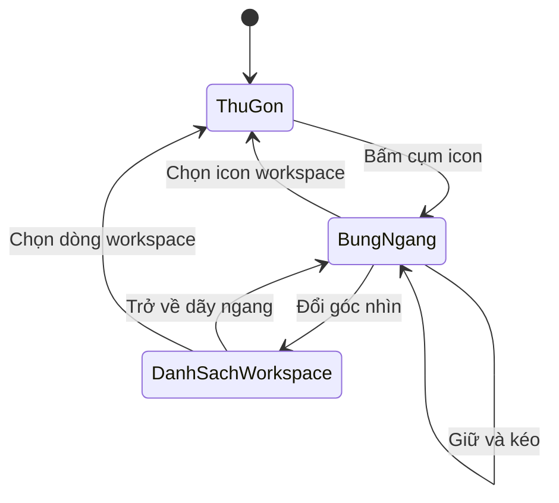

# Điều hướng workspace và màn Công việc

| Trường | Giá trị |
| --- | --- |
| Mục đích | Chỉ rõ thứ bậc các mục và nội dung xuất hiện khi đổi phạm vi |
| Phạm vi | Lối vào cá nhân, Lớp học và điều hướng trong workspace |
| Kiểm định | DCA-checked cho phân cấp, điều kiện xuất hiện và hành vi đã duyệt |
| Bằng chứng duyệt | [SRC-03, SRC-04, SRC-07, SRC-08, SRC-16, SRC-17, SRC-19, SRC-20, Q19 và Q20](../../review/provenance.md) |

## Lối vào theo tài khoản

| Mã | Điều kiện và phạm vi | Hành vi đã chốt | Nguồn |
| --- | --- | --- | --- |
| NAV-01 | Chọn Giáo viên | Có lối vào Lớp học và thao tác tạo lớp khi cần. Workspace cá nhân có sẵn sau đăng ký. | SRC-07, SRC-08 |
| NAV-02 | Chọn Người học | Có phạm vi các lớp đang học. Hành động trong lớp và workspace theo quyền tại phạm vi đó. | SRC-07, SRC-08 |
| NAV-03 | Phạm vi cá nhân | “Việc của tôi” và “Lịch của tôi” tổng hợp xuyên workspace theo quyền truy cập. | SRC-03, SRC-04 |

## Các thành phần đã chốt trong workspace

| Mã | Thành phần | Số trong nhóm | Loại và cấp | Khi người dùng thao tác |
| --- | --- | --- | --- | --- |
| NAV-04 | Công việc, Lịch, Thư viện | 3 mục | Điều hướng ngang cấp trong cùng workspace. Thư viện đặt cạnh Lịch. | Chọn một mục để chuyển nội dung sang đúng tính năng trong workspace đang mở. |
| NAV-05 | Vùng nội dung chính | 1 vùng theo mục được chọn | Vùng hiển thị của workspace | Hiện nội dung của Công việc, Lịch hoặc Thư viện theo mục đang chọn. |
| NAV-06 | Hộp thu | 1 phần trong phạm vi đã chốt | Thành phần của Thư viện trong workspace cá nhân mặc định | Hiện các mục lưu nhanh chưa phân loại của chủ tài khoản khi truy cập Hộp thu. |

NAV-04 đến NAV-06 dùng SRC-03 và các quyết định về Hộp thu trong SRC-07, SRC-08. [Q32](../../review/provenance.md) đã chốt kiểu điều khiển và trạng thái của khung workspace cùng màn Công việc tại đặc tả Gantt. Các màn khác và chuyển động đã có [đặc tả tổng hợp](ui-and-motion.md) theo SRC-27.

## Chuyển giữa ngữ cảnh workspace và lớp

| Mã | Thành phần | Cấp và vị trí | Hành vi đã xác nhận | Nguồn |
| --- | --- | --- | --- | --- |
| NAV-07 | Lối tắt Lớp học | Cùng cấp với lối chọn workspace ở vùng chọn ngữ cảnh; không nằm trong ba mục tính năng của workspace | Chọn để đi vào phạm vi lớp. Lớp vẫn là cấp dữ liệu bao trùm các workspace nhóm; việc đứng cạnh workspace chỉ nói về vị trí lối vào giao diện. | SRC-16 |
| NAV-08 | Nhóm điều hướng tính năng theo ngữ cảnh | Trong workspace hiện ba mục Công việc, Lịch trình, Thư viện; khi mở lớp, cùng vùng điều hướng dùng năm mục Nhóm, Bài giao, Lịch lớp, Thành viên, Cài đặt thay cho ba mục workspace | Chọn một lớp mặc định mở **Thành viên** dưới dạng bảng danh sách người trong lớp; chọn mục khác thì vùng chính chỉ hiện tính năng ấy. Cài đặt ẩn với người không có quyền quản lý lớp; quyền thực thi vẫn kiểm ở từng thao tác. Màn điện thoại dùng danh sách thu gọn mở dọc. Xem [điều hướng lớp](class-navigation.md). | SRC-16, SRC-17, SRC-19, SRC-20 |

Phạm vi dữ liệu của mỗi màn tra ở [Công việc](../requirements/tasks.md), [Lịch](../requirements/calendar.md) và [Thư viện](../requirements/library.md). Bản đầu dùng web trên máy tính và điện thoại. [Q20](../../review/provenance.md)

## Chế độ xem Công việc

| Mã | Thành phần | Loại và quan hệ | Hành vi đã chốt |
| --- | --- | --- | --- |
| VIEW-01 | Gantt | Chế độ xem cùng cấp với Danh sách, thuộc Công việc | Mặc định khi mở “Việc của tôi” hoặc Công việc workspace. Mở chi tiết việc để sửa. Bản đầu chưa sửa bằng kéo thả trên trục. |
| VIEW-02 | Danh sách | Chế độ xem cùng cấp với Gantt, thuộc Công việc | Xem tổng quan và quản lý nhiều việc, gồm lưu trữ hoặc xóa hàng loạt theo quyền. |
| VIEW-03 | Phạm vi đang xem | Điều kiện chung của hai chế độ | Dùng tập việc theo phạm vi đang mở. Buổi làm riêng chỉ hiện cho người sở hữu. |
| VIEW-04 | Bộ lọc và sắp xếp | Điều khiển trong Công việc | Có Hôm nay, Ngày mai, Quan trọng và cài đặt thứ tự mặc định. Kết quả và thứ tự theo TASK-10 đến TASK-12. |

## Khung workspace, Gantt và Danh sách

### Phân cấp và vùng màn

| Cấp | Vị trí | Gồm những gì | Vùng chịu tác động |
| --- | --- | --- | --- |
| Ứng dụng | Đầu thanh bên | Nút Snote về “Việc của tôi” | Mở phạm vi tổng hợp xuyên workspace. |
| Chọn ngữ cảnh | Đầu vùng chính | Cụm workspace và lối tắt Lớp học cùng cấp | Chọn workspace hoặc đi vào phạm vi lớp; lớp vẫn bao trùm các workspace nhóm ở cấp dữ liệu. |
| Workspace | Trên vùng chính, cùng khung ứng dụng | Cụm chọn workspace, Tạo workspace khi bung, nút đổi góc nhìn workspace | Đổi workspace đang mở và dữ liệu của vùng chính. |
| Tính năng trong workspace | Thanh bên, ba mục cùng cấp | Công việc, Lịch trình, Thư viện; Mục lưu ý ở dưới | Chỉ nội dung của mục và workspace đang chọn xuất hiện trong vùng chính. |
| Chế độ trong Công việc | Đầu vùng Công việc | Nút Chế độ xem chuyển Gantt/Danh sách | Thay cách xem cùng tập việc. Danh sách việc khác danh sách workspace. |
| Nội dung Công việc | Phần lớn vùng chính | Lọc, Sắp xếp, điều hướng trục, Gantt hoặc Danh sách, chi tiết khi chọn việc | Thao tác theo quyền và tập việc của workspace đang mở. |

Thư viện và Lịch trình đứng cạnh nhau trong thanh bên để chuyển nhanh. Vùng Công việc không đặt nội dung ghi chú hay lịch trình khác vào Gantt; “Mục lưu ý” chỉ hiện bản xem trước ngắn theo quy tắc UXR-05.
Ba mục Công việc, Lịch trình và Thư viện là **tính năng của workspace đang mở**. Khi chuyển sang lớp, chính vùng điều hướng tính năng này thay bằng năm mục Nhóm, Bài giao, Lịch lớp, Thành viên, Cài đặt theo NAV-08. “Mục lưu ý” của workspace không hiển thị trong ngữ cảnh lớp theo [Q33-C3](class-navigation.md).

### Danh mục thành phần Q32

Số lượng tính trên một màn; mục phụ thuộc dữ liệu ghi rõ số lượng biến đổi. Những thao tác thay dữ liệu chỉ có hiệu lực khi người dùng xác nhận và backend kiểm quyền theo [yêu cầu nghiệp vụ](../requirements/README.md). Mã UXR giữ từ bản rà soát để truy vết quyết định.

| Mã | Vị trí, cùng cấp và mục cha | Số lượng và kiểu | Tác động khi bấm/chọn |
| --- | --- | --- | --- |
| UXR-01 | Đầu thanh bên; cấp ứng dụng | 1 nút Snote | Mở “Việc của tôi” tổng hợp xuyên workspace; NAV-03. |
| UXR-02 | Thanh bên; ba mục ngang cấp thuộc workspace đang mở | 3 nút Công việc, Lịch trình, Thư viện | Chọn mục để vùng chính hiển thị đúng tính năng của workspace đang mở; chỉ một mục được chọn tại một thời điểm. |
| UXR-03 | Đầu vùng chính; nhóm chọn workspace, trên nội dung tính năng | Thu gọn: 1 cụm icon xếp lớp, nhìn thấy tối đa 2 icon. Bung: 1 icon cho mỗi workspace được phép mở, thêm 1 icon đổi góc nhìn sang danh sách workspace. | Bấm cụm để bung theo chiều ngang. Bấm icon workspace để chuyển workspace. Giữ và kéo trái/phải để cuộn đến workspace mong muốn; **thả chỉ dừng ở vị trí đó, bấm icon mới chuyển**. Bấm icon đổi góc nhìn để xem cùng các workspace dạng danh sách. |
| UXR-04 | Bên trái ngoài cùng dãy workspace **chỉ khi UXR-03 đã bung** | 1 icon Tạo workspace | Mở thao tác tạo workspace; chỉ tạo khi xác nhận. Không có lối chia sẻ workspace cá nhân mặc định [ACC-06](../requirements/accounts-and-workspaces.md). |
| UXR-05 | Thanh bên, dưới ba nút UXR-02; thuộc workspace đang mở | 1 tiêu đề “Mục lưu ý”, tối đa 3 dòng xem trước | Mỗi dòng hiện loại mục, tiêu đề và thời điểm nếu có, từ ghi chú được ghim, việc gần hạn hoặc lịch trình sắp đến giờ **trong workspace đang mở**. Bấm dòng để mở mục nguồn; không hiện nội dung đầy đủ ở thanh bên. |
| UXR-06 | Đầu vùng Công việc; chế độ xem thuộc Công việc | 1 nút “Chế độ xem” | Bấm để chuyển giữa Gantt và Danh sách công việc của cùng tập việc; mặc định Gantt. Đây không phải nút đổi sang danh sách workspace UXR-03. |
| UXR-07 | Cạnh UXR-06; hành động trong Công việc | 1 nút Tạo việc khi có quyền | Mở tạo việc ở workspace hiện hành; hạn có thể để trống. |
| UXR-08 | Đầu Công việc, nhóm điều khiển hiển thị | 1 điều khiển Lọc | Thay tập việc đang nhìn thấy, hiện dấu khi đang áp lọc và có lối bỏ lọc; không sửa dữ liệu việc. Các bộ lọc Hôm nay, Ngày mai và Quan trọng theo VIEW-04. |
| UXR-09 | Cạnh Lọc, cùng nhóm điều khiển hiển thị | 1 điều khiển Sắp xếp | Đổi thứ tự hàng nhìn thấy. Trong Gantt không đảo chiều thời gian; lưu thứ tự làm mặc định là thao tác xác nhận riêng theo quy tắc công việc. |
| UXR-10 | Trên lưới Gantt; nhóm điều hướng trục | 3 nút Trước, Hôm nay, Sau; 1 nhãn khoảng ngày; 1 bộ chọn Ngày/Tuần | Di chuyển khoảng đang xem hoặc đổi độ chi tiết của trục. Hôm nay ở đây đưa trục về hiện tại, khác bộ lọc việc hôm nay. |
| UXR-11 | Vùng chính Công việc khi Gantt được chọn | 1 lưới tên việc và trục thời gian; số hàng theo việc hiện có | Biểu diễn hạn và buổi làm nhìn thấy theo quyền bằng dấu hiệu phân biệt; chọn hàng để mở việc. Bản đầu không kéo thanh để sửa. Buổi làm riêng của người khác không xuất hiện. |
| UXR-12 | Gắn với lưới Gantt khi có việc thiếu mốc | 1 nhóm “Chưa có mốc thời gian” với số việc phù hợp | Hiện việc không có hạn và không có buổi làm nhìn thấy; bấm việc để mở chi tiết, không tự vẽ thanh thời gian giả. |
| UXR-13 | Khi chọn việc; cạnh Gantt trên máy tính, màn riêng trên điện thoại | 1 vùng chi tiết | Xem và sửa theo quyền: người phụ trách, hạn, checklist, trạng thái, lịch làm riêng của mình. |
| UXR-14 | Vùng chính khi Danh sách việc được chọn | 1 danh sách, 1 ô chọn trên mỗi hàng đủ quyền; nhóm hành động chỉ hiện khi có mục được chọn | Lưu trữ hoặc xóa nhiều việc theo quyền và sau xác nhận. |

### Bộ chọn workspace và các trạng thái

| Trạng thái | Cách hiển thị | Tương tác |
| --- | --- | --- |
| Thu gọn | Tối đa hai icon xếp lớp. Icon của workspace đang mở nổi ở trước, icon chưa chọn chìm ở sau; có hiệu ứng mờ dần. | Bấm cụm để bung; màn máy tính mặc định giấu tên, hiện tên khi hover. Trên điện thoại tên workspace hiện bên phải icon. |
| Bung ngang | Tạo workspace ở đầu trái; tiếp theo là các icon workspace theo chiều ngang, có lối đổi sang danh sách workspace trong cùng nhóm. | Bấm icon chọn workspace. Giữ và kéo qua hai phía để lướt, thả dừng và bấm để chọn; thao tác được hỗ trợ trên máy tính và điện thoại. |
| Danh sách workspace | Mỗi dòng hiện tên workspace, tên lớp nếu đó là nhóm trong lớp, và dấu nhận biết workspace đang mở. | Chọn dòng để chuyển workspace. Đây là góc nhìn khác của cùng bộ chọn workspace, không phải chế độ Danh sách công việc. |
| Sau khi chuyển | Cụm thu gọn làm nổi icon workspace vừa chọn, vùng chính hiển thị dữ liệu của workspace đó. | Các nút tính năng ở thanh bên tiếp tục áp dụng trong phạm vi workspace mới. |

Sơ đồ chỉ mô tả thay đổi góc nhìn và lựa chọn workspace. Kéo một mình không đổi workspace. Thời lượng và trạng thái giảm chuyển động theo [hệ chuyển động](ui-and-motion.md); ngưỡng kéo cần kiểm bằng bản mẫu trên thiết bị thật.

### Trạng thái vùng Công việc và điện thoại

| Tình huống | Cách hiển thị và thao tác |
| --- | --- |
| Đang tải | Giữ workspace và điều hướng hiện tại; vùng Gantt/Danh sách thể hiện đang tải. |
| Workspace chưa có việc | Hiện thông tin chưa có việc và nút Tạo việc nếu người dùng có quyền. |
| Lọc không có kết quả | Hiện thông báo về bộ lọc và lối bỏ lọc. |
| Lỗi tải | Hiện lỗi ở đúng vùng đang xem và nút Thử lại. |
| Hết quyền workspace | Hiện thông báo không thể xem và lối chọn workspace còn quyền. |
| Điện thoại | Tên workspace đứng bên phải icon; bộ chọn bung ngang có thể giữ-kéo; Gantt cuộn ngang trong lưới; chi tiết việc mở thành màn riêng. Ba mục Công việc, Lịch trình, Thư viện vẫn cùng cấp. |

Các màn Q33 có đặc tả riêng trong [chỉ mục UX](README.md); thành phần và chuyển động chung theo [ui-and-motion.md](ui-and-motion.md). Bản thảo Q33 trước SRC-27 ở review chỉ dùng truy nguyên.
