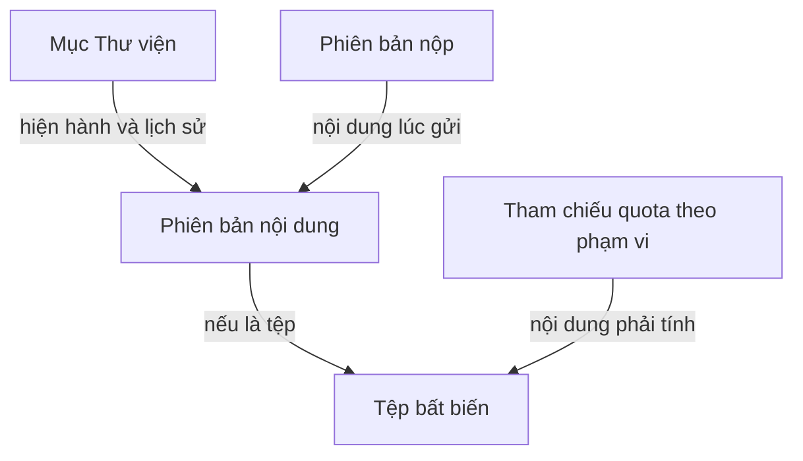

# Đề xuất bảo toàn nội dung, quota và thao tác gửi

| Trường | Nội dung |
| --- | --- |
| Trạng thái | **Đề xuất của tác nhân, chưa duyệt kiến trúc/hợp đồng** |
| Phạm vi | Tệp Thư viện, lịch sử ghi đè, bản sao, bản nộp; các thao tác có lỗi hoặc chạy đồng thời |
| Căn cứ | [LIB-11–18](../../docs/requirements/library.md), [ASG-04/12/16–18](../../docs/requirements/assignments-and-submissions.md), [PM-01–05](../../docs/requirements/permission-matrix.md), [EC-01–10/19/22–23](../edge-case-audit.md) |
| Giới hạn | Chưa xác định schema Prisma, endpoint, nhà cung cấp tệp, ngân sách máy chủ, thời gian giữ tệp tạm hoặc số lần thử lại |

Mục đích của mô hình là giữ đúng nội dung đã nộp trong khi Thư viện vẫn được sửa. Một đường dẫn tệp thay đổi tại chỗ không đủ cho yêu cầu này. Mô hình dưới đây đề xuất tách đối tượng người dùng thao tác khỏi bytes và lịch sử của nó.

## Đối tượng và trách nhiệm

| Đối tượng khái niệm | Chứa gì | Điều được phép thay đổi |
| --- | --- | --- |
| Mục Thư viện | Phạm vi sở hữu, thư mục, tiêu đề, trạng thái hoạt động/rác và liên kết phiên bản hiện hành | Thay metadata hoặc phiên bản hiện hành khi có quyền; giữ mã mục khi ghi đè |
| Phiên bản nội dung | Nội dung văn bản/link hoặc tham chiếu tệp của một lần lưu, tác giả và thời điểm | Đề xuất bất biến; sửa/khôi phục tạo phiên bản mới, không sửa ngược nội dung cũ |
| Đối tượng tệp | Bytes bất biến đã xác minh, kích thước, loại, dấu kiểm tra nội dung | Không ghi đè bytes tại cùng định danh; dọn khi không còn tham chiếu hợp lệ và đủ điều kiện giữ |
| Phiên bản nộp | Nội dung được đóng băng tại lần nộp, người nộp, thời điểm, hạn/quyền sau hạn đã dùng để xác nhận | Không sửa nội dung cũ; sửa bài tạo phiên bản mới. Phản hồi gắn đúng phiên bản theo ASG-09 |
| Tham chiếu tính quota | Phạm vi workspace/lớp, nội dung tệp và lý do phải tính | Tính tập nội dung hợp lệ, tránh cộng nhiều lần trong cùng phạm vi; lưu trữ vật lý được theo dõi riêng |

Sơ đồ thể hiện quan hệ, chưa quy định bảng hoặc khóa ngoại cụ thể. Tệp đính trực tiếp vào bản nộp vẫn cần nội dung bất biến nhưng không buộc tạo mục trong Thư viện. Khi sao chép sang workspace khác, bản đích có mục và quyền riêng; có thể tái sử dụng bytes ở tầng lưu trữ nếu thiết kế cho phép, nhưng không được phụ thuộc vào vòng đời hoặc quyền của mục nguồn. Đọc được một tệp phải đi qua đối tượng nghiệp vụ có quyền, không cấp quyền chỉ từ mã bytes.

**Phản biện:** Tách nhiều khái niệm làm tăng việc thiết kế so với chỉ lưu một đường dẫn. Đổi lại, yêu cầu độc lập bản sao, giữ phiên bản nộp và khôi phục lịch sử đã khiến một đường dẫn thay đổi tại chỗ không đủ. Mình đề xuất giữ các ranh giới này, nhưng chưa cần nhiều dịch vụ hoặc nhiều cơ sở dữ liệu.

## Trình tự hoàn tất một lần lưu/nộp

| Giai đoạn đề xuất | Việc cần làm | Khi thất bại hoặc kết quả chưa rõ |
| --- | --- | --- |
| Tiếp nhận ý định | Kiểm người gọi/phạm vi; nhận mã thao tác chống lặp và dấu nhận dạng dữ liệu; kiểm hoặc giữ chỗ quota | Cùng mã + cùng dữ liệu tra kết quả cũ; khác dữ liệu không âm thầm dùng lại mã |
| Nhận và xác minh tệp | Tải vào trạng thái chưa công bố; xác minh bytes, loại thực, kích thước và đích lưu; không tin hash do máy khách tự khai | Không tạo mục hoàn chỉnh; ghi trạng thái để trả quota và dọn có kiểm soát |
| Hoàn tất nghiệp vụ | Tệp đã lưu bền; trong giao dịch dữ liệu, kiểm lại quyền, lưu trữ, phiên bản nền, quota; với Nộp còn kiểm hạn và cài đặt tại thời điểm chấp nhận | Nếu bất kỳ điều kiện nào không đạt, không đổi bản hiện hành; giữ thông tin thất bại hoặc trạng thái đang xác định |
| Ghi kết quả | Ghi phiên bản/tham chiếu, quota và biên nhận của thao tác cùng giao dịch; chỉ sau xác nhận này trả thành công | Mất phản hồi không được coi là rollback; gửi lại/tra trạng thái trước khi sửa hoặc dọn dữ liệu |
| Đối soát | Tìm thao tác bỏ dở, giữ chỗ quá hạn và tệp không được tham chiếu; giải phóng có kiểm tra | Không dọn dữ liệu chỉ vì client đã timeout; không xóa tệp đang được giao dịch khác chốt |

Đây là **giao dịch nghiệp vụ**, không giả định cơ sở dữ liệu và kho tệp hỗ trợ một giao dịch nguyên tử chung. Tệp có thể đã tồn tại vật lý trước khi phiên bản nghiệp vụ có hiệu lực. Trong khoảng đó chỉ tầng xử lý biết nó, không hiển thị như mục đã lưu. J5 vẫn có nghĩa nếu ghi phiên bản thất bại thật sự thì không có phiên bản mới và không tính quota người dùng; trạng thái “chưa rõ đã ghi chưa” cần đường tra kết quả riêng.

Mã chống lặp chỉ ngăn tạo lại cùng ý định. Hai ý định sửa khác nhau vẫn phải kiểm phiên bản nền; không dùng mã chống lặp để bỏ qua xung đột ASG-12. Khi thử lại giao dịch do cạnh tranh dữ liệu, kiểm lại toàn bộ điều kiện liên quan; không lặp mù một câu lệnh rồi coi điều kiện đọc trước còn đúng. Cơ sở kỹ thuật: [PostgreSQL về serialization failure](https://www.postgresql.org/docs/18/mvcc-serialization-failure-handling.html).

## Tính quota và dọn dữ liệu

| Trường hợp | Quy tắc đã chốt | Cơ chế đề xuất |
| --- | --- | --- |
| Tệp hiện hành và tệp trong các phiên bản nộp cùng workspace | Cùng nội dung tính một lần theo LIB-16 | Tập tham chiếu theo phạm vi + định danh nội dung đã xác minh; tăng/giảm bộ đếm nguyên tử khi tập thay đổi |
| Sao chép sang workspace khác | Tính vào đích, mục độc lập theo LIB-12/16 | Phân biệt quyền và quota của mỗi phạm vi ngay cả khi có tái sử dụng bytes vật lý |
| Chỉ còn trong lịch sử ghi đè hoặc rác | Không tính quota người dùng theo LIB-16; thời gian giữ theo LIB-17 | Theo dõi dung lượng vật lý và điều kiện giữ riêng; không dọn chỉ vì không tính quota |
| Tệp đề bài của giáo viên | Thử nghiệm 1 GB/lớp theo ASG-16 | Phạm vi quota lớp riêng, không tự trừ vào workspace cá nhân giáo viên hoặc nhân bản theo số nhóm nhận |
| Hết thời gian Thùng rác | LIB-14/17 giữ nội dung còn thuộc bản nộp | Bỏ tham chiếu đủ điều kiện; chỉ dọn bytes sau khi chắc không còn tham chiếu cần giữ |

Kiểm tra “không còn tham chiếu” rồi xóa sau đó vẫn có khe cạnh tranh nếu một yêu cầu khác vừa gắn tham chiếu. Cần cơ chế đánh dấu chờ dọn và ngăn liên kết mới vào đối tượng đang dọn, hoặc khóa phù hợp, rồi kiểm lại trước xóa. Cách cụ thể thuộc thiết kế giao dịch còn mở; tuổi tệp không thay được kiểm tra này.

**Đề xuất về phạm vi tối ưu:** Ưu tiên tính quota đúng trong từng workspace và bản sao độc lập. Chưa nên tối ưu khử trùng bytes giữa mọi người dùng ở bản đầu nếu chưa xử lý quyền, sao lưu và thu gom an toàn. Tối ưu vật lý không được đổi quota đã duyệt hoặc dùng phản hồi “đã có tệp” để lộ nội dung tenant khác.

## Quyết định còn cần khóa

| Điểm cần khóa | Khuyến nghị của tác nhân | Hệ quả cần chấp nhận |
| --- | --- | --- |
| Trần lưu trữ vật lý, ngân sách và ngưỡng cảnh báo | Tách khỏi 1 GB hiển thị; chặn thao tác tăng thêm khi hết ngân sách và giữ dữ liệu cũ | Có thể tạm không ghi đè dù quota logic còn; cần thông báo đúng nguyên nhân. Chưa tự đặt số |
| Thời điểm nộp sát hạn | Thời điểm máy chủ chấp nhận hoàn tất với cấu hình có hiệu lực lúc đó | Bắt đầu tải trước hạn chưa bảo đảm đúng hạn; phải giải thích trên màn Nộp |
| Sửa/khôi phục Thư viện đồng thời | Kiểm phiên bản nền, khôi phục thành phiên bản mới, không ghi đè im lặng | Cần trạng thái xung đột và lối xem lại hoặc tạo bản sao |
| Khôi phục nhóm vi phạm giới hạn | Kiểm trước, giữ nhóm lưu trữ đến khi giải quyết xung đột | Không khôi phục một phần hoặc ép thành viên rời nhóm khác |
| Chọn kho tệp và cơ chế sao lưu | Đánh giá cùng khả năng phục hồi cả metadata lẫn bytes, không chỉ giá lưu hiện hành | Cần số liệu người dùng/tệp/lịch sử và mức mất dữ liệu/thời gian phục hồi mong muốn |

Các lựa chọn này được chuẩn bị để chủ sản phẩm đánh giá bằng hệ quả cụ thể; chưa chuyển sang `docs/architecture/` hoặc `docs/contracts/`. Không có endpoint, schema hoặc tham số triển khai nào ở đây được coi là đã khóa.
